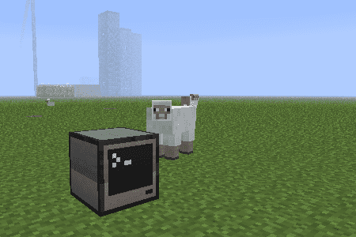
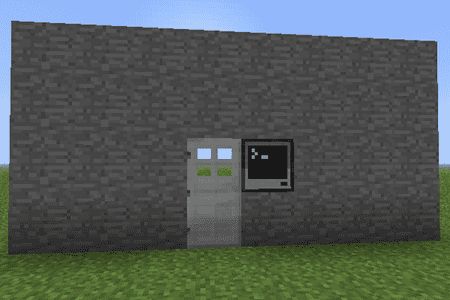

# Introduksjon {.intro}

Vi begynner med å bygge en enkel datamaskin. Etter å ha brukt litt tid på å bli
kjent med hvordan datamaskinen virker, bruker vi den til å lage et lite
mattespill. Til slutt låser vi opp en dør med passord.



Du trenger Minecraft med CC: Tweaked. Se [Installere CC:
Tweaked](../installasjon/installasjon.html) hvis det ikke er klart.


# Steg 1: Vår første datamaskin {.activity}

*Vi begynner med å lage en datamaskin.*

Det er mye enklere å starte i *Creative*-modus når vi skal lære å bruke
datamaskinene. Da slipper vi å samle materiale og slåss mot monstre. Vi antar
derfor at du er i *Creative*-modus og kan hente akkurat det du trenger.

Men først skal vi se at en datamaskin kan lages på vanlig måte i Minecraft:

## Sjekkliste {.check}

- [ ] Trykk `E` for å åpne inventory. Finn frem 7 __Stone__, 1 __Redstone__ og 1
  __Glass Pane__.

- [ ] Åpne et __Crafting Table__, og legg ut materialet slik:

  

- [ ] Legg den nye datamaskinen i den nederste raden i inventory, slik at du kan
  ta den i hånden. Lukk inventory.

- [ ] Velg datamaskinen med talltastene, og høyreklikk på bakken for å sette den
  ut.

I *Creative*-modus kan du også hente datamaskiner direkte. Trykk `E`, velg
søkefanen og skriv `computer`.

### Datamaskiner i CC: Tweaked {.protip}

Høyreklikk en datamaskin for å starte den. Den åpner en svart skjerm med teksten
`CraftOS` og et versjonsnummer øverst. Dette er datamaskinens *kommandolinje*.
Vi bruker den til å styre datamaskinen.

## Sjekkliste {.check}

- [ ] Skriv `help` og trykk Enter.

  Du får noen tips om hvordan du kan finne ut mer om datamaskinen.

- [ ] Skriv `programs` og trykk Enter.

  Nå ser du en liste over programmene som finnes på datamaskinen. Mange av dem
  er enkle programmer som lar deg undersøke datamaskinen. Vi ser på noen av dem
  i en senere oppgave.


# Steg 2: Vårt første program {.activity}

*Nå er det på tide å skrive vårt første program.*

Det er en lang tradisjon at det første programmet man lager i et nytt språk,
skriver en hyggelig melding på skjermen. Vi følger tradisjonen og lager et
program som heter `heiverden`.

## Sjekkliste {.check}

- [ ] Start en datamaskin.

- [ ] Skriv `edit heiverden` for å begynne på et nytt program.

- [ ] Skriv dette i det nye vinduet:

  ```lua
  print('Hei verden!')
  ```

  Trykk så på `Ctrl`-tasten. Nederst på skjermen dukker det opp en meny. Velg
  `Save` med piltastene og trykk Enter. Trykk `Ctrl` en gang til, velg `Exit` og
  trykk Enter.

- [ ] Skriv `programs`. Nå står `heiverden` på listen over programmer.

- [ ] Skriv `heiverden` og trykk Enter for å kjøre programmet.

### Filen heter heiverden.lua {.protip}

Skriver du `ls`, ser du at programmet ligger i en fil som heter `heiverden.lua`.
Datamaskinen legger til `.lua` bak navnet for deg, slik at alle vet at filen er
et Lua-program. Når du kjører programmet, kan du skrive navnet med eller uten
`.lua`.

### Prøv selv {.challenge}

Kan du endre programmet slik at det sier hei til deg, eller til de som sitter
ved siden av deg?

Skriv `edit heiverden` en gang til. Da åpnes programmet ditt igjen, og du kan
endre det. Bruk `Ctrl`-tasten for å lagre og avslutte, som sist.


# Steg 3: Litt enkel matematikk {.activity}

*Vi skal nå la datamaskinen regne for oss, og kanskje til og med se hvor flinke
vi er til å regne.*

Datamaskinene i CC: Tweaked bruker et programmeringsspråk som heter __Lua__. Det
er et enkelt og fleksibelt språk som ofte brukes inne i andre programmer, for
eksempel i spill som Roblox og World of Warcraft.

### Lua {.protip}

Lua ble laget i Brasil på begynnelsen av 1990-tallet. På et universitet i Rio de
Janeiro brukte de et språk som het *Simple Object Language* (SOL). Ordet *lua*
er portugisisk og betyr *måne*, et fint navn ved siden av SOL.

## Sjekkliste {.check}

Vi prøver noen kommandoer direkte i Lua. Det er en fin måte å teste enkle ting
på.

- [ ] Skriv `lua` og trykk Enter. Dette starter en *Lua-tolker*, som utfører
  hver kommando du skriver med en gang.

- [ ] Vi begynner med kommandoen fra det første programmet. Skriv `print('Hei
  verden!')` og trykk Enter. Skjer det samme som før?

- [ ] Som de fleste programmeringsspråk er Lua glad i å regne. Skriv `1 + 1` og
  trykk Enter.

  Lua kan alle de vanlige regneartene. Prøv for eksempel `17 - 8`, `3 * 4` eller
  `22 / 7`. Kjenner du igjen hva hver av dem betyr?

- [ ] Skriv `math.random(1, 10)` og trykk Enter.

  Nå får du et tilfeldig tall mellom 1 og 10. Dette er et eksempel på å kalle en
  *funksjon*, noe vi gjør ofte når vi programmerer. Funksjonen heter `random`,
  og den hører hjemme i `math`-*biblioteket*.

### Funksjoner {.protip}

Alle programmeringsspråk lar deg lage *funksjoner*. En funksjon er en samling
instruksjoner som utføres sammen, slik at det blir enklere å gjøre vanskelige
ting. Lua har mange innebygde funksjoner. Så langt har vi sett `print` og
`math.random`. Senere lærer vi å lage egne funksjoner.

## Sjekkliste {.check}

- [ ] Trykk pil opp. Da får du tilbake `math.random(1, 10)`. Trykk Enter. Gjør
  dette flere ganger. Får du forskjellige tall?

- [ ] Avslutt Lua-tolkeren ved å skrive `exit()` og trykke Enter.


# Steg 4: En liten matteprøve {.activity}

*Vi bruker de tilfeldige tallene til å lage et enkelt spill. Underveis lærer vi
om tester og løkker.*

## Sjekkliste {.check}

- [ ] Start et nytt program ved å skrive `edit mattetest` og trykke Enter.

- [ ] Skriv inn dette programmet:

  ```lua
  local tall1 = math.random(2, 12)
  local tall2 = math.random(2, 12)
  print('Hva er ' .. tall1 .. ' ganger ' .. tall2 .. '?')
  ```

  Pass på at du skriver de to punktumene `..` riktig. De setter sammen tekst.

- [ ] Lagre og avslutt editoren. Kjør programmet ved å skrive `mattetest`.

  Blir du spurt om svaret på et gangestykke? Får du et annet gangestykke når du
  kjører programmet en gang til? Hva skjer om du prøver å svare?

### Variabler {.protip}

Det meste i programmet har vi sett før. `math.random` lager tilfeldige tall, og
`print` skriver en melding på skjermen. Det nye er at vi bruker *variabler* til
å huske de tilfeldige tallene. Den første linjen lager et tilfeldig tall mellom
2 og 12 og husker det i en variabel som heter `tall1`. Ordet `local` betyr at
variabelen bare finnes i dette programmet (lokalt).

## Sjekkliste {.check}

- [ ] Nå jobber vi videre med programmet. Skriv `edit mattetest` igjen, og legg
  til en linje nederst.

  ```lua
  local tall1 = math.random(2, 12)
  local tall2 = math.random(2, 12)
  print('Hva er ' .. tall1 .. ' ganger ' .. tall2 .. '?')

  local svar = read()                           --ny linje
  ```

  Lagre, avslutt og kjør programmet på nytt. Får du lov til å svare nå?
  Funksjonen `read` leser det du skriver på tastaturet.

### Kommentarer {.protip}

Alt som står etter `--` på en linje, er en *kommentar*. Datamaskinen hopper over
kommentarer. Vi bruker dem til å vise hvilke linjer som er nye. Du trenger ikke
skrive dem av.

## Sjekkliste {.check}

- [ ] Nå vil vi at programmet skal sjekke om du svarer riktig. Til det bruker vi
  en `if`-test. Den sjekker om noe er sant, her om svaret ditt er det samme som
  det riktige svaret. Legg til en `if`-test nederst:

  ```lua
  local tall1 = math.random(2, 12)
  local tall2 = math.random(2, 12)
  print('Hva er ' .. tall1 .. ' ganger ' .. tall2 .. '?')

  local svar = read()

  if tonumber(svar) == tall1 * tall2 then       --alle linjer herfra
      print('Ja, svaret er ' .. svar)           --og ned er nye
  else
      print('Nei, det riktige svaret er ' .. tall1 * tall2)
  end
  ```

  Kjør programmet igjen. Hva skjer når du svarer riktig? Og når du svarer feil?
  Skjønner du hvorfor?

  `read` gir oss alltid tekst. `tonumber` gjør teksten om til et tall, slik at
  vi kan sammenligne den med svaret.

- [ ] Det er kjedelig å starte programmet på nytt hele tiden. Vi lager derfor en
  løkke som stiller flere spørsmål. En `for`-løkke som teller fra 1 til 5 gir
  oss fem spørsmål.

  ```lua
  for i = 1, 5 do                               --ny linje
      local tall1 = math.random(2, 12)
      local tall2 = math.random(2, 12)
      print('Hva er ' .. tall1 .. ' ganger ' .. tall2 .. '?')

      local svar = read()

      if tonumber(svar) == tall1 * tall2 then
          print('Ja, svaret er ' .. svar)
      else
          print('Nei, det riktige svaret er ' .. tall1 * tall2)
      end
  end                                           --ny linje
  ```

  Test programmet igjen. Får du fem gangestykker? Kan du endre programmet så det
  spør om et annet antall? Kan du bruke en variabel som sier hvor mange
  gangestykker det skal være?

- [ ] Til slutt vil vi telle hvor mange riktige svar du klarer. Vi bruker en ny
  variabel, og denne gangen endrer vi verdien hver gang du svarer riktig.

  ```lua
  local antStykker = 5                          --ny linje
  local antRiktig = 0                           --ny linje

  for i = 1, antStykker do                      --endret linje
      local tall1 = math.random(2, 12)
      local tall2 = math.random(2, 12)
      print('Hva er ' .. tall1 .. ' ganger ' .. tall2 .. '?')

      local svar = read()

      if tonumber(svar) == tall1 * tall2 then
          print('Ja, svaret er ' .. svar)
          antRiktig = antRiktig + 1             --ny linje
      else
          print('Nei, det riktige svaret er ' .. tall1 * tall2)
      end
  end

  --ny linje under
  print('Du klarte ' .. antRiktig .. ' av ' .. antStykker)
  ```

### Prøv selv {.challenge}

Kan du endre programmet slik at det spør om andre typer regnestykker, for
eksempel pluss, minus eller deling?

For minusstykker: hvordan kan du lage `tall2` slik at det aldri er større enn
`tall1`?

For delestykker: hvordan kan du lage stykker som går opp, slik at svaret blir et
helt tall?

Kan du bruke `math.random` og noen `if`-tester til å velge en tilfeldig type
regnestykke?


# Steg 5: Passordlås på en dør {.activity}

*Datamaskinene er en del av Minecraft. Nå kobler vi en datamaskin til verden
rundt oss.*

## Sjekkliste {.check}

- [ ] Gå ut av datamaskinen ved å trykke `Esc`.

- [ ] Hent litt __Stone__, en __Iron Door__ og en __Computer__. Bygg en vegg med
  døren i, og sett datamaskinen rett ved siden av døren. Det skal se omtrent
  slik ut:

  

- [ ] Start datamaskinen.

- [ ] Lag et nytt program som heter `passord`:

  ```lua
  local passord = 'eira'

  while true do
      print('Hva er passordet?')
      local svar = read()

      if svar == passord then
          print('Riktig')
      else
          print('Feil')
      end
  end
  ```

  Programmet ligner ganske mye på `mattetest`. Det eneste nye er en
  `while`-løkke. Den gjentar det som står inni, så lenge noe er sant. Her er
  dette *noe* verdien `true`, som alltid er sann. Vi har laget en *evig løkke*.
  Programmet spør om passordet for alltid!

- [ ] Kjør programmet. Oppfører det seg slik du trodde? Husker du passordet?

### Avslutte programmer {.protip}

Hold inne `Ctrl` og `T` samtidig i omtrent ett sekund. Da stopper programmet, og
teksten `Terminated` skrives på skjermen. Dette virker i alle programmer.

## Sjekkliste {.check}

- [ ] Nå vil vi at døren skal åpne seg når vi skriver riktig passord. Det gjør
  vi med __redstone__, som overfører energi i Minecraft. Endre programmet
  `passord` slik:

  ```lua
  local passord = 'eira'

  while true do
      print('Hva er passordet?')
      local svar = read()

      if svar == passord then
          redstone.setOutput('left', true)      --endret linje
          sleep(5)                              --endret linje
          redstone.setOutput('left', false)     --endret linje
      end
  end
  ```

  Kjør programmet. Hva skjer når du skriver riktig passord?

  Funksjonen `setOutput` i `redstone`-biblioteket skrur redstone-energi av og
  på. Ordet `left` sier hvilken side av datamaskinen døren står på. Du kan også
  bruke `right`, `front`, `back`, `top` eller `bottom`. Funksjonen `sleep` får
  datamaskinen til å vente, her i 5 sekunder, før energien skrus av og døren
  lukker seg.

  Åpner ikke døren seg? Prøv å bytte `left` med `right`. Sidene regnes fra
  datamaskinen sitt ståsted, ikke ditt.

- [ ] Før vi er helt fornøyde, gjør vi noen små forbedringer. Vi kaller to
  funksjoner fra `term`-biblioteket. Den ene tømmer skjermen, og den andre
  flytter skrivemerket til `(1, 1)`, øverst til venstre. I tillegg ber vi `read`
  vise `*` i stedet for passordet vi skriver. Programmet ser da slik ut:

  ```lua
  local passord = 'eira'

  while true do
      term.clear()                              --ny linje
      term.setCursorPos(1, 1)                   --ny linje
      print('Hva er passordet?')
      local svar = read('*')                    --endret linje

      if svar == passord then
          redstone.setOutput('left', true)
          sleep(5)
          redstone.setOutput('left', false)
      end
  end
  ```

Gratulerer, nå har du lært ganske mye om å programmere datamaskiner med CC:
Tweaked! Prøv gjerne å forandre programmene vi har laget. Kan du gjøre dem enda
bedre?

### Prøv selv {.challenge}

Datamaskinen kan sende ut redstone-energi i alle retninger. Prøv å koble en
__Trapdoor__ til en annen side av datamaskinen med litt __Redstone Dust__. Åpne
fellen hvis noen skriver feil passord!

Alle skriver feil passord av og til. Kanskje fellen bare skal åpne seg hvis noen
skriver feil tre ganger på rad? Lag en variabel som teller hvor mange feil
passord som er skrevet.

Nå kjenner du datamaskinene. I
[Robotinvasjon](../robotinvasjon/robotinvasjon.html) lærer du å programmere
roboter.

*Basert på en oppgave til ComputerCraft av Geir Arne Hjelle,
delt under CC BY-SA 4.0.*
