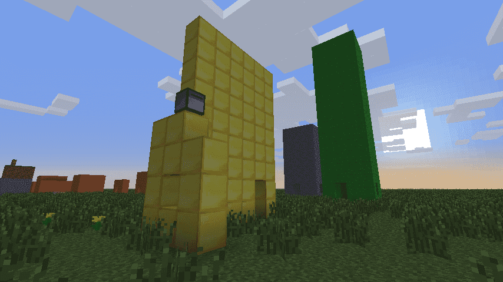
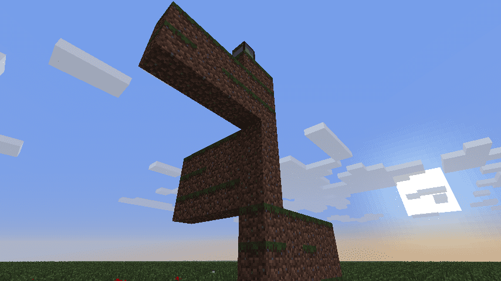
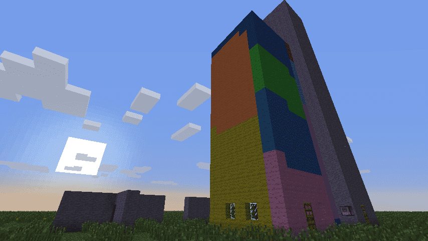

# Introduksjon {.intro}

I denne oppgaven får vi en robot til å bygge et hus for oss. Underveis lærer vi
å bruke løkker og funksjoner for å gjenta ting som skal gjøres flere ganger.




# Steg 1: Prøv selv først {.activity}

Vi har lært at roboter trenger fuel for å kjøre og byggemateriale for å bygge.
Pass på at roboten har nok fuel mens du jobber med oppgavene under. Se
[Robotinvasjon](../robotinvasjon/robotinvasjon.html) hvis du har glemt hvordan.

Vi har brukt `turtle`-biblioteket til å styre roboter. Vi flytter roboten med

`turtle.forward()`, `turtle.back()`, `turtle.turnLeft()`, `turtle.turnRight()`,
`turtle.up()`, `turtle.down()`.

Med `turtle.place()` eller `turtle.placeDown()` setter roboten ut en kloss, og
med `for`-løkker kan vi gjenta ting.

## Sjekkliste {.check}

- [ ] Lag en robot, gi den fuel og legg en del byggemateriale i inventory til
  roboten.

- [ ] Lag et nytt program, `edit bygghus`, og skriv inn denne koden:

  ```lua
  for i = 1, 5 do
      turtle.back()
      turtle.place()
  end
  ```

  Kjør programmet. Bygger roboten en liten vegg av klosser?

### Prøv selv {.challenge}

Jobb videre med `bygghus` og se om du klarer å få roboten til å bygge et enkelt
hus med fire vegger og tak. Bruk litt tid på dette, slik at du tenker gjennom
hva som skal til for å bygge et hus.

Et par små tips:

- Det er nok å bruke kommandoene vi har nevnt så langt.

- Du trenger nok flere `for`-løkker. Da må de ha forskjellige variabler, så bytt
  ut `i` med andre bokstaver eller navn i de andre løkkene.

- Dører og vinduer får du enklest til med `if`-tester som sjekker hvor på huset
  roboten bygger.

## Sjekkliste {.check}

- [ ] Når du har laget et enkelt hus, viser du det frem til de andre. Hvilke
  problemer fikk dere underveis?

  Ingen skriver programmer riktig første gang. Det er nyttig å snakke om både
  hvordan man løser en utfordring, og hva som ikke virker.

I de neste stegene lager vi et mer avansert program for husbyggeroboten.
Underveis lærer vi nye kommandoer og begreper som gjør programmet både
kraftigere og enklere.


# Steg 2: Flygende robot {.activity}

Kanskje har du allerede merket at roboten av og til krasjer i ting, og havner et
annet sted enn du tenkte. Her er et eksempel. Meningen er å bygge grunnmuren til
et hus.

## Sjekkliste {.check}

- [ ] Skriv programmet `grunnmur` med denne koden:

  ```lua
  for i = 1, 4 do
      for j = 1, 5 do
          turtle.back()
          turtle.place()
      end
      turtle.turnLeft()
  end
  ```

  Lagre og kjør programmet. Ser du problemet?

- [ ] Til slutt krasjer roboten i muren den allerede har bygd, så den får ikke
  satt ut den siste klossen. Et smart triks er å la roboten fly over bakken og
  sette klossene under seg med `turtle.placeDown()`. Da kan roboten også gå
  forover i stedet for bakover, noe som er mer naturlig.

  Endre programmet slik:

  ```lua
  turtle.up()                                   --ny linje
  for i = 1, 4 do
      for j = 1, 5 do
          turtle.forward()                      --endret linje
          turtle.placeDown()                    --endret linje
      end
      turtle.turnLeft()
  end
  ```

  Nå bygger roboten hele firkanten uten å krasje! Vi bruker `turtle.placeDown()`
  i resten av oppgaven.


# Steg 3: Bygg en vegg {.activity}

Når vi skriver større programmer, for eksempel et som bygger et hus, er det lurt
å dele dem opp i mindre deloppgaver. Hver deloppgave er enklere å programmere
enn hele det store programmet.

En naturlig deloppgave når vi bygger et hus, er å bygge en vegg. Vi starter med
den! Husk å teste programmet underveis.

## Sjekkliste {.check}

- [ ] Skriv `edit bygghus` og bytt ut koden med en enkel stripe:

  ```lua
  turtle.up()
  for i = 1, 5 do
      turtle.placeDown()
      turtle.forward()
  end
  ```

- [ ] En vegg er flere slike striper oppå hverandre. En enkel måte er å la
  roboten rygge tilbake med `turtle.back()` før den bygger neste stripe.

  ```lua
  for j = 1, 3 do                               --ny linje
      turtle.up()
      for i = 1, 5 do
          turtle.placeDown()
          turtle.forward()
      end

      for i = 1, 5 do                           --ny linje
          turtle.back()                         --ny linje
      end                                       --ny linje
  end                                           --ny linje
  ```

- [ ] Før vi går videre, lager vi et par variabler som forklarer hva tallene `3`
  og `5` betyr. Da blir det også lettere å endre størrelsen på veggen senere.

  ```lua
  local hoyde = 3                               --ny linje
  local lengde = 5                              --ny linje

  for j = 1, hoyde do                           --endret linje
      turtle.up()
      for i = 1, lengde do                      --endret linje
          turtle.placeDown()
          turtle.forward()
      end

      for i = 1, lengde do                      --endret linje
          turtle.back()
      end
  end
  ```

  Legg merke til at vi skriver `hoyde` med `o` og ikke med `ø`. Variabelnavn i
  Lua kan ikke inneholde de norske bokstavene æ, ø og å.

### Prøv selv {.challenge}

Endre verdiene av `hoyde` og `lengde`. Gjør roboten som du ber den om?


# Steg 4: Funksjoner {.activity}

Nå kan roboten lage en vegg. For å bruke dette enkelt senere, gjør vi det om til
en *funksjon*. Det betyr at vi lærer roboten en ny kommando, som vi kan bruke på
samme måte som de innebygde kommandoene, for eksempel `turtle.forward()`.

## Sjekkliste {.check}

- [ ] Vi lager en funksjon med ordet `function`.

  ```lua
  function byggVegg()                           --ny linje
      local hoyde = 3
      local lengde = 5

      for j = 1, hoyde do
          turtle.up()
          for i = 1, lengde do
              turtle.placeDown()
              turtle.forward()
          end

          for i = 1, lengde do
              turtle.back()
          end
      end
  end                                           --ny linje
  ```

- [ ] Kjører du programmet nå, gjør roboten ingenting. Vi har bare *definert*
  funksjonen. Det vil si at vi har fortalt roboten *hvordan* den bygger en vegg,
  men ikke bedt den om å *gjøre* det. Legg til denne linjen helt nederst i
  programmet:

  ```lua
  byggVegg()
  ```

  Nå ber vi roboten bygge veggen.

- [ ] Funksjoner kan ha *parametre*. Det betyr at vi bestemmer verdiene på
  variablene utenfor selve funksjonen. Endre programmet slik at det ser slik ut.
  Pass på at du sletter de to linjene som ga verdi til `hoyde` og `lengde`.

  ```lua
  function byggVegg(hoyde, lengde)              --endret linje
      for j = 1, hoyde do
          turtle.up()
          for i = 1, lengde do
              turtle.placeDown()
              turtle.forward()
          end

          for i = 1, lengde do
              turtle.back()
          end
      end
  end

  byggVegg(3, 5)                                --endret linje
  ```

### Prøv selv {.challenge}

Endre tallene `3` og `5` i den siste linjen. Bygger roboten vegger i
forskjellige størrelser?


# Steg 5: Bygg et hus {.activity}

Når vi kan bygge en vegg, er vi ikke langt unna et enkelt hus. Vi prøver å sette
sammen fire vegger!

## Sjekkliste {.check}

- [ ] Vi begynner enkelt: bygg en vegg, snu roboten, bygg en ny vegg og så
  videre. Bytt ut den siste linjen, `byggVegg(3, 5)`, med denne løkken:

  ```lua
  for i = 1, 4 do
      byggVegg(3, 5)
      turtle.turnLeft()
  end
  ```

  Hva skjer når du kjører programmet?

  

- [ ] Hmm ... det ble ganske stilig, men et hus er det ikke. Problemet er at vi
  ikke har tenkt på hvor roboten står når den er ferdig med en vegg.

  Vi legger til litt kode i `byggVegg()` slik at roboten er klar til å bygge
  neste vegg. Etter den siste stripen går roboten nedover i stedet for bakover.
  Endre funksjonen `byggVegg` slik:

  ```lua
  function byggVegg(hoyde, lengde)
      for j = 1, hoyde do
          turtle.up()
          for i = 1, lengde do
              turtle.placeDown()
              turtle.forward()
          end

          if j < hoyde then                     --ny linje
              for i = 1, lengde do
                  turtle.back()
              end
          end                                   --ny linje
      end

      for j = 1, hoyde do                       --ny linje
          turtle.down()                         --ny linje
      end                                       --ny linje
  end
  ```

- [ ] Nå klarer programmet nesten å bygge fire vegger. Men igjen krasjer roboten
  i ting den har bygd. Vi må passe på at roboten ikke går lenger enn den
  trenger.

  ```lua
  function byggVegg(hoyde, lengde)
      for j = 1, hoyde do
          turtle.up()
          for i = 1, lengde do
              turtle.placeDown()
              if i < lengde then                --ny linje
                  turtle.forward()
              end                               --ny linje
          end

          if j < hoyde then
              for i = 1, lengde - 1 do          --endret linje
                  turtle.back()
              end
          end
      end

      turtle.forward()                          --ny linje
      for j = 1, hoyde do
          turtle.down()
      end
  end
  ```

Nå har huset fire vegger. Snart bygger vi tak, men først sørger vi for at
roboten har nok å bygge med.


# Steg 6: Mer byggemateriale {.activity}

Du har sikkert merket at roboten stadig går tom for byggemateriale. Selv om den
har 16 plasser i inventory, bruker den bare én av dem. Med funksjonene
`turtle.getItemCount()`, `turtle.getSelectedSlot()` og `turtle.select()` kan vi
gjøre noe med det.

## Sjekkliste {.check}

- [ ] Vi lager en ny funksjon som sjekker at det finnes materiale før roboten
  setter ut en kloss. Under har vi byttet ut `turtle.placeDown()` med vår egen
  funksjon `plasser()`:

  ```lua
  function byggVegg(hoyde, lengde)
      for j = 1, hoyde do
          turtle.up()
          for i = 1, lengde do
              plasser()                         --endret linje
              if i < lengde then
                  turtle.forward()
              end
          end

          if j < hoyde then
              for i = 1, lengde - 1 do
                  turtle.back()
              end
          end
      end

      turtle.forward()
      for j = 1, hoyde do
          turtle.down()
      end
  end

  function plasser()                            --ny funksjon
      while turtle.getItemCount() == 0 do
          local plass = turtle.getSelectedSlot()
          if plass < 16 then
              turtle.select(plass + 1)
          else
              turtle.select(1)
          end
      end

      turtle.placeDown()
  end

  for i = 1, 4 do
      byggVegg(3, 5)
      turtle.turnLeft()
  end
  ```

  Les nøye gjennom den nye funksjonen `plasser()`. Skjønner du hva den gjør?

  Til slutt setter den ut en kloss med `turtle.placeDown()`. Men før det sjekker
  den med `turtle.getItemCount()` om det er klosser i plassen roboten bruker. Er
  det 0 klosser, går vi inn i `while`-løkken og velger en annen plass. Først
  finner vi ut hvilken plass roboten bruker, med `turtle.getSelectedSlot()`. Er
  det ikke den siste plassen (plass 16), velger vi neste plass med
  `turtle.select()`. Er vi allerede på den siste, velger vi den første.

- [ ] Kjør programmet. Hva skjer når roboten går helt tom for byggemateriale?
  Den står og venter på at du fyller på med mer.

  

### Prøv selv {.challenge}

Nå bruker roboten flere plasser. Legg forskjellig materiale i de ulike plassene.
Da kan du for eksempel få et fargerikt hus!


# Steg 7: Vi trenger et tak! {.activity}

Nå er det på tide å lære roboten å bygge tak!

## Sjekkliste {.check}

- [ ] Før vi begynner på taket, flytter vi koden som bygger huset inn i en egen
  funksjon, slik vi gjorde med `byggVegg()`. Bytt ut den nederste løkken i koden
  (den som bygger veggene) med denne koden:

  ```lua
  function byggHus(hoyde, bredde, dybde)
      byggVegg(hoyde, bredde - 1)
      turtle.turnLeft()
      byggVegg(hoyde, dybde - 1)
      turtle.turnLeft()
      byggVegg(hoyde, bredde - 1)
      turtle.turnLeft()
      byggVegg(hoyde, dybde - 1)
      turtle.turnLeft()
  end

  byggHus(3, 5, 4)
  ```

  Ser du hvorfor vi bruker `bredde - 1` og ikke `bredde`? Sjekk at huset får
  riktig størrelse!

- [ ] Nå lager vi en ny funksjon, `byggTak()`. Legg først til denne linjen
  nederst i `byggHus()`, rett før `end`:

  ```lua
  byggTak(bredde, dybde)
  ```

- [ ] Funksjonen som bygger taket, ligner mye på den som bygger en vegg.
  Forskjellen er at veggen står opp, mens taket ligger flatt. Legg til
  funksjonen `byggTak` i koden, over `byggHus`:

  ```lua
  function byggTak(bredde, dybde)
      turtle.up()
      for j = 1, dybde do
          for i = 1, bredde do
              plasser()
              turtle.forward()
          end

          for i = 1, bredde do
              turtle.back()
          end
          turtle.turnLeft()
          turtle.forward()
          turtle.turnRight()
      end
  end
  ```


# Steg 8: Dører og vinduer {.activity}

Nå er vi nesten ferdige. Det som mangler for at dette skal ligne et ordentlig
hus, er dører og vinduer.

## Sjekkliste {.check}

- [ ] Vi velger en enkel løsning: roboten lar det være hull der dører og vinduer
  skal være. Vi vil ikke ha dør på alle veggene, og vi vil kunne velge hvor
  vinduene skal være. Derfor gir vi `byggVegg()` to nye parametre. Endre
  funksjonen slik:

  ```lua
  function byggVegg(hoyde, lengde, dor, vindu)  --endret linje
      for j = 1, hoyde do
          turtle.up()
          for i = 1, lengde do
              local erDor = j <= 2 and i == dor        --ny linje
              local erVindu = j == 2 and i == vindu    --ny linje
              if not (erDor or erVindu) then           --ny linje
                  plasser()
              end                                      --ny linje
              if i < lengde then
                  turtle.forward()
              end
          end

          if j < hoyde then
              for i = 1, lengde - 1 do
                  turtle.back()
              end
          end
      end

      turtle.forward()
      for j = 1, hoyde do
          turtle.down()
      end
  end
  ```

  Den nye `if`-testen lager en dør ved å hoppe over de to nederste klossene.
  Vinduene lages i høyde 2.

- [ ] Til slutt endrer vi koden i `byggHus()` som kaller `byggVegg()`:

  ```lua
  function byggHus(hoyde, bredde, dybde)
      byggVegg(hoyde, bredde - 1, 2, nil)
      turtle.turnLeft()
      byggVegg(hoyde, dybde - 1, nil, math.floor(dybde / 2))
      turtle.turnLeft()
      byggVegg(hoyde, bredde - 1, nil, bredde - 2)
      turtle.turnLeft()
      byggVegg(hoyde, dybde - 1, nil, 2)
      turtle.turnLeft()

      byggTak(bredde, dybde)
  end
  ```

  Vi bruker det spesielle ordet `nil` når en vegg ikke skal ha dør eller vindu.
  Skjønner du hvor vinduene på de forskjellige veggene havner?


# Steg 9: Forskjellige hus {.activity}

Nå har vi en husbyggerobot! Vi gjør bare en liten forbedring til før vi er helt
ferdige.

Størrelsen på huset står i den siste linjen i programmet, `byggHus(3, 5, 4)`.
Vil vi ha et større eller mindre hus, må vi endre programmet. Det er tungvint.
Det er bedre å si hvor stort huset skal være når vi starter programmet.

## Sjekkliste {.check}

- [ ] Bytt ut linjen `byggHus(3, 5, 4)` med dette:

  ```lua
  local args = { ... }
  if #args ~= 3 then
      print('Skriv: bygghus <hoyde> <bredde> <dybde>')
      print('For eksempel: bygghus 3 5 4')
      return
  end

  byggHus(tonumber(args[1]), tonumber(args[2]), tonumber(args[3]))
  ```

  `{ ... }` er en *tabell* med alt du skrev etter navnet på programmet. `#args`
  er hvor mange ting det er i tabellen, og `args[1]` er den første. Tabeller
  lærer du mer om i [Fjernstyr en
  robot](../fjernstyr_en_robot/fjernstyr_en_robot.html).

- [ ] Kjører du programmet ved å bare skrive `bygghus`, får du beskjed om at du
  også må oppgi høyde, bredde og dybde. Skriv for eksempel `bygghus 3 5 4` for å
  starte husbyggeroboten.

*Basert på en oppgave til ComputerCraft av Geir Arne Hjelle,
delt under CC BY-SA 4.0.*
