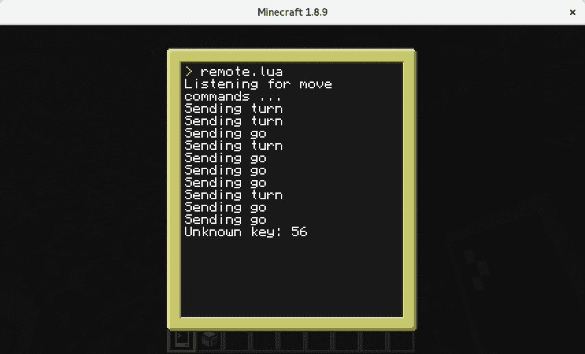
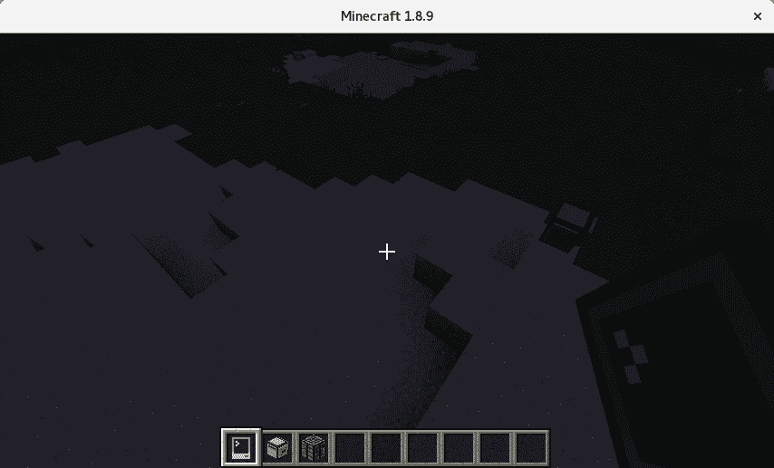
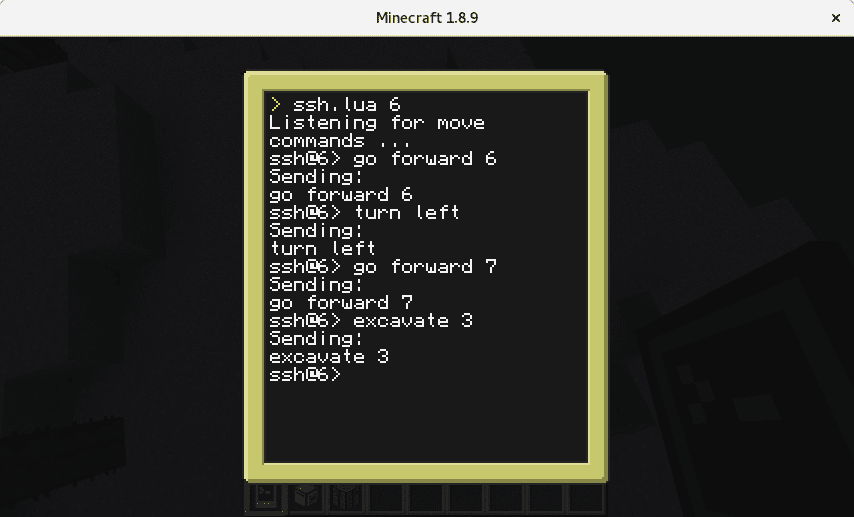
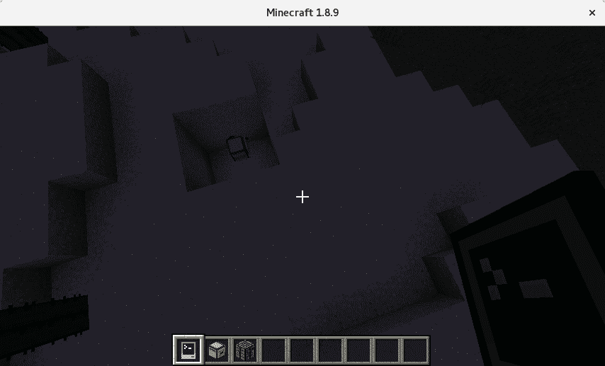

# Introduksjon {.intro}

I denne oppgaven skal vi fjernstyre en robot fra en annen datamaskin. Vi skal
lese tastetrykk, sende dem til roboten og la roboten gjøre om beskjedene til
kommandoer. Dette er for viderekomne!




# Steg 1: Forberedelser {.activity}

Denne oppgaven bygger på andre oppgaver:

- [Send en beskjed](../nettverk_send_beskjed/nettverk_send_beskjed.html) viser
  hvordan vi sender og tar imot meldinger over `rednet`.

- [Hendelser](../hendelser/hendelser.html), steg 1 (Skattejakt), viser hvordan
  vi finner ut hvilken tast som ble trykket.

- [Bygg et hus](../bygg_et_hus/bygg_et_hus.html), steg 4 (Funksjoner), viser
  hvordan vi lager egne funksjoner.

Gå tilbake til disse oppgavene hvis denne blir vanskelig.

## Rediger filer utenfor Minecraft {.tip}

`edit` virker fint til små programmer, men blir tungvint til store. Det er for
eksempel ikke lett å kopiere og lime inn kode. Derfor lærer vi nå å redigere
filene *utenfor* Minecraft.

Hver datamaskin har sin egen mappe i verdenen din:

```
saves/<navn på verdenen>/computercraft/computer/<id>
```

Mappen `saves` ligger i mappen til Minecraft-profilen din. Hvor den er, står i
[Hendelser](../hendelser/hendelser.html), steg 5. Bruker du Modrinth App, åpner
du mappen fra menyen til profilen.

Vil du redigere `hello.lua` på datamaskin nummer 3 i verdenen "Kodeklubb",
finner du den altså i `saves/Kodeklubb/computercraft/computer/3/hello.lua`.

<!-- BILDE: Filutforsker eller Finder med mappen
saves/Kodeklubb/computercraft/computer/3 åpen. -->

Åpne programmet i et tekstprogram som er laget for kode:

- [Visual Studio Code](https://code.visualstudio.com/) er gratis og finnes for
  Windows, macOS og Linux. Den forstår Lua og farger koden.

- [Notepad++](https://notepad-plus-plus.org/) er enkel og god på Windows.

Nå kan du kopiere og lime inn kode mellom datamaskiner, eller flytte et program
til en annen verden.

## Skriv koden selv! {.tip}

Du blir ikke vant med et programmeringsspråk uten å skrive koden selv. Når jeg
leser en veiledning på nettet, kopierer jeg ikke. Jeg leser et stykke kode og
skriver det selv. Da leser jeg grundigere, og får med meg hvor det skal være
komma, `end`, `then` og andre små ting som Lua kan klage på.

Når du har skrevet koden, prøv deg frem:

- Trenger jeg egentlig denne biten?

- Hva skjer om jeg fjerner denne linjen?

- Eller om jeg bytter ut dette tallet?

Programmering er lek! Ikke la noen si noe annet!


# Steg 2: Tastetrykk på fjernkontrollen {.activity}

Først programmerer vi kommandosentralen. Den skal lytte etter tastetrykk, gjøre
dem om til kommandoer og sende dem til roboten.

## Sjekkliste {.check}

- [ ] Hent en __Advanced Wireless Pocket Computer__. Den kan du ta med deg
  rundt, så du er ikke bundet til ett sted. Se [Send en
  beskjed](../nettverk_send_beskjed/nettverk_send_beskjed.html) for hvordan du
  får tak i den.

## Filtyper {.tip}

Filer har ofte en *filendelse* som sier hva slags fil det er.

- Lua-programmer heter ofte `program.lua`.

- Nettsider heter ofte `nettside.html`. Nettsider skrives i et språk som heter
  HTML.

- `dokument.docx` er et Word-dokument.

Kjenner du til andre filtyper?

## Sjekkliste {.check}

- [ ] Vi kaller programmet på fjernkontrollen `remote.lua`:

  ```
  > edit remote.lua
  ```

- [ ] Vi begynner med å lese hva brukeren trykker på:

  ```lua
  function remoteMove()
      local hendelse, tast = os.pullEvent('key')
      if tast == keys.w then
          return { 'go', 'forward' }
      elseif tast == keys.a then
          return { 'Denne', 'må', 'du', 'fikse', 'selv!' }
      else
          return { 'Hjelp! Ukjent tast! Hva skal jeg gjøre???' }
      end
  end

  function main()
      print('Venter på kommando ...')
      rednet.open('back')  --modemet på en lommedatamaskin sitter bak
      while true do
          local kommando = remoteMove()
          print(table.concat(kommando, ' '))
      end
  end

  main()
  ```

- [ ] Prøv! Hva skjer når du trykker `W`? Hva skjer når du trykker noe annet?

- [ ] Roboten skal også kunne svinge og rygge. Legg til `elseif` for tastene
  `A`, `S` og `D`!

- [ ] Roboten kan også fly opp og ned. I Minecraft bruker vi mellomrom for å
  hoppe og `Shift` for å snike. Bruk `keys.space` og `keys.leftShift` til å
  sende `{ 'go', 'up' }` og `{ 'go', 'down' }`.

Nå kjenner vi igjen tastene for å flytte oss. Neste steg er å sende dem til
roboten.


# Steg 3: Kommandotabell {.activity}

Vi lagrer kommandoene i en *tabell*. På engelsk heter det *table*.

Først leker vi litt med en robot.

## Sjekkliste {.check}

- [ ] Pass på at roboten har nok kull!

- [ ] Start Lua-tolkeren på roboten, og lag en tabell. Skriv én linje om gangen:

  ```lua
  tabell = { 'hei', 'på', 'deg' }
  print(tabell)
  print(table.unpack(tabell))
  print(tabell[1])
  print(tabell[2])
  print(tabell[3])
  ```

## Tabeller {.tip}

- Skriver vi ut en tabell alene, får vi bare *adressen* til tabellen, noe som
  ligner `table: 1a2b3c`.

- `table.unpack` pakker ut tabellen, slik at vi kan gi innholdet til en
  funksjon. `print(table.unpack({ 1, 2 }))` er det samme som `print(1, 2)`.

- Vil vi ha ut ett *element* fra tabellen, skriver vi *nummeret* til elementet i
  firkantparentes: `tabell[2]`.

## Sjekkliste {.check}

Nå skal vi se på to måter å styre en robot på.

- [ ] Avslutt Lua-tolkeren med `exit()`. Kjør kommandoene på vanlig måte i
  kommandolinjen til roboten:

  ```
  > go forward 5
  > turn left
  ```

  Men vi gidder ikke løpe etter roboten og skrive nye kommandoer hele dagen! Vi
  programmerer det i stedet.

- [ ] Start Lua-tolkeren igjen, og lag tabeller med kommandoene:

  ```lua
  kommando1 = { 'go', 'forward', '5' }
  kommando2 = { 'turn', 'left' }
  shell.run(table.unpack(kommando1))
  shell.run(table.unpack(kommando2))
  ```

- [ ] Hva gjør `table.unpack` her? Kan du få roboten til å gå frem med
  `shell.run()` *uten* `table.unpack()`?

## Nøtt {.challenge}

- Lag et nytt program, `edit mange.lua`, og skriv:

  ```lua
  local kommando = { 'go', 'forward', '5' }
  ```

- Kan du lage en funksjon som kjører `kommando` 2 ganger?

- Ekstra vanskelig: Kan du lage en funksjon som kjører kommandoen i en tabell
  `n` ganger, der `n` sendes inn i funksjonen?

  Du kan starte med dette:

  ```lua
  function mangeGanger(kommando, ganger)
      for i = 1, ganger do
          --hva skal gjøres mange ganger?
      end
  end

  mangeGanger({ 'go', 'forward', '5' }, 7)
  ```

## Sjekkliste {.check}

Nå endrer vi koden på fjernkontrollen, slik at den sender kommandoene til
roboten. Hva er forskjellig fra koden over? Forklar det til en annen
programmerer eller en voksen! Hva gjør programmet nå?

- [ ] Åpne `remote.lua` på fjernkontrollen igjen.

- [ ] Endre koden til:

  ```lua
  local robotId = 5  --hvilket nummer har roboten din? Skriv id på den!

  --ny funksjon som inneholder deler av den gamle remoteMove
  function tilKommando(tast)
      if tast == keys.w then
          return { 'go', 'forward' }  --nå må dette være ekte kommandoer
      elseif tast == keys.a then
          return { 'Denne', 'må', 'du', 'fikse', 'selv!' }
      else
          return nil
      end
  end

  --remoteMove sender nå kommandoen dit den skal
  function remoteMove()
      local hendelse, tast = os.pullEvent('key')
      local kommando = tilKommando(tast)
      if kommando == nil then
          print('Ukjent tast: ' .. keys.getName(tast))
      else
          print('Sender ' .. table.concat(kommando, ' '))
          rednet.send(robotId, kommando)
      end
  end

  function main()
      print('Venter på tastetrykk ...')
      rednet.open('back')
      while true do
          remoteMove()  --nå skriver vi ikke bare ut, vi sender
      end
  end

  main()
  ```

  `keys.getName` gjør om en tastekode til navnet på tasten, for eksempel `q`.


# Steg 4: Ta imot kommandoer på roboten {.activity}

Gratulerer! Du har bygget en fjernkontroll!

Hva skal vi bruke den til, mon tro?

Noe å styre?

Ja, helt enig. Vi gjør det!

## Sjekkliste {.check}

- [ ] Gi roboten et __Wireless Modem__ eller et __Ender Modem__. Det enkleste er
  å bruke en __Advanced Ender Turtle__, slik som i [Send en
  beskjed](../nettverk_send_beskjed/nettverk_send_beskjed.html).

- [ ] Skriv `edit react.lua` på roboten.

## Egne filer {.tip}

- Husker du hvordan vi fant filene på vår egen datamaskin, så vi kan bruke
  Visual Studio Code eller Notepad++? Se over!

- Har datamaskinen ingen filer ennå, har den heller ingen mappe. Lag en tom fil
  på datamaskinen i Minecraft, så dukker mappen opp.

## Sjekkliste {.check}

- [ ] Skriv inn koden:

  ```lua
  function main()
      --hva sier peripherals? Hvilken side sitter modemet på?
      rednet.open('left')
      print('Venter på kommandoer ...')
      while true do
          local avsender, melding = rednet.receive()
          local tekst = table.concat(melding, ' ')
          print('Melding fra ' .. avsender .. ': ' .. tekst)
          shell.run(table.unpack(melding))
      end
  end

  main()
  ```

## `main()` {.tip}

Funksjonen `main()` er ofte inngangen til et program. I Lua og Python kan vi
velge selv om vi vil ha en `main`. I andre språk, for eksempel C, Java og
Haskell, *må* vi ha den.

## Sjekkliste {.check}

- [ ] I [Send en beskjed](../nettverk_send_beskjed/nettverk_send_beskjed.html)
  skrev vi et tall i `rednet.receive()`. Hva skjer når vi ikke skriver noe tall?

- [ ] Hvorfor bruker vi en `while`-løkke? Hva skjer uten den?


# Steg 5: Kjør robot! {.activity}

Gratulerer! Du har klart en vanskelig programmeringsoppgave og sendt nyttige
beskjeder over `rednet`! Vær stolt!

Nå tester vi!

## Sjekkliste {.check}

- [ ] Start `react` på roboten.

- [ ] Start `remote` på lommedatamaskinen.

- [ ] Trykk `W` for å gå fremover!

- [ ] Legg til flere kommandoer du savner!

  Forslag:

  - Angrip: lag et lite program, `angrip.lua`, med `turtle.attack()`

  - Bygg en kloss foran

  - Kjør `excavate 4` der roboten står


# Steg 6: Vil du ha mer? {.activity}

Du har spilt med roboter *lenge*, og har mange forskjellige roboter å styre. Da
er det kjekt å kunne kjøre hvilken som helst kommando på roboten!

Programmet `react.lua` kan kjøre andre kommandoer enn de vi har laget for å
flytte roboten, for eksempel `excavate` og `dance`.

## Sjekkliste {.check}

- [ ] Lag et nytt program på fjernkontrollen, `edit ssh.lua`:

  ```lua
  --Starter du programmet slik:
  --> ssh 5
  --blir args[1] lik "5"
  local args = { ... }
  local robotId = tonumber(args[1])

  if robotId == nil then
      print('Skriv: ssh <id til roboten>')
      return
  end

  function sendKommando()
      write('ssh@' .. robotId .. '> ')
      local linje = read()
      print('Sender: ' .. linje)
      rednet.send(robotId, { linje })
  end

  function main()
      rednet.open('back')
      while true do
          sendKommando()
      end
  end

  main()
  ```

- [ ] Start `react` på roboten.

- [ ] Start `ssh 5` på fjernkontrollen. Bytt ut 5 med nummeret til roboten din.
  Skriv en kommando, for eksempel `excavate 4`, og trykk Enter.

### SSH {.protip}

Navnet `ssh` er lånt fra et ekte program. Med SSH (*Secure Shell*) styrer
programmerere datamaskiner langt unna, for eksempel servere i et datasenter.

En fjernstyrt gruverobot er nyttig! Du lager en gruverobot ved å legge en
__Turtle__ og en __Diamond Pickaxe__ ved siden av hverandre på et __Crafting
Table__. Slik gikk det med min:



Gruveroboten står klar til høyre i bildet.



Jeg flytter den dit den skal begynne å grave ...



... og der har den kommet et godt stykke!
