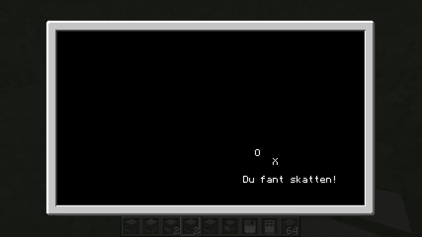
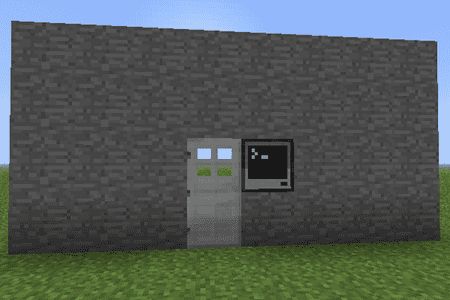
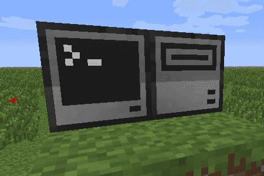

# Introduksjon {.intro}

I denne oppgaven ser vi nærmere på hvordan datamaskinene bruker *hendelser* for
å reagere på ting som tastetrykk og museklikk. Vi blir også bedre kjent med
datamaskinene, og lærer å flytte filer og programmer rundt på en datamaskin og
mellom datamaskiner.




# Steg 1: Skattejakt {.activity}

Datamaskiner bruker hendelser for å merke tastetrykk, museklikk og så videre.
Først lager vi et enkelt spill der vi styrer en figur med piltastene.

## Sjekkliste {.check}

- [ ] Start et nytt program ved å skrive `edit skattejakt`, og skriv inn dette:

  ```lua
  local x = 20
  local y = 10

  term.clear()
  term.setCursorPos(x, y)
  print('O')
  ```

  Lagre og kjør programmet. Skjønner du hva det gjør? Prøv å endre verdiene av
  `x` og `y` og kjør igjen.

- [ ] Så langt skriver programmet bare en `O` på et bestemt sted. Nå skal vi
  bruke hendelser til å flytte figuren rundt på skjermen.

  For å vente på hendelser bruker vi `os.pullEvent()`. Vi vil vente på
  tastetrykk. Slike hendelser heter `key`. Endre programmet slik:

  ```lua
  local x = 20
  local y = 10

  term.clear()
  term.setCursorPos(x, y)
  print('O')

  local hendelse, tast = os.pullEvent('key')    --ny linje
  print(hendelse)                               --ny linje
  print(tast)                                   --ny linje
  ```

  Når du kjører programmet, venter det til du trykker en tast. Så skrives
  teksten `key` og et tall på skjermen. `key` betyr bare at det var et
  tastetrykk. Det er ikke så viktig nå, men nyttig i programmer som lytter etter
  flere slags hendelser.

  Tallet er derimot veldig viktig. Hver tast på tastaturet har sin egen
  tastekode. Kjør programmet flere ganger. Ser du at samme tast alltid gir samme
  tall? For eksempel er `A` alltid 65, mens pil opp alltid er 265.

- [ ] Heldigvis trenger vi ikke huske tastekodene. Biblioteket `keys` kjenner
  dem alle, så vi kan skrive for eksempel `keys.q` for `Q`-tasten. Endre
  programmet igjen:

  ```lua
  local x = 20
  local y = 10

  term.clear()
  term.setCursorPos(x, y)
  print('O')

  local hendelse, tast = os.pullEvent('key')
  if tast == keys.q then                        --ny linje
      print('Du trykket Q')                     --ny linje
  else                                          --ny linje
      print('Du trykket ikke Q')                --ny linje
  end                                           --ny linje
  ```

- [ ] Nå lager vi en løkke som hele tiden sjekker hvilken tast som trykkes. Når
  `Q` trykkes, avslutter vi løkken med `break`.

  ```lua
  local x = 20
  local y = 10

  while true do                                 --ny linje
      term.clear()
      term.setCursorPos(x, y)
      print('O')

      local hendelse, tast = os.pullEvent('key')
      if tast == keys.q then
          break                                 --endret linje
      end
  end                                           --ny linje
  ```

  Når du kjører programmet, ser det ikke ut som noe skjer før du trykker `Q`.
  Det er den eneste tasten vi har kode for.

- [ ] Nå kan vi sjekke piltastene og flytte figuren. Vi trenger bare å endre `x`
  og `y` etter hvilken piltast som trykkes.

  ```lua
  local x = 20
  local y = 10

  while true do
      term.clear()
      term.setCursorPos(x, y)
      print('O')

      local hendelse, tast = os.pullEvent('key')
      if tast == keys.q then
          break
      end

      if tast == keys.right then                --ny linje
          x = x + 1                             --ny linje
      end                                       --ny linje
  end
  ```

  Nå kan du flytte figuren mot høyre med pil høyre.

### Prøv selv {.challenge}

De andre piltastene kan du programmere selv på samme måte. Sammenlign med
`keys.left`, `keys.down` og `keys.up`. Hvordan må du endre `x` og `y`? Prøv deg
frem!

## Sjekkliste {.check}

- [ ] Til slutt legger vi ut en skatt som figuren skal lete etter. Tilfeldige
  tall bestemmer hvor skatten ligger. Endre begynnelsen av programmet slik:

  ```lua
  local x = 20
  local y = 10
  local skattX = math.random(1, 50)             --ny linje
  local skattY = math.random(1, 18)             --ny linje

  while true do
      term.clear()
      term.setCursorPos(skattX, skattY)         --ny linje
      print('X')                                --ny linje
      term.setCursorPos(x, y)
      print('O')

      if x == skattX and y == skattY then       --ny linje
          term.setCursorPos(1, 1)               --ny linje
          print('Du fant skatten!')             --ny linje
          break                                 --ny linje
      end                                       --ny linje

      local hendelse, tast = os.pullEvent('key')
      if tast == keys.q then
          break
      end

      if tast == keys.right then
          x = x + 1
      end
      --her kommer koden for de andre piltastene
  end
  ```

  Prøv spillet! Virker det som du trodde? Klarer du å legge til flere skatter?

### Prøv selv {.challenge}

Med `local maxX, maxY = term.getSize()` finner du størrelsen på skjermen. Kan du
bruke den til å hindre figuren i å gå ut av skjermen?

En litt vanskeligere oppgave: Lag et lignende program for en robot. I stedet for
å flytte en figur på skjermen skal piltastene flytte roboten!


# Steg 2: Filsystemet {.activity}

Datamaskiner lagrer informasjon i *filer*, og filene ligger i et *filsystem*. Du
har kanskje sett filsystemet på en vanlig datamaskin i Filutforsker på Windows
eller Finder på Mac. I CC: Tweaked bruker vi kommandolinjen for å se på filene.
Vi skal lære noen enkle kommandoer for å kopiere og flytte filer.

## Sjekkliste {.check}

- [ ] Start datamaskinen der du laget `skattejakt`.

- [ ] Kommandoen `ls` viser innholdet i en mappe (`ls` er kort for *list*, som
  betyr *liste*). Skriv `ls` og trykk Enter.

  Datamaskinen svarer `rom` og `skattejakt.lua`. `rom` er en mappe med alle de
  innebygde programmene på datamaskinen. Navnet er kort for *Read Only Memory*,
  som betyr *minne du bare kan lese fra*. Vi ser mer på den senere. Mapper vises
  i en annen farge enn filer på en **Advanced Computer**.

- [ ] Med `type` kan du sjekke om noe er en fil eller en mappe. Skriv `type
  skattejakt.lua`. Datamaskinen svarer at det er en fil (`file`). Skriv `type
  rom`, og du får vite at det er en mappe (`directory`).

- [ ] Du kan lage egne mapper for å holde orden på filene. Skriv `mkdir
  mine_programmer`. Kommandoen `mkdir` lager nye mapper (kort for *make
  directory*, som betyr *lag mappe*). Sjekk med `ls` at mappen finnes.

- [ ] Kommandoen `mv` flytter filer (kort for *move*). Skriv `mv skattejakt.lua
  mine_programmer`. Skriver du `ls` nå, er `skattejakt.lua` borte. Skriv `ls
  mine_programmer` for å se at filen ble flyttet dit.

- [ ] Vi kan også flytte oss rundt i filsystemet. Da bytter vi hvilken mappe vi
  står i. Til det bruker vi `cd` (kort for *change directory*, som betyr *bytt
  mappe*). Skriv `cd mine_programmer`. Teksten foran `>` viser nå hvilken mappe
  du er i. Skriv `ls` for å se at du er i samme mappe som `skattejakt.lua`.

  For å gå en mappe tilbake bruker du det spesielle navnet `..`. Skriv `cd ..`.
  Nå er du tilbake der du startet.

### Prøv selv {.challenge}

Nå kjenner du kommandoene `ls`, `edit`, `type`, `mkdir`, `mv` og `cd`. I tillegg
finnes `rm`, som sletter filer og mapper, og `cp`, som virker som `mv`, men
kopierer i stedet for å flytte. De gamle navnene `dir`, `move`, `copy` og
`delete` virker også.

Bruk kommandoene til å flytte deg rundt, lage nye filer og mapper og flytte dem,
til du føler deg trygg på hvordan filsystemet virker.


# Steg 3: Et bedre passordprogram {.activity}

I oppgaven [Bli kjent med
datamaskinen](../bli_kjent_med_datamaskinen/bli_kjent_med_datamaskinen.html)
laget vi et passordprogram. Det har et par svakheter:

1. Programmet må startes ved å skrive `passord` etter at datamaskinen er skrudd
  på.

2. I stedet for å skrive passordet kan man trykke `Ctrl+T` for å stoppe
  programmet, og så lese det hemmelige passordet i programmet.

Vi skal bruke et par triks for å gjøre passordprogrammet tryggere.



## Sjekkliste {.check}

- [ ] Har du ikke gjort det ennå: Sett en datamaskin ved siden av en dør, skriv
  `edit passord` og skriv inn dette:

  ```lua
  local passord = 'eira'

  while true do
      term.clear()
      term.setCursorPos(1, 1)
      print('Hva er passordet?')
      local svar = read('*')

      if svar == passord then
          redstone.setOutput('left', true)
          sleep(5)
          redstone.setOutput('left', false)
      end
  end
  ```

  Kjør programmet og sjekk at det virker.

- [ ] Når en datamaskin starter, ser den først etter et program som heter
  `startup.lua` (*startup* betyr *oppstart*). Finner den det, kjøres det før noe
  annet. Gir vi passordprogrammet navnet `startup.lua`, starter det altså av seg
  selv.

  Skriv `mv passord.lua startup.lua` for å gi programmet nytt navn. Start
  datamaskinen på nytt ved å skrive `reboot`. Nå spør den med en gang om
  passordet.

- [ ] Trykk `Ctrl+T` for å stoppe programmet. At `Ctrl+T` stopper programmer, er
  noe `os.pullEvent` ordner for oss. Funksjonen `read` bruker `os.pullEvent`.
  Vil vi ikke at det skal gå an, kan vi bytte ut `os.pullEvent` med
  `os.pullEventRaw`. De virker nesten likt, men den siste bryr seg ikke om
  `Ctrl+T`.

  Skriv `edit startup.lua` og legg til en linje øverst:

  ```lua
  os.pullEvent = os.pullEventRaw                --ny linje
  local passord = 'eira'

  while true do
      term.clear()
      term.setCursorPos(1, 1)
      print('Hva er passordet?')
      local svar = read('*')

      if svar == passord then
          redstone.setOutput('left', true)
          sleep(5)
          redstone.setOutput('left', false)
      end
  end
  ```

- [ ] Start datamaskinen på nytt med `reboot`. Nå har du en datamaskin som bare
  spør etter passord!

  Vær litt forsiktig. Det er ikke lett å få datamaskinen til å gjøre noe annet
  nå. Det du lærer i de to neste stegene, kan hjelpe deg.


# Steg 4: Diskettstasjoner {.activity}

Nå skal vi bruke disketter og diskettstasjoner til å flytte filer mellom
datamaskiner.



## Sjekkliste {.check}

- [ ] Hent en __Disk Drive__ (diskettstasjon) og sett den inntil datamaskinen.
  Hent også en __Floppy Disk__ (diskett). Fargen spiller ingen rolle.

- [ ] Høyreklikk på diskettstasjonen og legg disketten i den ledige plassen.

- [ ] Start datamaskinen og skriv `ls`. Nå finnes det en ny mappe som heter
  `disk`. Det er disketten.

- [ ] Vi lager et lite program. Skriv `edit navn` og skriv inn dette:

  ```lua
  print('Hva heter du?')
  local navn = read()
  print('Hei, ' .. navn)
  ```

  Test at programmet virker ved å skrive `navn`.

- [ ] Kopier programmet til disketten ved å skrive `cp navn.lua disk`.

- [ ] Nå kan vi ta med programmet til en annen datamaskin:

  __1__: Lukk datamaskinen med `Esc`.

  __2__: Åpne diskettstasjonen og flytt disketten til inventory.

  __3__: Lag en ny datamaskin med en diskettstasjon inntil.

  __4__: Legg disketten i den nye diskettstasjonen.

  __5__: Start den nye datamaskinen. Skriv `ls` og `ls disk`, og se at
  programmet ditt er med på disketten.

- [ ] Nå kopierer vi programmet fra disketten til den nye datamaskinen. Da kan
  vi ta med disketten videre og likevel bruke programmet. Skriv `cp
  disk/navn.lua .`. Legg merke til punktumet på slutten. Det er et spesielt
  mappenavn som betyr *denne mappen*. Skriv til slutt `ls` og `navn` for å se at
  programmet er kopiert.

### Hva er en diskett? {.protip}

Disketter var en vanlig måte å lagre programmer og filer på fra 1970-tallet til
tidlig på 2000-tallet. De var også den vanligste måten å flytte filer mellom
datamaskiner på. I dag bruker vi internett, minnepenner og eksterne disker i
stedet.

Morsomt nok lever disketten videre som symbolet for å lagre i mange programmer.


# Steg 5: Skriv kode utenfor Minecraft {.activity}

Vi kan også se på og endre programmene våre utenfor Minecraft. Det er nyttig
fordi

__1__: vi kan redde programmene hvis vi ødelegger en datamaskin ved et uhell,

__2__: vi raskt kan kopiere filer mellom datamaskiner, og

__3__: det er lettere å skrive i et vanlig tekstprogram enn i `edit`.

Alle verdenene dine lagres i en mappe på datamaskinen din. Hvor den ligger,
kommer an på hvordan du installerte CC: Tweaked:

__Modrinth App__: Velg profilen din, klikk på menyen med tre prikker og velg å
åpne mappen. Se [Installere CC: Tweaked](../installasjon/installasjon.html).

__Minecraft Launcher__ på Windows: Trykk `Win+R`, skriv `%appdata%\.minecraft`
og trykk Enter.

__Minecraft Launcher__ på macOS: `~/Library/Application Support/minecraft`

I denne mappen går du inn i `saves`, så mappen med navnet på verdenen din, og
til slutt `computercraft` og `computer`. Der ligger en mappe for hver
datamaskin, med et tall som navn. I mappen `disk` ved siden av ligger
diskettene.

<!-- BILDE: Filutforsker med mappen saves/<verden>/computercraft/computer/0 åpen
ved siden av Minecraft, og et Lua-program åpnet i et tekstprogram. -->

## Sjekkliste {.check}

- [ ] Gå til Minecraft. Åpne en datamaskin der du har lagret et program. Skriv
  `id` og trykk Enter. Da får du vite nummeret til datamaskinen.

- [ ] Finn mappen med det nummeret i filutforskeren. Åpne et av programmene i et
  tekstprogram, for eksempel Notisblokk på Windows eller TextEdit på Mac. Gjør
  en liten endring og lagre.

- [ ] Gå tilbake til Minecraft. Åpne det samme programmet med `edit`. Ser du
  endringen?

- [ ] I filutforskeren kan du også kopiere filer mellom datamaskiner. Kopier
  programmet du endret til en annen datamaskin. Finner du det igjen inne i
  Minecraft?

### Flytt en datamaskin {.protip}

Vil du flytte en datamaskin, må du være litt forsiktig. Programmene kan bli
borte når du ødelegger den og setter ut en ny.

Med kommandoen `label` kan du gi datamaskinen et navn. Skriv for eksempel `label
set snakker`. Når du ødelegger datamaskinen nå, legger den seg i inventory med
navnet `snakker`. Setter du den ut igjen, er alle programmene der fortsatt.


# Steg 6: De innebygde programmene {.activity}

Nå tar vi en kikk i mappen `rom`. Der ligger de innebygde programmene. Med
kommandoene vi har lært, kan vi se hvordan de er programmert, og til og med lage
våre egne versjoner.

## Sjekkliste {.check}

- [ ] Bruk `cd` til å gå inn i `rom`, så `programs` og til slutt `fun`. Bruk
  gjerne `ls` underveis for å se hva som finnes.

- [ ] Mappen `fun` har flere spill og programmer. Vi ser på `hello.lua`, som er
  det enkleste. Det ligner på `heiverden` som vi skrev tidligere.

  Kjør programmet ved å skrive `hello`. Teksten `Hello World!` skrives på
  skjermen, ett tegn om gangen.

- [ ] Nå ser vi på koden. Skriv `edit hello.lua`. Øverst står noen linjer som
  begynner med `--`. Det er kommentarer om hvem som har laget programmet. Under
  dem står koden:

  ```lua
  if term.isColour() then
      term.setTextColour(2 ^ math.random(0, 15))
  end
  textutils.slowPrint("Hello World!")
  term.setTextColour(colours.white)
  ```

  Ser du hvilken linje som skriver teksten på skjermen?

- [ ] Nå vil vi bytte ut `Hello World!` med noe annet. Prøver du å endre
  teksten, merker du at det ikke går. Trykker du `Ctrl`, er `Save` borte fra
  menyen. Det er fordi filen ligger i `rom`, minnet du bare kan lese fra.

- [ ] For å lage vår egen versjon må vi kopiere filen ut av `rom`. Avslutt
  `edit` og skriv `cp hello.lua ../../..`. Den litt rare rekken med `..` og `/`
  betyr at vi kopierer filen tre mapper opp. Husk at `..` betyr *en mappe opp*.

- [ ] Gå tilbake til toppen av filsystemet ved å skrive `cd ..` tre ganger.
  Skriv `ls`. Nå ser du `hello.lua` ved siden av `rom`.

- [ ] Skriv `edit hello.lua` og bytt ut `Hello World!` med noe annet, kanskje
  `Hei` og navnet ditt? Lagre og avslutt, og skriv `hello` for å se om du fikk
  det til.

### Resten av programmet {.protip}

Så langt har vi bare sett på linjen med `textutils.slowPrint`. Skjønner du hva
de andre linjene gjør?

Ut fra navnene `term.isColour()` og `term.setTextColour()` kan vi gjette at de
har med tekstfarge å gjøre. De tre første linjene sier at hvis datamaskinen kan
vise farger, skal teksten få en tilfeldig farge. Den siste linjen setter
tekstfargen tilbake til hvit.

Vil du se hvordan det virker? Lag en __Advanced Computer__ og kjør `hello` på
den.

### Prøv selv {.challenge}

Se på noen av de andre programmene du kjenner, som `cd`, `go` eller `refuel`. Du
må kanskje lete litt i mappene for å finne dem. Programmet `which` hjelper deg:
skriv `which go` for å se hvor `go` ligger. Disse programmene er mer kompliserte
enn de vi har laget. Skjønner du hva deler av koden gjør? Finner du for eksempel
linjen som bytter mappe i `cd`, eller linjen som skriver fuelnivået i `refuel`?


# Steg 7: Andre typer datamaskiner {.activity}

Så langt har vi stort sett brukt vanlige datamaskiner, __Computer__. Men det
finnes flere typer, blant annet __Advanced Computer__ og __Pocket Computer__. De
virker omtrent som en vanlig datamaskin, men kan litt mer.

## Sjekkliste {.check}

- [ ] Lag og start en __Advanced Computer__. Den kan vise farger, og du kan
  bruke musen.

- [ ] Vi lager et enkelt tegneprogram. Skriv `edit tegne` og skriv inn dette:

  ```lua
  term.clear()

  while true do
      local hendelse, knapp, x, y = os.pullEvent('mouse_click')
      print('Du klikket ' .. knapp)
      print('Posisjon: x = ' .. x .. ', y = ' .. y)
  end
  ```

  Kjør programmet og klikk rundt på skjermen med både venstre og høyre
  museknapp. Skjønner du hvordan museklikk-hendelser virker? Bruk `Ctrl+T` for å
  avslutte.

- [ ] Nå skal programmet tegne når du venstreklikker, og viske ut når du
  høyreklikker. Endre koden til

  ```lua
  term.clear()

  while true do
      local hendelse, knapp, x, y = os.pullEvent('mouse_click')
      term.setCursorPos(x, y)                   --ny linje

      if knapp == 1 then                        --ny linje
          write('#')                            --ny linje
      end                                       --ny linje

      if knapp == 2 then                        --ny linje
          write(' ')                            --ny linje
      end                                       --ny linje
  end
  ```

  Vi bruker `write` i stedet for `print`. `write` skriver tegnet uten å hoppe
  til neste linje.

### Prøv selv {.challenge}

Kan du legge til farger i tegneprogrammet? Se på `hello.lua` for å se hvordan
`term.setTextColour()` endrer farge. Kanskje talltastene kan bytte farge?

Vil du sjekke flere typer hendelser, for eksempel både museklikk og tastetrykk,
er det best å bruke `os.pullEvent()` uten noe navn inni parentesen. Så sjekker
du variabelen `hendelse` for å se hva som skjedde.

Når du tegner, må du klikke for hvert punkt. Det hadde vært bedre å holde
knappen nede og dra musen. Se på hendelsen `mouse_drag` og prøv å forbedre
programmet.

*Basert på en oppgave til ComputerCraft av Geir Arne Hjelle,
delt under CC BY-SA 4.0.*
