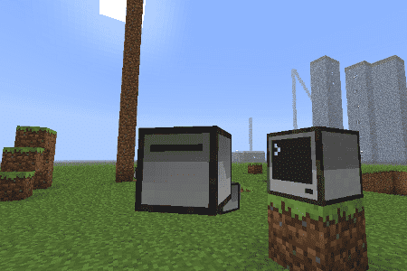
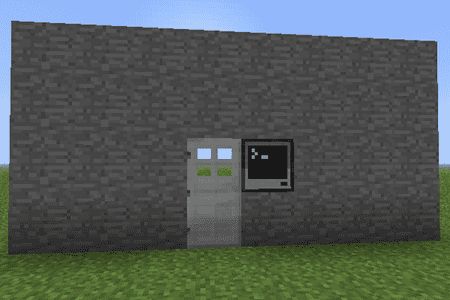
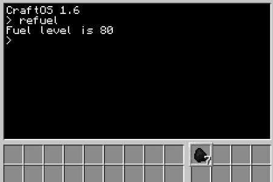
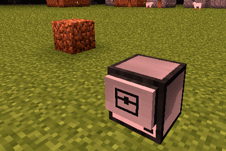
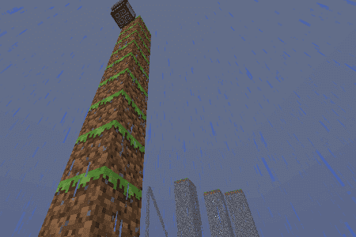
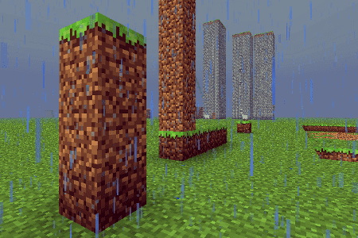
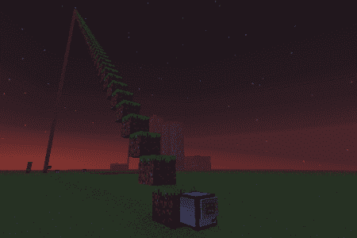

# Introduksjon {.intro}

__CC: Tweaked__ er en mod til __Minecraft__ som lar deg bygge og programmere
__datamaskiner__ og __roboter__ inne i Minecraft-verdenen.

Vi begynner med å bygge en enkel datamaskin. Når vi har blitt litt kjent med
den, bruker vi den til å låse opp en dør med passord. Etterpå ser vi på
datamaskiner som kan bevege seg, altså roboter! De kan både grave og bygge for
oss.



Du trenger Minecraft med CC: Tweaked. Se [Installere CC:
Tweaked](../installasjon/installasjon.html) hvis det ikke er klart.


# Steg 1: Vår første datamaskin {.activity}

*Vi begynner med å lage en datamaskin.*

Det er mye enklere å starte i *Creative*-modus når vi skal lære å bruke
datamaskinene. Da slipper vi å samle materiale og slåss mot monstre. Vi antar
derfor at du er i *Creative*-modus og kan hente akkurat det du trenger.

Men først skal vi se at en datamaskin kan lages på vanlig måte i Minecraft:

## Sjekkliste {.check}

- [ ] Trykk `E` for å åpne inventory. Finn frem 7 __Stone__, 1 __Redstone__ og 1
  __Glass Pane__.

- [ ] Åpne et __Crafting Table__, og legg ut materialet slik:

  

- [ ] Legg den nye datamaskinen i den nederste raden i inventory, slik at du kan
  ta den i hånden. Lukk inventory.

- [ ] Velg datamaskinen med talltastene, og høyreklikk på bakken for å sette den
  ut.

I *Creative*-modus kan du også hente datamaskiner direkte. Trykk `E`, velg
søkefanen og skriv `computer`.

### Datamaskiner i CC: Tweaked {.protip}

Høyreklikk en datamaskin for å starte den. Den åpner en svart skjerm med teksten
`CraftOS` og et versjonsnummer øverst. Dette er datamaskinens *kommandolinje*.
Vi bruker den til å styre datamaskinen.

## Sjekkliste {.check}

- [ ] Skriv `help` og trykk Enter.

  Du får noen tips om hvordan du kan finne ut mer om datamaskinen.

- [ ] Skriv `programs` og trykk Enter.

  Nå ser du en liste over programmene som finnes på datamaskinen. Mange av dem
  er enkle programmer som lar deg undersøke datamaskinen. Vi ser på noen av dem
  i en senere oppgave.


# Steg 2: Vårt første program {.activity}

*Nå er det på tide å skrive vårt første program.*

Det er en lang tradisjon at det første programmet man lager i et nytt språk,
skriver en hyggelig melding på skjermen. Vi følger tradisjonen og lager et
program som heter `heiverden`.

## Sjekkliste {.check}

- [ ] Start en datamaskin.

- [ ] Skriv `edit heiverden` for å begynne på et nytt program.

- [ ] Skriv dette i det nye vinduet:

  ```lua
  print('Hei verden!')
  ```

  Trykk så på `Ctrl`-tasten. Nederst på skjermen dukker det opp en meny. Velg
  `Save` med piltastene og trykk Enter. Trykk `Ctrl` en gang til, velg `Exit` og
  trykk Enter.

- [ ] Skriv `programs`. Nå står `heiverden` på listen over programmer.

- [ ] Skriv `heiverden` og trykk Enter for å kjøre programmet.

### Filen heter heiverden.lua {.protip}

Skriver du `ls`, ser du at programmet ligger i en fil som heter `heiverden.lua`.
Datamaskinen legger til `.lua` bak navnet for deg, slik at alle vet at filen er
et Lua-program. Når du kjører programmet, kan du skrive navnet med eller uten
`.lua`.

### Prøv selv {.challenge}

Kan du endre programmet slik at det sier hei til deg, eller til de som sitter
ved siden av deg?

Skriv `edit heiverden` en gang til. Da åpnes programmet ditt igjen, og du kan
endre det. Bruk `Ctrl`-tasten for å lagre og avslutte, som sist.


# Steg 3: Datamaskiner og redstone {.activity}

*Nå skal datamaskinen åpne en dør for oss. Etter hvert setter vi passord på
døren.*

Datamaskinene i CC: Tweaked bruker et programmeringsspråk som heter __Lua__. Det
er et enkelt og fleksibelt språk som ofte brukes inne i andre programmer, for
eksempel i spill som Roblox og World of Warcraft.

### Lua {.protip}

Lua ble laget i Brasil på begynnelsen av 1990-tallet. På et universitet i Rio de
Janeiro brukte de et språk som het *Simple Object Language* (SOL). Ordet *lua*
er portugisisk og betyr *måne*, et fint navn ved siden av SOL.

## Sjekkliste {.check}

Vi bruker __redstone__ til å styre døren. Redstone overfører energi i Minecraft.
Først setter vi en datamaskin ved siden av en dør.

- [ ] Gå ut av datamaskinen ved å trykke `Esc`.

- [ ] Hent litt __Stone__, en __Iron Door__ og en __Computer__. Bygg en vegg med
  døren i, og sett datamaskinen rett ved siden av døren. Det skal se omtrent
  slik ut:

  

- [ ] Start datamaskinen.

Nå prøver vi noen kommandoer direkte i Lua. Det er en fin måte å teste enkle
ting på.

- [ ] Skriv `lua` og trykk Enter. Dette starter en *Lua-tolker*, som utfører
  hver kommando du skriver med en gang.

- [ ] Vi begynner med kommandoen fra det første programmet. Skriv `print('Hei
  verden!')` og trykk Enter. Skjer det samme som før?

- [ ] Som de fleste programmeringsspråk er Lua glad i å regne. Skriv `1 + 1` og
  trykk Enter.

  Lua kan alle de vanlige regneartene. Prøv for eksempel `17 - 8`, `3 * 4` eller
  `22 / 7`. Kjenner du igjen hva hver av dem betyr?

- [ ] Skriv `redstone.setOutput('left', true)` og trykk Enter.

  Nå skal døren til venstre for datamaskinen åpne seg. Ordet `left` sier hvilken
  side av datamaskinen døren står på. Du kan også bruke `right`, `front`,
  `back`, `top` eller `bottom`.

  Åpner ikke døren seg? Prøv `right` i stedet. Sidene regnes fra datamaskinen
  sitt ståsted, ikke ditt.

  Dette er et eksempel på å kalle en *funksjon*, noe vi gjør ofte når vi
  programmerer. Funksjonen heter `setOutput`, og den hører hjemme i
  `redstone`-*biblioteket*.

### Funksjoner {.protip}

Alle programmeringsspråk lar deg lage *funksjoner*. En funksjon er en samling
instruksjoner som utføres sammen, slik at det blir enklere å gjøre vanskelige
ting. Lua har mange innebygde funksjoner. Så langt har vi sett `print` og
`redstone.setOutput`. Du kan også lage egne funksjoner.

## Sjekkliste {.check}

- [ ] Trykk pil opp, og endre `true` til `false`, slik at det står
  `redstone.setOutput('left', false)`. Trykk Enter. Nå lukker døren seg, fordi
  vi skrur av redstone-energien.

- [ ] Avslutt Lua-tolkeren ved å skrive `exit()` og trykke Enter.


# Steg 4: Passordlås på en dør {.activity}

*Nå bruker vi redstone-biblioteket til å lage en passordlås på døren. Underveis
lærer vi om tester og løkker.*

## Sjekkliste {.check}

- [ ] Start et nytt program ved å skrive `edit passord` og trykke Enter.

- [ ] Skriv inn dette programmet nøyaktig slik det står:

  ```lua
  local passord = 'eira'
  print('Passordet er ' .. passord .. '!')
  ```

  Pass på at du skriver de to punktumene `..` riktig. De setter sammen tekst.

- [ ] Lagre og avslutt editoren. Kjør programmet ved å skrive `passord`.

  Programmet forteller deg hva passordet er. Klarer du å endre passordet til noe
  annet, for eksempel navnet ditt?

### Variabler {.protip}

Nå har vi laget en *variabel*. Variabelen `passord` husker hva passordet er. Da
blir det lett å endre passordet senere. Ordet `local` betyr at variabelen bare
finnes i dette programmet (lokalt).

## Sjekkliste {.check}

- [ ] Datamaskinen skal jo spørre oss om passordet, ikke fortelle oss hva det
  er. Skriv `edit passord` igjen, og endre programmet slik:

  ```lua
  local passord = 'eira'
  print('Hva er passordet?')                    --endret linje
  local svar = read()                           --ny linje
  ```

  Lagre, avslutt og kjør programmet på nytt. Nå spør programmet om passordet.
  Skjer det noe når du svarer? Funksjonen `read` leser det du skriver på
  tastaturet, men programmet gjør ingenting med svaret ennå.

### Kommentarer {.protip}

Alt som står etter `--` på en linje, er en *kommentar*. Datamaskinen hopper over
kommentarer. Vi bruker dem til å vise hvilke linjer som er nye. Du trenger ikke
skrive dem av.

## Sjekkliste {.check}

- [ ] Nå skal programmet sjekke om du skriver riktig passord. Til det bruker vi
  en `if`-test. Den sjekker om noe er sant, her om svaret ditt er det samme som
  passordet. Legg til en `if`-test nederst:

  ```lua
  local passord = 'eira'
  print('Hva er passordet?')
  local svar = read()

  if svar == passord then                       --ny linje
      print('Riktig, passordet er ' .. passord) --ny linje
  else                                          --ny linje
      print('Feil, passordet er ikke ' .. svar) --ny linje
  end                                           --ny linje
  ```

  Kjør programmet igjen. Hva skjer når du svarer riktig? Og når du svarer feil?
  Skjønner du hvorfor?

- [ ] Nå kobler vi passordet sammen med `redstone`-kommandoene. Døren skal åpne
  seg hvis passordet er riktig, og lukke seg igjen etter 5 sekunder. Endre
  programmet slik:

  ```lua
  local passord = 'eira'
  print('Hva er passordet?')
  local svar = read()

  if svar == passord then
      redstone.setOutput('left', true)          --endret linje
      sleep(5)                                  --endret linje
      redstone.setOutput('left', false)         --endret linje
  end
  ```

  Kjør programmet. Hva skjer når du skriver riktig passord?

  Funksjonen `sleep` får datamaskinen til å vente. Her venter den i 5 sekunder
  før energien skrus av og døren lukker seg.

- [ ] Det er kjedelig å starte programmet på nytt hele tiden. Vi lager derfor en
  løkke som spør om passordet igjen og igjen.

  ```lua
  local passord = 'eira'

  while true do                                 --ny linje
      print('Hva er passordet?')
      local svar = read()

      if svar == passord then
          redstone.setOutput('left', true)
          sleep(5)
          redstone.setOutput('left', false)
      end
  end                                           --ny linje
  ```

  Det eneste nye her er en `while`-løkke. Den gjentar det som står inni, så
  lenge noe er sant. Her er dette *noe* verdien `true`, som alltid er sann. Vi
  har laget en *evig løkke*. Programmet spør om passordet for alltid!

- [ ] Kjør programmet. Oppfører det seg slik du trodde? Husker du passordet?

### Avslutte programmer {.protip}

Hold inne `Ctrl` og `T` samtidig i omtrent ett sekund. Da stopper programmet, og
teksten `Terminated` skrives på skjermen. Dette virker i alle programmer.

## Sjekkliste {.check}

- [ ] Til slutt gjør vi noen små forbedringer. Vi kaller to funksjoner fra
  `term`-biblioteket. Den ene tømmer skjermen, og den andre flytter skrivemerket
  til `(1, 1)`, øverst til venstre. I tillegg ber vi `read` vise `*` i stedet
  for passordet vi skriver. Programmet ser da slik ut:

  ```lua
  local passord = 'eira'

  while true do
      term.clear()                              --ny linje
      term.setCursorPos(1, 1)                   --ny linje
      print('Hva er passordet?')
      local svar = read('*')                    --endret linje

      if svar == passord then
          redstone.setOutput('left', true)
          sleep(5)
          redstone.setOutput('left', false)
      end
  end
  ```

Gratulerer, nå har du lært ganske mye om å programmere datamaskiner med CC:
Tweaked! Prøv gjerne å forandre programmene. Kan du gjøre dem enda bedre?


# Steg 5: Vår første robot {.activity}

*Vi skal bli kjent med roboter og se noe av det de kan brukes til.*

En robot er en datamaskin som kan bevege seg. I CC: Tweaked kan vi gi robotene
forskjellige verktøy, slik at de for eksempel kan grave, bygge og slåss.

Vi begynner likevel med en helt enkel robot:

## Sjekkliste {.check}

- [ ] Åpne inventory ved å trykke `E`. Finn frem 7 __Iron Ingot__, 1 __Chest__
  og 1 __Computer__.

- [ ] Åpne et __Crafting Table__, og lag en robot slik:

  

- [ ] Ta den nye roboten i hånden, lukk inventory og sett roboten ut.

I *Creative*-modus finner du robotene ved å trykke `E`, velge søkefanen og
skrive `turtle`. Robotene heter nemlig __Turtle__ i CC: Tweaked.

### Turtles {.protip}

__Turtle__ betyr *skilpadde*. Navnet har en historie. For over 70 år siden bygde
William Grey Walter noen roboter som kunne bevege seg rundt. De beveget seg
ganske sakte, og var lave og formet som et skall. Derfor fikk de kallenavnet
skilpadder.

Senere ble måten skilpaddene beveget seg på (vi skal snart se hvordan) tatt inn
i flere programmeringsspråk, særlig som en måte å tegne på. Språket *Logo* er
mest kjent for slik skilpaddegrafikk, men i dag finnes den også i for eksempel
*Scratch*, *Python* og *CC: Tweaked*.

## Sjekkliste {.check}

Du starter roboter på samme måte som datamaskiner, ved å høyreklikke på dem. Da
åpnes kommandolinjen til roboten.

- [ ] Start en robot. Skriv `programs` og trykk Enter.

  Nå ser du hvilke programmer roboten kjenner til. Mange er de samme som på en
  datamaskin, men roboten kan også noen ting som datamaskinen ikke kan.

- [ ] Kjør programmet `dance`.

  Roboten begynner å danse! Trykk `Esc` for å lukke kommandolinjen, slik at du
  ser roboten. Blir du imponert?

- [ ] Vil du at roboten skal slutte å danse, høyreklikker du på den igjen. På
  skjermen står det at du kan stoppe dansen ved å trykke en tast.

  Du kan også la roboten danse videre. Lag i så fall en ny robot til de neste
  oppgavene.


# Steg 6: Roboter og skilpadder {.activity}

*Nå skal vi få robotene til å bevege seg.*

Som nevnt i boksen *Turtles* styrer vi robotene omtrent slik de gamle
skilpadderobotene ble styrt. Vi begynner med programmet `go`.

## Sjekkliste {.check}

- [ ] Kjør programmet `go forward` på roboten.

- [ ] Roboten svarer `Out of fuel`.

  Roboter trenger drivstoff, *fuel*, for å bevege seg. De kan bruke det samme
  som en __Furnace__, for eksempel __Coal__ eller __Blaze Rod__.

- [ ] Finn litt __Coal__ i inventory. Høyreklikk på roboten. Nederst ser du
  robotens eget inventory med 16 plasser (4 ganger 4). Flytt kullet over dit.

  

- [ ] Skriv `refuel` og trykk Enter.

  Ett kull forsvinner fra robotens inventory. Roboten forteller også hvor mye
  fuel den har, *fuel level*. Tallet sier hvor mange steg roboten kan gå før den
  går tom. Ett kull gir 80 steg.

- [ ] Gi roboten litt mer __Coal__, og skriv `refuel all`.

  Nå spiser roboten opp alt kullet, og melder at den er klar til å gå ganske
  langt!

- [ ] Prøv igjen: Kjør `go forward`. Nå skal roboten flytte seg ett steg frem.

  Flytter roboten seg? Det kan være vanskelig å se hva som er foran og bak på en
  robot. Et triks er å tenke at siden med skjermen er ansiktet til roboten. Det
  er den siden som er foran.

- [ ] Du kan flytte roboten bakover ved å skrive `go back`.

### Finne hjelp {.protip}

Datamaskiner og roboter har et innebygd hjelpesystem. Skriv `help` og trykk
Enter for å se hvordan det virker. Du kan skrive `help` og navnet på et program
for å få hjelp om akkurat det programmet, for eksempel `help go`.

Mer hjelp finner du på nettsiden til CC: Tweaked, <https://tweaked.cc/>. Den er
på engelsk.

## Sjekkliste {.check}

- [ ] Skriv `help go` for å finne ut mer om hvordan roboten kan flytte seg.

  Her ser vi at vi kan bruke `go forward`, `go back`, `go up`, `go down`, `go
  left` og `go right`. Vi kan også skrive et tall bak for å gå flere steg.

- [ ] Prøv `go up 2`, `go forward 10`, `go down` og lignende kommandoer.

  Hvordan kan vi få roboten til å gå sidelengs?

- [ ] Ingen kommando får roboten til å gå sidelengs. `go left` og `go right`
  snur bare roboten. For å gå sidelengs må roboten først snu seg og så gå
  fremover. Skriv `go left` og deretter `go forward 3`.

- [ ] Du kan sette sammen flere bevegelser i én kommando. `go forward 3 left
  forward 4 up 2` får roboten til å gå 3 steg frem, snu seg mot venstre, gå 4
  steg til og til slutt løfte seg 2 steg opp.

- [ ] Lek litt mer med `go` til du skjønner hvordan du flytter roboten rundt.
  Synes du `go left` og `go right` er forvirrende, siden roboten ikke flytter
  seg? Da kan du bruke `turn left` og `turn right` i stedet.

  Hva skjer om du ber roboten gå gjennom bakken eller en vegg, eller om du står
  i veien for den?


# Steg 7: Gruverobot {.activity}

*Med riktig verktøy kan roboter grave, bygge og slåss for oss.*

Nå skal vi bruke en gruverobot som graver for oss.

## Sjekkliste {.check}

- [ ] Hent en __Mining Turtle__. I *Creative*-modus finner du den med søket
  `turtle`. Du kan også lage en selv: legg en __Turtle__ og en __Diamond
  Pickaxe__ ved siden av hverandre på et __Crafting Table__. Sett ut og start
  gruveroboten.

- [ ] Gi roboten mye __Coal__ og kjør `refuel all`.

- [ ] Vi skal bruke programmet `excavate`, som betyr *grave ut*. Det ber roboten
  grave et hull rett ned i bakken.

  Skriv `excavate 3` og trykk Enter.

  Gå et steg tilbake og se på mens roboten graver. Den fortsetter til den møter
  grunnfjellet, __Bedrock__, eller går tom for fuel. I en vanlig verden er det
  langt ned. Prøv gjerne i en flat verden (*Superflat*), der grunnfjellet ligger
  bare noen få klosser under bakken.

- [ ] Hva tror du tallet `3` betyr? Skriv `help excavate` og se om du har rett.

- [ ] Høyreklikk på roboten mens den graver. Den tar vare på alt den graver ut.

  Når roboten er ferdig, kommer den tilbake dit den startet og legger fra seg
  det den har gravd ut. Står det en __Chest__ bak roboten når den starter,
  havner alt i kisten.

- [ ] Lag flere gruveroboter som graver større eller mindre hull.


# Steg 8: Robotprogrammer {.activity}

*Nå lærer vi å styre roboter fra våre egne programmer.*

Når vi skriver egne programmer for robotene, bruker vi kommandoer fra
`turtle`-biblioteket.

## Sjekkliste {.check}

- [ ] Start en ny robot. Pass på at den har fått kull og kjørt `refuel`.

- [ ] Vi begynner med å finne mer informasjon om `turtle`-biblioteket. Skriv
  `help turtle`.

  Nå ser du en ganske lang liste med kommandoer. Vi viser frem noen av dem. Prøv
  gjerne resten på egen hånd senere, og se om du skjønner hvordan de virker.

  Nederst på skjermen står det hvordan du blar og kommer ut av hjelpen.

- [ ] For å eksperimentere skriver vi kommandoene rett i Lua-tolkeren. Skriv
  `lua` og trykk Enter. Husk at du skriver `exit()` for å komme tilbake til
  kommandolinjen.

- [ ] Vi begynner med flyttekommandoene. Skriv `turtle.forward()` og trykk
  Enter. Flytter roboten seg fremover?

  Trykk `Esc` for å se bedre hva roboten gjør. Høyreklikk på roboten for å komme
  tilbake til Lua-tolkeren.

- [ ] Prøv også disse kommandoene. De gjør det samme som `go`, og sammen lar de
  oss flytte roboten dit vi vil:

  `turtle.forward()`, `turtle.back()`, `turtle.turnLeft()`,
  `turtle.turnRight()`, `turtle.up()`, `turtle.down()`.

  Lua-tolkeren skriver `true` når roboten klarte å flytte seg. Står det noe i
  veien, får du `false` og en forklaring.

### Prøv selv {.challenge}

Sett en kloss et stykke unna roboten, omtrent som på bildet under. Klarer du å
bruke `turtle`-kommandoene til å flytte roboten opp på toppen av klossen?




# Steg 9: Up, up, up, and away ... {.activity}

*Kan vi få roboten til å bygge for oss?*

Et av poengene med roboter er at de gjør arbeid for oss. I Minecraft betyr det
for eksempel å grave eller bygge.

## Sjekkliste {.check}

- [ ] Start en ny robot og gi den fuel. Legg også noe byggemateriale, for
  eksempel __Dirt__, i plassen øverst til venstre i robotens inventory.

- [ ] Pass på at det ikke står noe foran roboten. Skriv `turtle.place()` i
  Lua-tolkeren.

  Bygde roboten en kloss foran seg? Da har du gjort alt riktig. Hvis ikke, kan
  du sjekke

  __1__: at du har startet `lua`,

  __2__: at roboten har fuel,

  __3__: at roboten har byggemateriale,

  __4__: at det ikke står noe foran roboten (husk at skjermen er foran), og

  __5__: at plassen med byggemateriale i robotens inventory er valgt, det vil si
  at den har en tykkere ramme rundt seg enn de andre plassene.

- [ ] Roboten kan også sjekke om den har noe foran seg. Skriv `turtle.detect()`.

  Du skal få svaret `true`, som betyr at roboten merker at det er noe foran den.

- [ ] Prøv `turtle.back()` og så `turtle.detect()` igjen.

  Nå står det ikke noe rett foran roboten, så du får svaret `false`.

I steg 10 skal vi bruke `place()` og `detect()` sammen til å lage en ganske
smart byggerobot.

Men først: Med `go` kunne vi flytte roboten flere steg ved å skrive et tall, for
eksempel `go forward 3`. Det virker ikke med `turtle`-biblioteket. Der må vi
bruke løkker i stedet.

## Sjekkliste {.check}

- [ ] En enkel måte å gjøre noe et bestemt antall ganger på, er en `for`-løkke.

  Skriv

  ```lua
  for i = 1, 5 do turtle.back() end
  ```

  i Lua-tolkeren. Flytter roboten seg 5 steg bakover?

### `for`-løkker {.protip}

En `for`-løkke brukes ofte når vi vet hvor mange ganger vi vil gjøre noe. Over
flyttet roboten seg 5 ganger bakover. `i` i koden er en variabel, så vi kan
følge med på hvor langt vi har kommet i løkken. For eksempel skriver

```lua
for i = 1, 5 do print(i) end
```

tallene 1, 2, 3, 4 og 5 på hver sin linje.

Vi kan bruke andre variabelnavn enn `i`, og starte på andre tall enn `1`:

```lua
for tall = 10, 20 do print(tall) end
```

## Sjekkliste {.check}

- [ ] Du kan ha flere kommandoer inni samme løkke. Prøv

  ```lua
  for i = 1, 5 do turtle.back() turtle.place() end
  ```

- [ ] Gi roboten mye byggemateriale, for eksempel 64 __Dirt__, i den valgte
  plassen i inventory.

- [ ] La oss bygge et høyt tårn!

  Skriv

  ```lua
  for i = 1, 60 do turtle.up() turtle.place() end
  ```

  

Oops! Vi glemte å si til roboten at den skulle komme ned igjen. Hvordan skal vi
få tak i den nå?


# Steg 10: Bygg en trapp {.activity}

*Kan vi skrive et program som henter ned den forsvunne roboten?*

Når vi skal gjøre noe litt komplisert, er det enklere å skrive et program enn å
gi enkeltkommandoer i Lua-tolkeren. Vi lager et program som bygger en trapp opp
til toppen av det høye tårnet.

Før vi bygger en kjempehøy trapp, øver vi oss på et mindre tårn.

## Sjekkliste {.check}

- [ ] Bygg et tårn som er tre klosser høyt. Du kan bygge det med en robot eller
  selv.

  

- [ ] Sett ut en ny robot inntil det lille tårnet. Gi den fuel og
  byggemateriale. Pass på at den ser mot tårnet.

- [ ] Start et nytt program ved å skrive `edit byggTrapp`. Skriv inn dette:

  ```lua
  turtle.detect()
  ```

  Lagre og avslutt med `Ctrl`-tasten.

- [ ] Kjør programmet ved å skrive `byggTrapp`. Det bygger ingen trapp ennå. Det
  ser ut som det ikke gjør noe i det hele tatt. Det eneste som skjer, er at
  roboten merker at det er en kloss foran den. Vi har ikke sagt hva den skal
  gjøre etterpå.

  Vi kan bruke `turtle.detect()` til å finne toppen av tårnet.

- [ ] Skriv `edit byggTrapp` igjen. Nå lager vi en løkke der roboten klatrer
  oppover så lenge den merker at tårnet er høyere.

  ```lua
  while turtle.detect() do                      --endret linje
      turtle.up()                               --ny linje
  end                                           --ny linje
  ```

  Lagre og kjør programmet. Klatrer roboten til toppen av det lille tårnet?

- [ ] Vi har lært av feilen vår, så nå sørger vi for at roboten kommer ned
  igjen. Vi legger til en ny løkke der roboten klatrer ned. Denne gangen bruker
  vi `turtle.detectDown()`. Den gjør det samme som `detect()`, men merker om det
  er en kloss *under* roboten i stedet for foran.

  Utvid programmet slik:

  ```lua
  while turtle.detect() do
      turtle.up()
  end

  while not turtle.detectDown() do              --ny linje
      turtle.down()                             --ny linje
  end                                           --ny linje
  ```

  Så lenge roboten *ikke* har en kloss under seg, tar den et steg ned. Kommer
  roboten ned igjen når du kjører programmet?

- [ ] Nå er vi klare til å bygge selve trappen. I den andre løkken tar roboten
  et steg tilbake og setter ut en kloss.

  ```lua
  while turtle.detect() do
      turtle.up()
  end

  while not turtle.detectDown() do
      turtle.down()
      turtle.back()                             --ny linje
      turtle.place()                            --ny linje
  end
  ```

  Virker det? Lager roboten en trapp?

- [ ] Nå er det tid for den store testen. Klarer trappebyggeroboten å komme seg
  opp det høye tårnet?

  Pass på at roboten har nok fuel og byggemateriale. Kjør den bort til det høye
  tårnet, og la den kjøre `byggTrapp`!

  

Gratulerer! Nå har du programmert en robot! Siden `byggTrapp` bruker
`detect`-kommandoer, kan den bygge trapper opp alle slags tårn og bratte
fjellsider.

### Prøv selv {.challenge}

Nå har vi et program som bygger trapper oppover. Kan du lage et program som
graver en trapp ned under bakken?

Lag et program som heter `gravTrapp`. Til det trenger du en __Mining Turtle__.

Se på kommandoene `turtle.dig()` og `turtle.digDown()`. De graver foran og under
roboten. `turtle.digUp()` er nyttig hvis du vil ha nok plass til å gå ned
trappen selv.

Det enkleste er å bruke en `for`-løkke, for eksempel slik at roboten graver 10
trinn nedover.

Vil du ha en utfordring? La roboten grave nedover til den finner grunnfjellet.
Med `turtle.inspectDown()` kan roboten se hva slags kloss som er under den:

```lua
local finnes, kloss = turtle.inspectDown()
if finnes and kloss.name == 'minecraft:bedrock' then
    print('Her er grunnfjellet!')
end
```

*Basert på en oppgave til ComputerCraft av Geir Arne Hjelle,
delt under CC BY-SA 4.0.*
