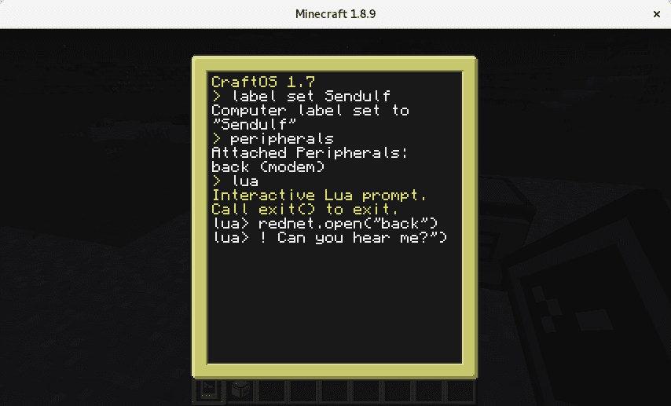
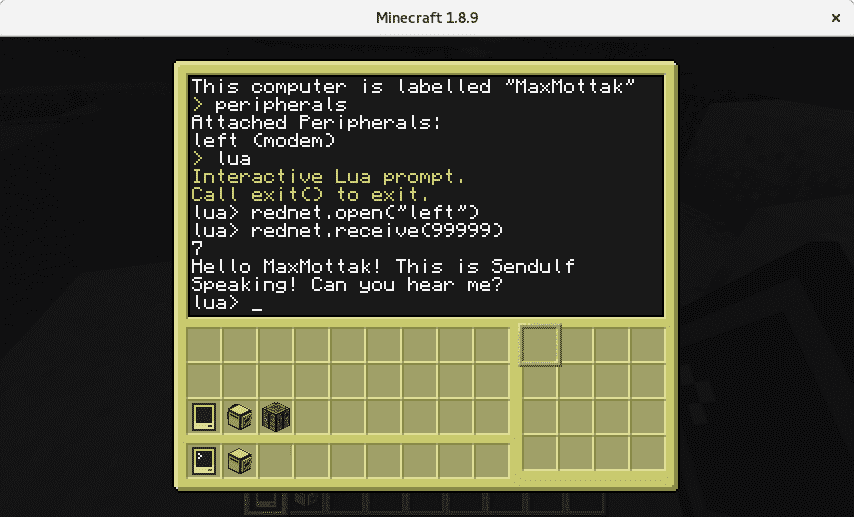

# Introduksjon {.intro}

Så langt har vi kjørt kode på én og én datamaskin. Nå skal vi få flere
datamaskiner til å snakke sammen.




# Steg 1: Utstyret vi trenger {.activity}

Et *modem* var det vi i gamle dager brukte for å koble oss til internett. I CC:
Tweaked bruker vi modem for å koble oss til *rednet*, et nett for datamaskiner
inne i Minecraft.

Trådløst utstyr er dyrt å lage, så det er lurt å bruke en verden i
*Creative*-modus.

## Sjekkliste {.check}

- [ ] Hent en __Advanced Wireless Pocket Computer__ (en lommedatamaskin med
  trådløst modem) og en __Advanced Ender Turtle__ (en robot med et modem som når
  langt). I *Creative*-modus finner du dem i fanen __ComputerCraft__, eller ved
  å søke etter `pocket` og `turtle`.

  <!-- BILDE: Creative-fanen ComputerCraft med Advanced Wireless Pocket Computer
  og Advanced Ender Turtle markert. -->

  Vil du lage dem selv? Et __Wireless Modem__ lages av 8 __Stone__ rundt en
  __Ender Pearl__. Legg modemet ved siden av en __Advanced Pocket Computer__ på
  et __Crafting Table__. Et __Ender Modem__ lages av 8 __Gold Ingot__ rundt et
  __Eye of Ender__, og legges ved siden av en __Advanced Turtle__.

- [ ] Høyreklikk med lommedatamaskinen i hånden for å starte den. Gi den navnet
  *Sendulf* med `label set Sendulf`.

- [ ] Sett ut roboten, start den og gi den navnet *MaxMottak* med `label set
  MaxMottak`.

### Server og klient {.tip}

Ofte skal en datamaskin sende beskjeder til en annen. Da gir vi dem gjerne to
roller: *server* og *klient*.

- **Serveren** venter pent på å få beskjed.

- **Klienten** sender meldinger til serveren når den vil.

Vet du om noen eksempler på servere og klienter?

### Rednet {.tip}

Vi bruker `rednet` til å la datamaskinene snakke sammen. Skriv `help rednet` for
en rask oversikt over hva `rednet` kan gjøre.

Mer om `rednet` finner du på
[tweaked.cc/module/rednet.html](https://tweaked.cc/module/rednet.html) (på
engelsk).


# Steg 2: Klar til å motta en beskjed {.activity}

Nå skal *Sendulf* sende beskjeder til *MaxMottak*. *Sendulf* sender, så den er
klienten. *MaxMottak* venter på beskjeder, så den er serveren.

## Sjekkliste {.check}

- [ ] Sjekk hvilket nummer (*id*) *MaxMottak* har. Min *MaxMottak* svarte slik:

  ```
  > id
  This is computer #5
  This computer is labelled "MaxMottak"
  ```

  Ditt nummer er sikkert et annet. Skriv det ned.

- [ ] Sjekk hvor modemet sitter på *MaxMottak*. Min svarte:

  ```
  > peripherals
  Attached Peripherals:
  left (modem)
  ```

- [ ] Start Lua-tolkeren:

  ```
  > lua
  Interactive Lua prompt.
  Call exit() to exit.
  lua>
  ```

- [ ] Koble til `rednet` og vent på en beskjed. Husker du hvor modemet var?

  ```lua
  rednet.open("left")
  rednet.receive(100)
  ```

  Skriv én linje om gangen og trykk Enter etter hver.

### Nøtt {.challenge}

Hva betyr tallet i `receive`? Hva skjer hvis du skriver 1? 5? 10?


# Steg 3: Send en beskjed {.activity}

## Sjekkliste {.check}

- [ ] Skriv `peripherals` på *Sendulf* for å se hvor modemet sitter. På en
  lommedatamaskin sitter det på baksiden, `back`.

- [ ] Start Lua-tolkeren på *Sendulf* og skriv `rednet.open("back")`.

- [ ] Hva var nummeret til *MaxMottak*? Det trenger vi når vi skal sende. Min
  hadde nummer 5, så jeg bruker 5 når jeg sender beskjeden:

  ```lua
  rednet.send(5, "Hei, MaxMottak! Dette er Sendulf! Hører du meg?")
  ```

  Husk å starte `rednet.receive(100)` på *MaxMottak* først, og send beskjeden
  før tiden er ute.

  

## Test selv! {.flag}

- [ ] Ser du beskjeden på *MaxMottak*?

- [ ] Hva må du gjøre for å sende flere beskjeder etter hverandre?

- [ ] *MaxMottak* viser et tall i tillegg til beskjeden. Hva er det tallet?

### Finn modemet automatisk {.protip}

Det er lett å gå seg vill i hvilken side modemet sitter på. Denne linjen åpner
alle modemer som er koblet til, uansett side:

```lua
peripheral.find("modem", rednet.open)
```

### Prøv selv {.challenge}

Lag et program på *MaxMottak* som tar imot beskjeder i en løkke og skriver dem
ut, og et program på *Sendulf* som spør hva du vil sende med `read()`. Da har du
laget din egen chat!

Vil du gå videre? I [Fjernstyr en
robot](../fjernstyr_en_robot/fjernstyr_en_robot.html) bruker vi beskjeder til å
styre en robot.

*Basert på en oppgave til ComputerCraft av Teodor Heggelund,
delt under CC BY-SA 4.0.*
