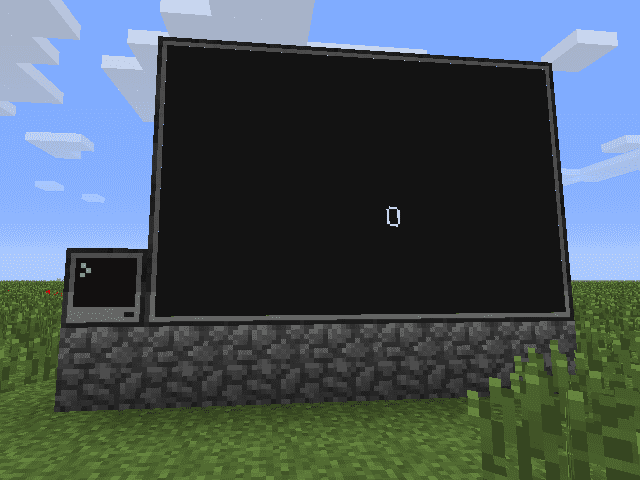
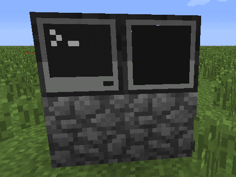
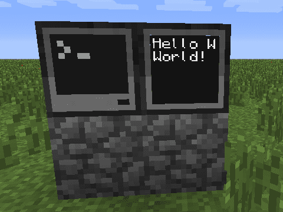
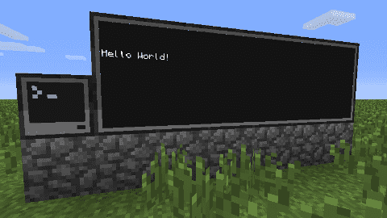
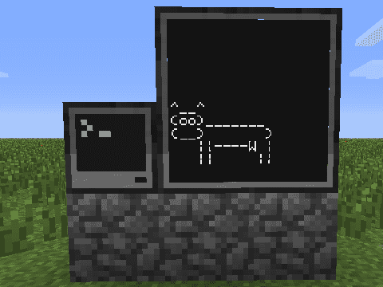
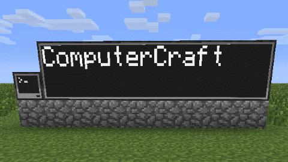

# Introduksjon {.intro}

Nå skal vi koble en skjerm til datamaskinen. Med en ekstra skjerm kan
datamaskinen vise ting til verden rundt seg. Kanskje Minecraft-verdenen blir
full av store reklameskilt?




# Steg 1: Koble en skjerm til datamaskinen {.activity}

Vi begynner enkelt. Vi kobler en skjerm til en datamaskin og ser om vi får
skrevet noe på den.

## Sjekkliste {.check}

- [ ] Sett ut en __Computer__. Du kan også bruke en __Advanced Computer__ hvis
  du vil.

- [ ] Sett en __Monitor__ inntil datamaskinen, omtrent som på bildet.

  

  I *Creative*-modus finner du skjermen ved å søke etter `monitor`. Vil du lage
  den selv, legger du 8 __Stone__ rundt en __Glass Pane__ på et __Crafting
  Table__.

- [ ] Start datamaskinen. Den enkleste måten å skrive noe på skjermen er med
  programmet `monitor`. Skriver du `help monitor`, kan du lese at `monitor`
  kjører andre programmer på en tilkoblet skjerm.

  Vi prøver med programmet `hello`, som bare skriver *Hello World!*. Kjør det
  først på datamaskinen:

  ```
  > hello
  Hello World!
  ```

  Nå skal det kjøre på skjermen. Står skjermen på høyre side av datamaskinen
  (*right*), slik som på bildet, skriver vi

  ```
  > monitor right hello
  ```

  Står skjermen på en annen side? Skriv `peripherals` for å se hvilken side den
  er koblet til. Trykk `Esc` for å gå ut av datamaskinen og se på skjermen. Står
  det *Hello World!*?

  

- [ ] Kult! Da er vi i gang. Men det ble lite plass på den skjermen! Det er lett
  å fikse. Setter du en __Monitor__ ved siden av den du har, smelter de sammen
  til én større skjerm. Slik kan du lage en stor skjerm! Kjør `hello` på den
  store skjermen.

  

- [ ] Trikset med `monitor` virker også med programmer vi skriver selv. Vi lager
  et lite program som heter `ku`:

  ```lua
  print("^__^")
  print("(oo)_______")
  print("(__)       )")
  print("   ||----w |")
  print("   ||     ||")
  ```

  Det gjør ikke noe om kua di ser litt annerledes ut. Du kan også tegne noe helt
  annet. Vi vil bare teste at vårt eget program kan vises på skjermen.

- [ ] Kjør programmet med `monitor right ku`.

  

## Cowsay {.protip}

Kua er laget etter et morsomt lite program som heter **Cowsay**. Det ble laget
av Tony Monroe på slutten av 1990-tallet.


# Steg 2: En annen metode {.activity}

I stedet for å bruke `monitor` kan vi skrive rett til skjermen fra våre egne
programmer. Det er ganske enkelt med biblioteket `peripheral`. *Peripheral*
betyr her *tilbehør*. Skjermen er altså tilbehør til datamaskinen.

## Sjekkliste {.check}

- [ ] Lag et enkelt program som heter `skjerm`:

  ```lua
  local skjerm = peripheral.wrap("right")
  skjerm.write("Heisann!")
  ```

  Bytt ut `right` med for eksempel `left` eller `top` hvis skjermen står et
  annet sted.

- [ ] Kjør programmet ved å skrive `skjerm`. Selv uten `monitor` skriver
  programmet på skjermen ved siden av datamaskinen.

- [ ] I stedet for `peripheral.wrap` kan vi bruke `peripheral.find`. Da trenger
  vi ikke si hvilken side skjermen står på. Endre programmet slik:

  ```lua
  local skjerm = peripheral.find("monitor")     --endret linje
  skjerm.write("Heisann!")
  ```

- [ ] Vi kan også sjekke om det er koblet til en skjerm i det hele tatt. Det
  gjør vi med en `if`-test:

  ```lua
  local skjerm = peripheral.find("monitor")

  if skjerm then                                --ny linje
      skjerm.write("Heisann!")
  else                                          --ny linje
      print("Ingen skjerm er koblet til")       --ny linje
  end                                           --ny linje
  ```

  Kjør det nye programmet. Av og til vil du kanskje tømme skjermen med `monitor
  right clear`. Prøv også å fjerne skjermen. Får du beskjed om at ingen skjerm
  er koblet til når du kjører programmet?


# Steg 3: En ball faller over skjermen {.activity}

Nå begynner vi på en enkel animasjon på skjermen.

## Sjekkliste {.check}

- [ ] Lag et nytt program som heter `sprettball`. Det begynner nesten som
  `skjerm`, så du kan kopiere det med `cp skjerm.lua sprettball.lua`. Programmet
  `sprettball` skal se slik ut:

  ```lua
  local skjerm = peripheral.find("monitor")

  if skjerm then
      skjerm.clear()
      skjerm.write("O")
  else
      print("Ingen skjerm er koblet til")
  end
  ```

  Dette tegner en ball øverst på skjermen.

- [ ] Med en enkel `for`-løkke kan vi animere ballen. Endre koden:

  ```lua
  local skjerm = peripheral.find("monitor")

  if skjerm then
      for rad = 1, 10 do                        --ny linje
          skjerm.clear()
          skjerm.setCursorPos(3, rad)           --ny linje
          skjerm.write("O")
          sleep(1)                              --ny linje
      end                                       --ny linje
  else
      print("Ingen skjerm er koblet til")
  end
  ```

  For at vi skal rekke å se at ballen flytter seg, venter `sleep(1)` ett sekund
  hver gang ballen flytter seg.

- [ ] Dette er ikke så spennende ennå. Før vi lager noe mer avansert, rydder vi
  litt i koden, slik at det blir lettere å holde oversikten. Vi flytter alt som
  har med ballen å gjøre, inn i en egen funksjon, `tegnBall`. Flytt linjene
  rundt slik at det blir slik:

  ```lua
  function tegnBall(skjerm)                     --ny linje
      for rad = 1, 10 do                        --flyttet linje
          skjerm.clear()                        --flyttet linje
          skjerm.setCursorPos(3, rad)           --flyttet linje
          skjerm.write("O")                     --flyttet linje
          sleep(1)                              --flyttet linje
      end                                       --flyttet linje
  end                                           --ny linje

  local skjerm = peripheral.find("monitor")

  if skjerm then
      tegnBall(skjerm)                          --ny linje
  else
      print("Ingen skjerm er koblet til")
  end
  ```


# Steg 4: Hvor stor er skjermen? {.activity}

Skjermer kan ha forskjellig størrelse. Setter du for eksempel tre skjermer oppå
hverandre, får du en høy skjerm, og ballen faller ikke helt til bunnen. Det
løser vi med funksjonen `getSize`.

## Sjekkliste {.check}

- [ ] `getSize` forteller hvor bred og hvor høy skjermen er. Endre `tegnBall`
  slik at ballen faller over hele skjermen:

  ```lua
  function tegnBall(skjerm)
      local bredde, hoyde = skjerm.getSize()    --ny linje
      for rad = 1, hoyde do                     --endret linje
          skjerm.clear()
          skjerm.setCursorPos(3, rad)
          skjerm.write("O")
          sleep(1)
      end
  end
  ```

- [ ] Gjør skjermen høyere eller lavere. Faller ballen hele veien ned når du
  kjører programmet?

- [ ] Klarer du å få ballen til å falle midt på skjermen, uansett hvor stor
  skjermen er? Prøv selv!


# Steg 5: Sprettball {.activity}

Nå skal ballen oppføre seg mer som en sprettball. Vi lager noen nye variabler.
`x` og `y` sier hvor ballen er, mens `fartX` og `fartY` sier hvor fort den
flytter seg.

## Sjekkliste {.check}

- [ ] I tillegg til de nye variablene bytter vi ut `for`-løkken med en
  `while`-løkke, slik at ballen spretter for alltid. Husk at `Ctrl+T` stopper
  programmet.

  ```lua
  function tegnBall(skjerm)
      local bredde, hoyde = skjerm.getSize()
      local x, y = 1, 2                         --ny linje
      local fartX, fartY = 1, 1                 --ny linje

      while true do                             --endret linje
          skjerm.clear()
          skjerm.setCursorPos(x, y)             --endret linje
          skjerm.write("O")
          sleep(1)

          x = x + fartX                         --ny linje
          y = y + fartY                         --ny linje
      end
  end
  ```

  Nå går ballen på skrå over skjermen. Ser du hvorfor?

- [ ] Nå skal ballen sprette når den treffer kanten. Det gjør vi ved å snu
  farten når ballen er ved kanten. Legg til to tester nederst i løkken:

  ```lua
  function tegnBall(skjerm)
      local bredde, hoyde = skjerm.getSize()
      local x, y = 1, 2
      local fartX, fartY = 1, 1

      while true do
          skjerm.clear()
          skjerm.setCursorPos(x, y)
          skjerm.write("O")
          sleep(1)

          x = x + fartX
          y = y + fartY

          if x <= 1 or x >= bredde then         --ny linje
              fartX = -fartX                    --ny linje
          end                                   --ny linje
          if y <= 1 or y >= hoyde then          --ny linje
              fartY = -fartY                    --ny linje
          end                                   --ny linje
      end
  end
  ```

  Spretter ballen tilbake når den treffer kanten? Lag gjerne en stor skjerm. Du
  kan også gjøre pausen kortere. Bytt for eksempel ut `sleep(1)` med
  `sleep(0.1)`.

- [ ] Til slutt gjør vi sprettet mer naturlig med en variabel for *tyngdekraft*.
  Tyngdekraften får ballen til å falle stadig raskere mot bakken. Den øker altså
  `fartY` litt hver gang.

  ```lua
  function tegnBall(skjerm)
      local bredde, hoyde = skjerm.getSize()
      local x, y = 1, 2
      local fartX, fartY = 1, 0                 --endret linje
      local tyngde = 0.2                        --ny linje

      while true do
          skjerm.clear()
          skjerm.setCursorPos(x, math.floor(y)) --endret linje
          skjerm.write("O")
          sleep(0.1)

          fartY = fartY + tyngde                --ny linje
          x = x + fartX
          y = y + fartY

          if x <= 1 or x >= bredde then
              fartX = -fartX
          end
          if y >= hoyde then                    --endret linje
              fartY = -(fartY + tyngde)         --endret linje
          end
      end
  end
  ```

  Nå blir `y` et desimaltall, for eksempel 3.6. Skjermen har bare hele rader, så
  `math.floor(y)` runder ned til et helt tall. Vi endret også testen for `y`.
  Tyngdekraften sørger for at ballen snur før den treffer taket.


# Steg 6: Reklameskilt {.activity}

Vi tar en pause fra sprettballen og bruker skjermene til å lage enkle skilt med
tekst.

## Sjekkliste {.check}

- [ ] Lag et nytt program som du kaller `reklame`. Vi begynner med kommandoer du
  kjenner:

  ```lua
  local skjerm = peripheral.find("monitor")

  if skjerm then
      skjerm.clear()
      skjerm.setCursorPos(1, 1)
      skjerm.write("CC: Tweaked")
  else
      print("Ingen skjerm er koblet til")
  end
  ```

  Kjør programmet. Skriver det på skjermen som det skal?

- [ ] Skal dette være et reklameskilt, er teksten alt for liten! Du må nesten gå
  helt bort til skjermen for å lese den.

  Med `setTextScale` endrer vi tekststørrelsen på skjermen. Legg til linjen

  ```lua
  skjerm.setTextScale(3)
  ```

  rett før `skjerm.clear()`, og kjør programmet på nytt. Ble teksten større?

  

  Tallet `3` er tekststørrelsen. Vi kan bruke tall fra 0.5 til 5, i steg på 0.5.
  5 gir den største teksten.

- [ ] Prøv andre tall i `setTextScale`. Endrer teksten størrelse? Hva skjer med
  et tall større enn 5, eller mindre enn 0.5?

- [ ] Nå skal programmet selv finne tekststørrelsen. Siden dette er et
  reklameskilt, vil vi ha så stor tekst som mulig.

  Vi lager en løkke som prøver alle tekststørrelsene fra størst til minst, til
  vi finner en der hele teksten får plass.

  Legg inn denne funksjonen øverst i `reklame`:

  ```lua
  function brukStorTekst(skjerm, tekst)
      local lengde = #tekst

      for skala = 5, 0.5, -0.5 do
          skjerm.setTextScale(skala)
          skjerm.clear()
          local bredde, hoyde = skjerm.getSize()
          if lengde <= bredde then
              break
          end
      end
  end
  ```

  Skjønner du hvordan koden virker? Vi bruker noen nye triks her.

  Tegnet `#` teller. `#tekst` er antall tegn i `tekst`, altså lengden. Den
  trenger vi for å sjekke om skjermen er bred nok.

  I `for`-løkken bruker vi tre tall i stedet for to. Det siste tallet, her
  `-0.5`, bestemmer hvor store steg løkken tar. Vi teller ned fra 5 til 0.5, så
  steget må være negativt.

  Til slutt avslutter `break` løkken før den er ferdig. Vi slutter å lete når vi
  finner en størrelse som passer. Vi brukte `break` på samme måte i
  [skattejakten](../hendelser/hendelser.html) da skatten ble funnet.

- [ ] Nå skal vi bruke funksjonen. Finn ut selv hvor og hvordan den skal kalles!
  Skal noen av de gamle linjene slettes? Test programmet ved å endre størrelsen
  på skjermen (sett til eller fjern noen skjermer) og kjøre det på nytt.

- [ ] Kanskje du ser at du må skrive teksten to ganger? Først fordi
  `brukStorTekst` trenger den for å finne riktig størrelse, og så fordi
  `skjerm.write` skal skrive den. Da er det lurt å bruke en variabel. Koden
  under funksjonen `brukStorTekst` kan da se omtrent slik ut:

  ```lua
  local tekst = "CC: Tweaked"
  local skjerm = peripheral.find("monitor")

  if skjerm then
      brukStorTekst(skjerm, tekst)
      skjerm.setCursorPos(1, 1)
      skjerm.write(tekst)
  else
      print("Ingen skjerm er koblet til")
  end
  ```

### Prøv selv {.challenge}

Det finnes flere måter å gjøre `reklame` enda bedre på. Her er to forslag:

Kan du plassere teksten midt på skjermen? Da må du regne ut tallene i
`setCursorPos` ut fra lengden på teksten og størrelsen på skjermen.

Når du endrer størrelsen på skjermen, forsvinner teksten. Programmet kan heller
skrive teksten på nytt i riktig størrelse. Bruk `os.pullEvent` til å lytte etter
hendelsen `monitor_resize`, og skriv teksten på nytt når den skjer.


# Steg 7: En skikkelig rulletekst! {.activity}

Det er en grense for hvor stor en skjerm kan bli. Du kan sette sammen høyst 8
ganger 6 skjermer. Det begrenser hvor lange tekster vi får plass til, i hvert
fall med stor tekst som synes godt.

For lengre tekster kan vi lage en *rulletekst*, der teksten glir over skjermen.

## Sjekkliste {.check}

- [ ] Lag et nytt program som heter `rulletekst`. Vi begynner på en kjent måte:

  ```lua
  local tekst = "Jeg er en lang tekst. Bytt meg gjerne ut!"
  local skjerm = peripheral.find("monitor")

  if skjerm then
      skjerm.setTextScale(5)
      skjerm.clear()

      skjerm.setCursorPos(1, 1)
      skjerm.write(tekst)
  else
      print("Ingen skjerm er koblet til")
  end
  ```

  Her bestemmer vi at tekststørrelsen er `5`, siden vi vil ha så stor tekst som
  mulig. Hva skjer når du kjører programmet?

- [ ] I stedet for å skrive hele teksten skriver vi bare så mye som får plass.
  Vi bruker igjen `skjerm.getSize()` for å finne bredden. Vi bruker også
  funksjonen `string.sub` (*sub* betyr her *del*). Den henter ut en del av en
  tekst.

  ```lua
  local tekst = "Jeg er en lang tekst. Bytt meg gjerne ut!"
  local skjerm = peripheral.find("monitor")

  if skjerm then
      skjerm.setTextScale(5)
      skjerm.clear()
      local bredde, hoyde = skjerm.getSize()         --ny linje

      local deltekst = string.sub(tekst, 1, bredde)  --ny linje
      skjerm.setCursorPos(1, 1)
      skjerm.write(deltekst)                         --endret linje
  else
      print("Ingen skjerm er koblet til")
  end
  ```

  `string.sub(tekst, 1, bredde)` henter ut tegnene i `tekst` fra tegn nummer `1`
  til tegn nummer `bredde`. Prøv å endre tallene og se hva som skjer, slik at du
  skjønner hvordan funksjonen virker.

- [ ] Nå kan vi animere teksten med en `for`-løkke.

  ```lua
  local tekst = "Jeg er en lang tekst. Bytt meg gjerne ut!"
  local skjerm = peripheral.find("monitor")

  if skjerm then
      skjerm.setTextScale(5)
      skjerm.clear()
      local bredde, hoyde = skjerm.getSize()
      local lengde = #tekst                     --ny linje

      for i = 0, lengde - bredde do             --ny linje
          --linjen under er endret
          local deltekst = string.sub(tekst, i + 1, i + bredde)
          skjerm.setCursorPos(1, 1)
          skjerm.clear()                        --ny linje
          skjerm.write(deltekst)
      end                                       --ny linje
  else
      print("Ingen skjerm er koblet til")
  end
  ```

  Skjønner du hvordan `i` virker? Den teller hvor langt fra det første tegnet i
  teksten vi har kommet.

- [ ] Kjør programmet. Ser du animasjonen? Ser du bare slutten av teksten, går
  animasjonen for fort. Legg inn en `sleep` nederst i `for`-løkken. Ble det
  bedre?

- [ ] En rulletekst skal gå hele tiden, ikke bare én gang. Lag en `while true
  do`-løkke rundt `for`-løkken. Gjentas animasjonen nå? Husk at `Ctrl+T` stopper
  programmet.

- [ ] Når animasjonen kommer til slutten, hopper den rett til begynnelsen igjen.
  Det ser ikke så bra ut. Vi kan gjøre det bedre ved å legge litt luft før og
  etter teksten.

  Hvor mye luft vi trenger, kommer an på hvor bred skjermen er. Til det bruker
  vi `string.rep`, som gjentar en tekst. `string.rep("Hei", 4)` blir for
  eksempel `HeiHeiHeiHei`.

  ```lua
  local tekst = "Jeg er en lang tekst. Bytt meg gjerne ut!"
  local skjerm = peripheral.find("monitor")

  if skjerm then
      skjerm.setTextScale(5)
      skjerm.clear()
      local bredde, hoyde = skjerm.getSize()
      local luft = string.rep(" ", bredde)      --ny linje
      tekst = luft .. tekst .. luft             --ny linje

      local lengde = #tekst
      while true do
          for i = 0, lengde - bredde do
              local deltekst = string.sub(tekst, i + 1, i + bredde)
              skjerm.setCursorPos(1, 1)
              skjerm.clear()
              skjerm.write(deltekst)
              sleep(0.2)
          end
      end
  else
      print("Ingen skjerm er koblet til")
  end
  ```

  Pass på at det er et mellomrom mellom anførselstegnene i `string.rep(" ",
  bredde)`.

### Prøv selv {.challenge}

Med en __Advanced Monitor__ kan du også bruke farger, og skjermen merker når
noen høyreklikker på den. Prøv `skjerm.setTextColour(colours.red)` før du
skriver teksten. Hendelsen `monitor_touch` gir deg `x` og `y` der noen klikket.
Kan du lage en knapp på skjermen som åpner en dør?
