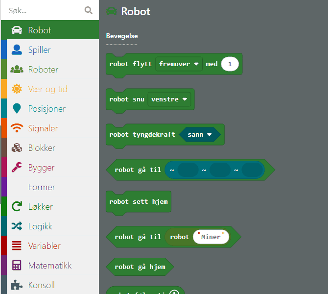
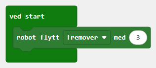

# Introduksjon {.intro}

I Halison Code har du en liten robot i Minecraft-verdenen din. Roboten gjør bare
det du forteller den. I denne oppgaven skal du lage roboten, åpne editoren og
skrive ditt første program. Programmet får roboten til å gå, snu seg og si hei.

<!-- BILDE: Roboten står på gresset i en flat verden og sier "Hei!" i en
snakkeboble. -->


# Steg 1: Lag roboten {.activity}

Først trenger vi en verden og en robot.

## Sjekkliste {.check}

- [ ] Start Minecraft med Halison Code, og åpne en verden i `Kreativ` modus. En
  flat verden er fin, da står ingenting i veien.

- [ ] Trykk `T` for å åpne chatten. Skriv `/robot spawn` og trykk Enter.

- [ ] Roboten dukker opp ved føttene dine. Den ser samme vei som deg.

<!-- BILDE: Chatten med /robot spawn skrevet inn, og roboten ved føttene til
spilleren. -->

## Tips {.tip}

Skriver du `/robot spawn` en gang til, flytter roboten seg til deg. Det er
nyttig hvis den har gått langt bort.


# Steg 2: Åpne editoren {.activity}

Programmene skriver du i nettleseren, i Halison Code-editoren.

## Sjekkliste {.check}

- [ ] Trykk `T` igjen, skriv `/halisoncode` og trykk Enter. Nettleseren åpner
  editoren.

- [ ] Trykk på `Nytt prosjekt` og gi prosjektet et navn, for eksempel `Første
  program`.

- [ ] Til venstre ser du simulatoren med `Kjør`-knappen under. I midten er
  kategoriene med blokker. Til høyre er arbeidsflaten der du bygger programmet.



## Tips {.protip}

Plasser vinduene slik at du ser både Minecraft og nettleseren. Da ser du hva
roboten gjør mens programmet kjører.


# Steg 3: Få roboten til å gå {.activity}

Robotblokkene ligger i kategorien `Robot`, som er grønn.

## Sjekkliste {.check}

- [ ] Klikk på `Robot`. Dra blokken `robot flytt fremover med 1` ut på
  arbeidsflaten, og legg den inni `ved start`.

- [ ] Klikk på tallet `1` og skriv `3`.



## Test prosjektet {.flag}

__Trykk på `Kjør`-knappen under simulatoren.__

- [ ] Se i Minecraft. Går roboten 3 blokker fremover?

- [ ] Prøv å endre `fremover` til `opp`, `bakover` eller `venstre`. Hva skjer
  nå?

## Tips {.tip}

Retningene er fra robotens side. `Venstre` er robotens venstre, ikke ditt.


# Steg 4: Snu og snakk {.activity}

Et program er en liste med kommandoer. Roboten gjør dem én etter én, ovenfra og
ned.

## Sjekkliste {.check}

- [ ] Dra `robot snu venstre` inn under flytt-blokken. Endre `venstre` til
  `høyre`.

- [ ] Legg til en `robot flytt fremover med 2` under snu-blokken.

- [ ] Til slutt: dra `robot si` inn nederst, og skriv `Hei!` i feltet.


## Test prosjektet {.flag}

__Trykk på `Kjør`.__

- [ ] Roboten går 3 blokker, snur seg mot høyre, går 2 blokker og sier `Hei!`.

- [ ] Hva skjer hvis du bytter rekkefølgen på blokkene?


# Steg 5: Gå i en firkant {.activity}

Kan du få roboten til å gå rundt en firkant og komme tilbake dit den startet?

## Sjekkliste {.check}

- [ ] Lag et program med fire `robot flytt fremover med 3` og fire `robot snu
  venstre`, annenhver.

- [ ] Kjør programmet. Står roboten der den startet, og ser den samme vei?

## Tips {.protip}

Programmet blir langt, og du skriver det samme fire ganger. I neste oppgave
lærer du en lurere måte: en løkke.


# Programmet i JavaScript {.activity}

Øverst i editoren kan du bytte fra `Blokker` til `JavaScript`. Da ser du det
samme programmet skrevet som tekst:

```javascript
agent.move(SixDirection.Forward, 3)
agent.turn(TurnDirection.Right)
agent.move(SixDirection.Forward, 2)
agent.say("Hei!")
```

`agent` er roboten din. Bytt tilbake til `Blokker` for å fortsette med blokker.

## Utfordring {.challenge}

- [ ] Få roboten til å gå en trekant eller en sikksakk.

- [ ] Få roboten til å fly opp 5 blokker, si noe og komme ned igjen.

- [ ] Hvis du stopper et program midt i, trykker du på stoppknappen i editoren
  eller skriver `/robot stop` i chatten. Prøv begge.
