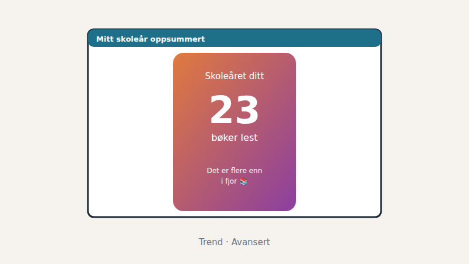

# Introduksjon {.intro}

Strømmetjenester lager en oppsummering av året ditt i fargerike lysbilder: mest
spilt, flest minutter, din topp fem. Nå lager du din egen, om skoleåret,
treningsåret eller sommeren, ut fra tall du legger inn selv. Denne appen bygger
du i flere runder. Start lite, og legg til én ting om gangen.



## Før du starter {.tip}

Gjør [Din første app fra chatten](../forste_app/forste_app) først. Har du ikke
gitt KI-en beskrivelsen av KIT Apps i chatten du bruker, gjør du steg 3 der
først.


# Steg 1: Lag appen {.activity}

## Sjekkliste {.check}

- [ ] Lim inn denne prompten i chatten. Endre den gjerne, så appen blir din:

  ```
  Lag en årsoppsummering for KIT Apps i fullskjerm, som lysbilder i
  høyformat med sterke farger og store tall. Først et skjema der jeg
  legger inn tall og lister selv, for eksempel antall bøker lest, timer
  trening, favorittfag og topp fem sanger. Så vises lysbildene ett om
  gangen, med en animasjon når tallene dukker opp. Trykk for neste
  lysbilde. Norsk tekst.
  ```

- [ ] Be om ett tillegg om gangen: «Lag et siste lysbilde som samler alt på ett
  kort», «Lag en knapp som laster ned det siste kortet som et bilde», og «Husk
  tallene, så jeg kan endre dem senere».

- [ ] Kopier koden. Trykk **New** i KIT Apps, skriv et navn i **App Name**, lim
  inn koden og trykk **Run App**. Appen lagres av seg selv.

- [ ] Virker den ikke? Trykk **Copy a fix request for your AI** og lim det inn i
  chatten.

- [ ] Får du en ny versjon fra KI-en, trykker du **Edit**, bytter ut all koden
  og trykker **Save Changes**.

## Tenk deg om {.tip}

Legg bare inn tall om deg selv. Tenk deg om før du deler: Står det noe der du
ikke vil at alle skal se om ett år?


# Steg 2: Test appen {.activity}

## Test prosjektet {.flag}

| Test | Dette skal skje |
|---|---|
| Fyll ut skjemaet | Alle tallene vises på lysbildene |
| La et felt stå tomt | Lysbildet hoppes over eller viser noe fornuftig |
| Se på mobilvisning | Lysbildene fyller skjermen |

- [ ] Gjør alle testene. Rett det som ikke virker, én ting om gangen.

- [ ] La en annen prøve appen uten at du forklarer noe.


# Steg 3: Bygg videre {.activity}

Velg det du vil ha, og be om én ting om gangen. Be alltid om hele filen på nytt,
og test igjen etter hver endring.

- **Tema:**

  ```
  La meg velge fargetema.
  ```

- **Sammenligning:**

  ```
  Vis hvordan tallene har endret seg fra i fjor.
  ```

## Lagre {.save}

Appen ligger i lista i KIT Apps. Vil du ha den som eget program, se [Gjør den
til en ferdig app](../ferdig_app/ferdig_app).


## Utfordring {.challenge}

Lag en versjon for klassen, med tall dere har samlet sammen, uten navn.
