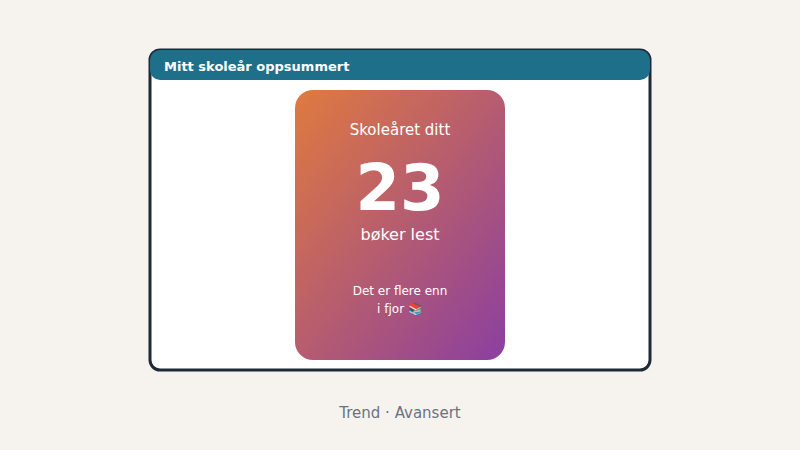

# Introduksjon {.intro}

Strøymetenester lagar ei oppsummering av året ditt i fargerike lysbilete: mest
spelt, flest minutt, din topp fem. No lagar du di eiga, om skuleåret,
treningsåret eller sommaren, ut frå tal du legg inn sjølv. Denne appen byggjer
du i fleire rundar. Start smått, og legg til éin ting om gongen.



## Før du startar {.tip}

Gjer [Din første app frå chatten](../forste_app/forste_app_nn) først. Har
du ikkje gitt KI-en skildringa av KIT Apps i chatten du brukar, gjer du steg 3
der først.


# Steg 1: Lag appen {.activity}

## Sjekkliste {.check}

- [ ] Lim inn denne prompten i chatten. Endre han gjerne, så appen blir din:

  ```
  Lag ei årsoppsummering for KIT Apps i fullskjerm, som lysbilete i
  høgformat med sterke fargar og store tal. Først eit skjema der eg legg
  inn tal og lister sjølv, til dømes talet på bøker eg har lese, timar
  trening, favorittfag og topp fem songar. Så blir lysbileta viste eitt
  om gongen, med ein animasjon når tala dukkar opp. Trykk for neste
  lysbilete. Nynorsk tekst.
  ```

- [ ] Be om eitt tillegg om gongen: «Lag eit siste lysbilete som samlar alt på
  eitt kort», «Lag ein knapp som lastar ned det siste kortet som eit bilete», og
  «Hugs tala, så eg kan endre dei seinare».

- [ ] Kopier koden. Trykk **New** i KIT Apps, skriv eit namn i **App Name**, lim
  inn koden og trykk **Run App**. Appen blir lagra av seg sjølv.

- [ ] Verkar han ikkje? Trykk **Copy a fix request for your AI** og lim det inn
  i chatten.

- [ ] Får du ein ny versjon frå KI-en, trykkjer du **Edit**, byter ut all koden
  og trykkjer **Save Changes**.

## Tenk deg om {.tip}

Legg berre inn tal om deg sjølv. Tenk deg om før du deler: Står det noko der du
ikkje vil at alle skal sjå om eitt år?


# Steg 2: Test appen {.activity}

## Test prosjektet {.flag}

| Test | Dette skal skje |
|---|---|
| Fyll ut skjemaet | Alle tala blir viste på lysbileta |
| La eit felt stå tomt | Lysbiletet blir hoppa over eller viser noko fornuftig |
| Sjå på mobilvising | Lysbileta fyller skjermen |

- [ ] Gjer alle testane. Rett det som ikkje verkar, éin ting om gongen.

- [ ] La ein annan prøve appen utan at du forklarer noko.


# Steg 3: Byggj vidare {.activity}

Vel det du vil ha, og be om éin ting om gongen. Be alltid om heile fila på nytt,
og test igjen etter kvar endring.

- **Tema:**

  ```
  La meg velje fargetema.
  ```

- **Samanlikning:**

  ```
  Vis korleis tala har endra seg frå i fjor.
  ```

## Lagre {.save}

Appen ligg i lista i KIT Apps. Vil du ha han som eige program, sjå [Gjer han til
ein ferdig app](../ferdig_app/ferdig_app_nn).


## Utfordring {.challenge}

Lag ein versjon for klassen, med tal de har samla saman, utan namn.
