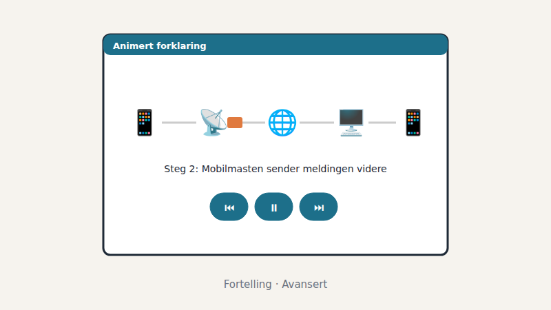

# Introduksjon {.intro}

En animasjon som viser hvordan noe virker, steg for steg: hvordan en melding går
over internett, hvordan et hjerte pumper blod, eller hvordan et lån vokser med
renter. Seeren kan spille av, pause og gå et steg tilbake. Denne appen bygger du
i flere runder. Start lite, og legg til én ting om gangen.



## Før du starter {.tip}

Gjør [Din første app fra chatten](../forste_app/forste_app) først. Har du ikke
gitt KI-en beskrivelsen av KIT Apps i chatten du bruker, gjør du steg 3 der
først.


# Steg 1: Lag appen {.activity}

## Sjekkliste {.check}

- [ ] Lim inn denne prompten i chatten. Endre den gjerne, så appen blir din:

  ```
  Lag en animert forklaring for KIT Apps om hvordan en melding fra
  mobilen din kommer fram til en venn: mobil, mobilmast, internett,
  server, vennens mobil. Vis det som en tegning der meldingen beveger
  seg mellom stedene. Del det i fem steg med en kort tekst for hvert.
  Knapper for spill av, pause, forrige og neste steg. Norsk tekst.
  ```

- [ ] Velg et tema fra et fag, og skriv stegene og tekstene selv før du ber
  KI-en lage animasjonen. Sjekk at forklaringen stemmer.

- [ ] Kopier koden. Trykk **New** i KIT Apps, skriv et navn i **App Name**, lim
  inn koden og trykk **Run App**. Appen lagres av seg selv.

- [ ] Virker den ikke? Trykk **Copy a fix request for your AI** og lim det inn i
  chatten.

- [ ] Får du en ny versjon fra KI-en, trykker du **Edit**, bytter ut all koden
  og trykker **Save Changes**.


# Steg 2: Test appen {.activity}

## Test prosjektet {.flag}

| Test | Dette skal skje |
|---|---|
| Trykk spill av | Animasjonen går gjennom alle stegene |
| Trykk pause midt i | Animasjonen stopper der den er |
| Trykk forrige | Forrige steg vises igjen |

- [ ] Gjør alle testene. Rett det som ikke virker, én ting om gangen.

- [ ] La en annen prøve appen uten at du forklarer noe.


# Steg 3: Bygg videre {.activity}

Velg det du vil ha, og be om én ting om gangen. Be alltid om hele filen på nytt,
og test igjen etter hver endring.

- **Fart:**

  ```
  La meg velge hvor fort animasjonen går.
  ```

- **Spørsmål:**

  ```
  Still et spørsmål etter hvert steg, før neste steg starter.
  ```

## Lagre {.save}

Appen ligger i lista i KIT Apps. Vil du ha den som eget program, se [Gjør den
til en ferdig app](../ferdig_app/ferdig_app).


## Utfordring {.challenge}

Bruk animasjonen når du forklarer temaet for klassen. Hvilket steg måtte du
forklare mest?
