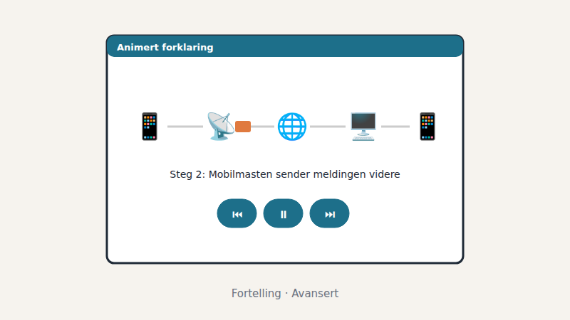

# Introduksjon {.intro}

Ein animasjon som viser korleis noko verkar, steg for steg: korleis ei melding
går over internett, korleis eit hjarte pumpar blod, eller korleis eit lån veks
med renter. Sjåaren kan spele av, pause og gå eitt steg tilbake. Denne appen
byggjer du i fleire rundar. Start lite, og legg til éin ting om gongen.



## Før du startar {.tip}

Gjer [Din første app frå chatten](../forste_app/forste_app_nn) først. Har du
ikkje gitt KI-en skildringa av KIT Apps i chatten du bruker, gjer du steg 3 der
først.


# Steg 1: Lag appen {.activity}

## Sjekkliste {.check}

- [ ] Lim inn denne prompten i chatten. Endre han gjerne, så appen blir din:

  ```
  Lag ei animert forklaring for KIT Apps om korleis ei melding frå
  mobilen din kjem fram til ein ven: mobil, mobilmast, internett,
  server, mobilen til venen. Vis det som ei teikning der meldinga
  flyttar seg mellom stadene. Del det i fem steg med ein kort tekst for
  kvart. Knappar for spel av, pause, førre og neste steg. Nynorsk tekst.
  ```

- [ ] Vel eit tema frå eit fag, og skriv stega og tekstane sjølv før du ber
  KI-en lage animasjonen. Sjekk at forklaringa stemmer.

- [ ] Kopier koden. Trykk **New** i KIT Apps, skriv eit namn i **App Name**, lim
  inn koden og trykk **Run App**. Appen blir lagra av seg sjølv.

- [ ] Verkar han ikkje? Trykk **Copy a fix request for your AI** og lim det inn
  i chatten.

- [ ] Får du ein ny versjon frå KI-en, trykkjer du **Edit**, byter ut all koden
  og trykkjer **Save Changes**.


# Steg 2: Test appen {.activity}

## Test prosjektet {.flag}

| Test | Dette skal skje |
|---|---|
| Trykk spel av | Animasjonen går gjennom alle stega |
| Trykk pause midt i | Animasjonen stoppar der han er |
| Trykk førre | Førre steg blir vist igjen |

- [ ] Gjer alle testane. Rett det som ikkje verkar, éin ting om gongen.

- [ ] La ein annan prøve appen utan at du forklarer noko.


# Steg 3: Bygg vidare {.activity}

Vel det du vil ha, og be om éin ting om gongen. Be alltid om heile fila på nytt,
og test igjen etter kvar endring.

- **Fart:**

  ```
  La meg velje kor fort animasjonen går.
  ```

- **Spørsmål:**

  ```
  Still eit spørsmål etter kvart steg, før neste steg startar.
  ```

## Lagre {.save}

Appen ligg i lista i KIT Apps. Vil du ha han som eige program, sjå [Gjer han til
ein ferdig app](../ferdig_app/ferdig_app_nn).


## Utfordring {.challenge}

Bruk animasjonen når du forklarer temaet for klassen. Kva steg måtte du forklare
mest?
