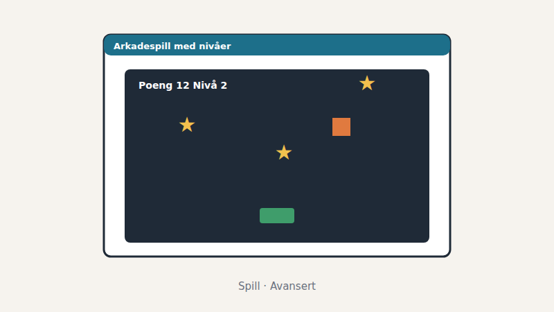

# Introduksjon {.intro}

Et spill der du styrer en figur med piltastene og fanger stjerner mens
hindringer faller ned. Du bygger det i runder: først styring, så poeng, så
nivåer og rekord. Denne appen bygger du i flere runder. Start lite, og legg til
én ting om gangen.



## Før du starter {.tip}

Gjør [Din første app fra chatten](../forste_app/forste_app) først. Har du ikke
gitt KI-en beskrivelsen av KIT Apps i chatten du bruker, gjør du steg 3 der
først.


# Steg 1: Lag appen {.activity}

## Sjekkliste {.check}

- [ ] Lim inn denne prompten i chatten. Endre den gjerne, så appen blir din:

  ```
  Lag et spill for KIT Apps på et canvas. Spilleren er en firkant
  nederst som styres med piltastene til venstre og høyre. Stjerner
  faller ned og gir ett poeng når spilleren fanger dem. Bare dette i
  første versjon. Norsk tekst.
  ```

- [ ] Når det virker, ber du om ett tillegg om gangen: «Legg til hindringer som
  avslutter spillet», «Gjør det raskere for hvert tiende poeng og vis nivået»,
  «Husk rekorden», og «Legg til en startskjerm og en Game over-skjerm».

- [ ] Kopier koden, trykk **New** i KIT Apps, lim inn og trykk **Run App**.

- [ ] Virker den ikke? Trykk **Copy a fix request for your AI** og lim det inn i
  chatten.

- [ ] Trykk **Save** når appen virker.


# Steg 2: Test appen {.activity}

## Test prosjektet {.flag}

| Test | Dette skal skje |
|---|---|
| Hold inne piltast | Spilleren stopper ved kanten |
| Fang en stjerne | Poengene øker med 1 |
| Treff en hindring | Spillet stopper og viser poeng |
| Slå rekorden | Ny rekord vises og huskes |

- [ ] Gjør alle testene. Rett det som ikke virker, én ting om gangen.

- [ ] La en annen prøve appen uten at du forklarer noe.


# Steg 3: Bygg videre {.activity}

Velg det du vil ha, og be om én ting om gangen. Be alltid om hele filen på nytt,
og test igjen etter hver endring.

- **Lyd:**

  ```
  Legg til en kort lyd når en stjerne fanges. Lyden skal kunne slås av.
  ```

- **Mobil:**

  ```
  Legg til knapper på skjermen, så spillet kan styres uten tastatur.
  ```

## Lagre {.save}

Trykk **Save** i KIT Apps. Vil du ha appen som eget program, se [Gjør den til
en ferdig app](../ferdig_app/ferdig_app).


## Utfordring {.challenge}

Lag en egen idé til et spill. Beskriv den med tre setninger: hva spilleren gjør,
hva som gir poeng, og hvordan spillet slutter. Bygg den i runder.
