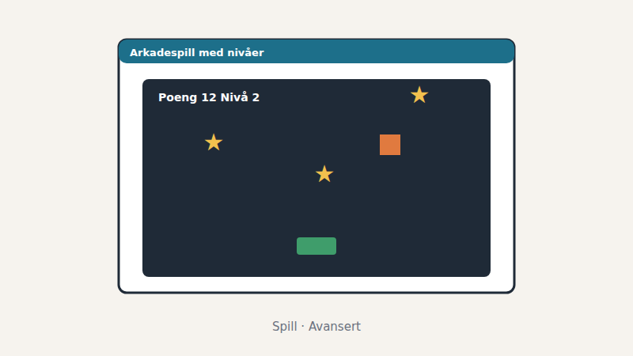

# Introduksjon {.intro}

Eit spel der du styrer ein figur med piltastane og fangar stjerner medan
hindringar fell ned. Du byggjer det i rundar: først styring, så poeng, så nivå
og rekord. Denne appen byggjer du i fleire rundar. Start smått, og legg til éin
ting om gongen.



## Før du startar {.tip}

Gjer [Din første app frå chatten](../forste_app/forste_app_nn) først. Har du
ikkje gitt KI-en skildringa av KIT Apps i chatten du bruker, gjer du steg 3 der
først.


# Steg 1: Lag appen {.activity}

## Sjekkliste {.check}

- [ ] Lim inn denne prompten i chatten. Endre han gjerne, så appen blir din:

  ```
  Lag eit spel for KIT Apps på eit canvas. Spelaren er ein firkant nedst
  som blir styrt med piltastane til venstre og høgre. Stjerner fell ned
  og gir eitt poeng når spelaren fangar dei. Berre dette i første
  versjon. Nynorsk tekst.
  ```

- [ ] Når det verkar, ber du om eitt tillegg om gongen: «Legg til hindringar som
  avsluttar spelet», «Gjer det raskare for kvart tiande poeng og vis nivået»,
  «Hugs rekorden», og «Legg til ein startskjerm og ein Game over-skjerm».

- [ ] Kopier koden. Trykk **New** i KIT Apps, skriv eit namn i **App Name**, lim
  inn koden og trykk **Run App**. Appen blir lagra av seg sjølv.

- [ ] Verkar han ikkje? Trykk **Copy a fix request for your AI** og lim det inn
  i chatten.

- [ ] Får du ein ny versjon frå KI-en, trykkjer du **Edit**, byter ut all koden
  og trykkjer **Save Changes**.


# Steg 2: Test appen {.activity}

## Test prosjektet {.flag}

| Test | Dette skal skje |
|---|---|
| Hald inne piltast | Spelaren stoppar ved kanten |
| Fang ei stjerne | Poenga aukar med 1 |
| Treff ei hindring | Spelet stoppar og viser poeng |
| Slå rekorden | Ny rekord blir vist og hugsa |

- [ ] Gjer alle testane. Rett det som ikkje verkar, éin ting om gongen.

- [ ] La ein annan prøve appen utan at du forklarer noko.


# Steg 3: Byggj vidare {.activity}

Vel det du vil ha, og be om éin ting om gongen. Be alltid om heile fila på nytt,
og test igjen etter kvar endring.

- **Lyd:**

  ```
  Legg til ein kort lyd når ei stjerne blir fanga. Lyden skal kunne
  slåast av.
  ```

- **Mobil:**

  ```
  Legg til knappar på skjermen, så spelet kan styrast utan tastatur.
  ```

## Lagre {.save}

Appen ligg i lista i KIT Apps. Vil du ha han som eige program, sjå [Gjer han
til ein ferdig app](../ferdig_app/ferdig_app_nn).


## Utfordring {.challenge}

Lag ein eigen idé til eit spel. Beskriv han med tre setningar: kva spelaren
gjer, kva som gir poeng, og korleis spelet sluttar. Byggj han i rundar.
