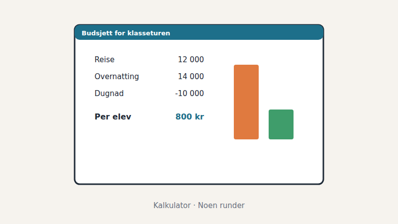

# Introduksjon {.intro}

Klassen skal på tur. Hva koster det, hvor mye må hver elev betale, og hvor mye
kan dere tjene på dugnad? En kalkulator gjør det lett å prøve ulike planer.
Denne appen lager du med én prompt og noen runder med forbedringer.



## Før du starter {.tip}

Gjør [Din første app fra chatten](../forste_app/forste_app) først. Har du ikke
gitt KI-en beskrivelsen av KIT Apps i chatten du bruker, gjør du steg 3 der
først.


# Steg 1: Lag appen {.activity}

## Sjekkliste {.check}

- [ ] Lim inn denne prompten i chatten. Endre den gjerne, så appen blir din:

  ```
  Lag en budsjettkalkulator for en klassetur for KIT Apps. Jeg skal
  kunne legge inn utgifter (reise, overnatting, mat, aktiviteter) og
  inntekter (dugnad, støtte). Vis hva hver elev må betale, med antall
  elever som et felt. Vis utgifter og inntekter i et enkelt diagram.
  Husk tallene. Norsk tekst og kroner.
  ```

- [ ] Kopier koden, trykk **New** i KIT Apps, lim inn og trykk **Run App**.

- [ ] Virker den ikke? Trykk **Copy a fix request for your AI** og lim det inn i
  chatten.

- [ ] Trykk **Save** når appen virker.


# Steg 2: Test appen {.activity}

## Test prosjektet {.flag}

| Test | Dette skal skje |
|---|---|
| Utgifter 30 000, inntekter 10 000, 20 elever | 1 000 kr per elev |
| Sett antall elever til 0 | Appen sier fra, i stedet for å dele på null |
| Lukk og åpne | Tallene er der fortsatt |

- [ ] Gjør alle testene. Rett det som ikke virker, én ting om gangen.

- [ ] La en annen prøve appen uten at du forklarer noe.


# Steg 3: Bygg videre {.activity}

Velg det du vil ha, og be om én ting om gangen. Be alltid om hele filen på nytt,
og test igjen etter hver endring.

- **Dugnad:**

  ```
  Legg til en dugnadskalkulator: hvor mange dorullpakker må vi selge,
  med fortjeneste per pakke?
  ```

- **Sammenlign:**

  ```
  La meg lagre to planer og sammenligne dem.
  ```

## Lagre {.save}

Trykk **Save** i KIT Apps. Vil du ha appen som eget program, se [Gjør den til
en ferdig app](../ferdig_app/ferdig_app).


## Utfordring {.challenge}

Regn ut én plan for hånd eller i et regneark. Stemmer det med appen?
