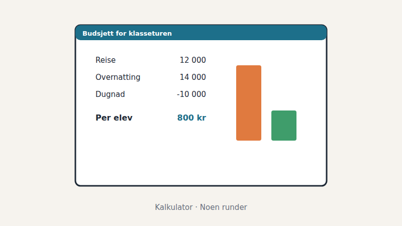

# Introduksjon {.intro}

Klassen skal på tur. Kva kostar det, kor mykje må kvar elev betale, og kor mykje
kan de tene på dugnad? Ein kalkulator gjer det lett å prøve ulike planar. Denne
appen lagar du med éin prompt og nokre rundar med forbetringar.



## Før du startar {.tip}

Gjer [Din første app frå chatten](../forste_app/forste_app_nn) først. Har du
ikkje gitt KI-en skildringa av KIT Apps i chatten du bruker, gjer du steg 3 der
først.


# Steg 1: Lag appen {.activity}

## Sjekkliste {.check}

- [ ] Lim inn denne prompten i chatten. Endre han gjerne, så appen blir din:

  ```
  Lag ein budsjettkalkulator for ein klassetur for KIT Apps. Eg skal
  kunne leggje inn utgifter (reise, overnatting, mat, aktivitetar) og
  inntekter (dugnad, støtte). Vis kva kvar elev må betale, med talet på
  elevar som eit felt. Vis utgifter og inntekter i eit enkelt diagram.
  Hugs tala. Nynorsk tekst og kroner.
  ```

- [ ] Kopier koden. Trykk **New** i KIT Apps, skriv eit namn i **App Name**, lim
  inn koden og trykk **Run App**. Appen blir lagra av seg sjølv.

- [ ] Verkar han ikkje? Trykk **Copy a fix request for your AI** og lim det inn
  i chatten.

- [ ] Får du ein ny versjon frå KI-en, trykkjer du **Edit**, byter ut all koden
  og trykkjer **Save Changes**.


# Steg 2: Test appen {.activity}

## Test prosjektet {.flag}

| Test | Dette skal skje |
|---|---|
| Utgifter 30 000, inntekter 10 000, 20 elevar | 1 000 kr per elev |
| Set talet på elevar til 0 | Appen seier frå, i staden for å dele på null |
| Lukk og opne | Tala er der framleis |

- [ ] Gjer alle testane. Rett det som ikkje verkar, éin ting om gongen.

- [ ] La ein annan prøve appen utan at du forklarer noko.


# Steg 3: Byggj vidare {.activity}

Vel det du vil ha, og be om éin ting om gongen. Be alltid om heile fila på nytt,
og test igjen etter kvar endring.

- **Dugnad:**

  ```
  Legg til ein dugnadskalkulator: kor mange dorullpakkar må vi selje,
  med forteneste per pakke?
  ```

- **Samanlikn:**

  ```
  La meg lagre to planar og samanlikne dei.
  ```

## Lagre {.save}

Appen ligg i lista i KIT Apps. Vil du ha han som eige program, sjå [Gjer han
til ein ferdig app](../ferdig_app/ferdig_app_nn).


## Utfordring {.challenge}

Rekn ut éin plan for hand eller i eit rekneark. Stemmer det med appen?
