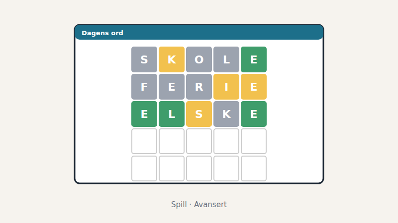

# Introduksjon {.intro}

Et ordspill der du har seks forsøk på å gjette et norsk ord med fem bokstaver.
Etter hvert forsøk viser fargene hvilke bokstaver som er riktige og står riktig.
Alle får samme ord samme dag. Denne appen bygger du i flere runder. Start lite,
og legg til én ting om gangen.



## Før du starter {.tip}

Gjør [Din første app fra chatten](../forste_app/forste_app) først. Har du ikke
gitt KI-en beskrivelsen av KIT Apps i chatten du bruker, gjør du steg 3 der
først.


# Steg 1: Lag appen {.activity}

## Sjekkliste {.check}

- [ ] Lim inn denne prompten i chatten. Endre den gjerne, så appen blir din:

  ```
  Lag et ordspill for KIT Apps. Spilleren skal gjette et norsk ord med
  fem bokstaver på seks forsøk. Etter hvert forsøk: grønn for riktig
  bokstav på riktig plass, gul for riktig bokstav på feil plass, grå for
  bokstav som ikke er med. Lag et tastatur på skjermen med Æ, Ø og Å.
  Bruk en liste med 30 vanlige norske ord. Bare dette i første versjon.
  Norsk tekst.
  ```

- [ ] Når det virker, ber du om ett tillegg om gangen: «Velg ordet ut fra dagens
  dato, så alle får samme ord», «Husk statistikk: spilte, vunnet og streak», og
  «Lag en knapp som kopierer resultatet som fargede ruter uten bokstaver, så det
  kan deles».

- [ ] Kopier koden. Trykk **New** i KIT Apps, skriv et navn i **App Name**, lim
  inn koden og trykk **Run App**. Appen lagres av seg selv.

- [ ] Virker den ikke? Trykk **Copy a fix request for your AI** og lim det inn i
  chatten.

- [ ] Får du en ny versjon fra KI-en, trykker du **Edit**, bytter ut all koden
  og trykker **Save Changes**.


# Steg 2: Test appen {.activity}

## Test prosjektet {.flag}

| Test | Dette skal skje |
|---|---|
| Gjett ordet riktig | Alle ruter blir grønne |
| Gjett et ord med en bokstav to ganger | Fargene er riktige for begge |
| Skriv et ord med fire bokstaver | Appen sier fra |

- [ ] Gjør alle testene. Rett det som ikke virker, én ting om gangen.

- [ ] La en annen prøve appen uten at du forklarer noe.


# Steg 3: Bygg videre {.activity}

Velg det du vil ha, og be om én ting om gangen. Be alltid om hele filen på nytt,
og test igjen etter hver endring.

- **Fagord:**

  ```
  Lag en versjon med ord fra et fag, som naturfagbegreper.
  ```

- **Ordliste:**

  ```
  Godta bare ord som finnes i en lengre liste.
  ```

## Lagre {.save}

Appen ligger i lista i KIT Apps. Vil du ha den som eget program, se [Gjør den
til en ferdig app](../ferdig_app/ferdig_app).


## Utfordring {.challenge}

Bokstaver som finnes to ganger, er vanskelig å få riktig. Lag en test med ordet
«KAKER» og gjett «KAKAO». Stemmer fargene?
