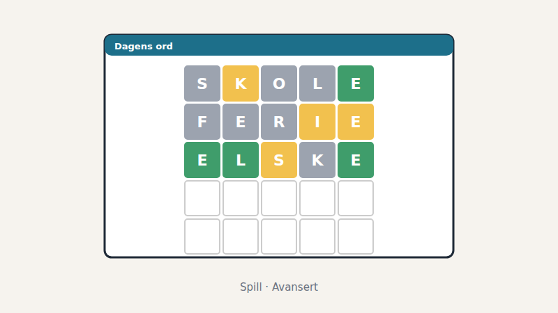

# Introduksjon {.intro}

Eit ordspel der du har seks forsøk på å gjette eit norsk ord med fem bokstavar.
Etter kvart forsøk viser fargane kva bokstavar som er rette og står rett. Alle
får same ord same dag. Denne appen byggjer du i fleire rundar. Start smått, og
legg til éin ting om gongen.



## Før du startar {.tip}

Gjer [Din første app frå chatten](../forste_app/forste_app_nn) først. Har
du ikkje gitt KI-en skildringa av KIT Apps i chatten du brukar, gjer du steg 3
der først.


# Steg 1: Lag appen {.activity}

## Sjekkliste {.check}

- [ ] Lim inn denne prompten i chatten. Endre han gjerne, så appen blir din:

  ```
  Lag eit ordspel for KIT Apps. Spelaren skal gjette eit norsk ord med
  fem bokstavar på seks forsøk. Etter kvart forsøk: grøn for rett
  bokstav på rett plass, gul for rett bokstav på feil plass, grå for
  bokstav som ikkje er med. Lag eit tastatur på skjermen med Æ, Ø og Å.
  Bruk ei liste med 30 vanlege norske ord. Berre dette i første versjon.
  Nynorsk tekst.
  ```

- [ ] Når det verkar, bed du om eitt tillegg om gongen: «Vel ordet ut frå datoen
  i dag, så alle får same ord», «Hugs statistikk: spelte, vunne og streak», og
  «Lag ein knapp som kopierer resultatet som farga ruter utan bokstavar, så det
  kan delast».

- [ ] Kopier koden. Trykk **New** i KIT Apps, skriv eit namn i **App Name**, lim
  inn koden og trykk **Run App**. Appen blir lagra av seg sjølv.

- [ ] Verkar han ikkje? Trykk **Copy a fix request for your AI** og lim det inn
  i chatten.

- [ ] Får du ein ny versjon frå KI-en, trykkjer du **Edit**, byter ut all koden
  og trykkjer **Save Changes**.


# Steg 2: Test appen {.activity}

## Test prosjektet {.flag}

| Test | Dette skal skje |
|---|---|
| Gjett ordet rett | Alle rutene blir grøne |
| Gjett eit ord med ein bokstav to gonger | Fargane er rette for begge |
| Skriv eit ord med fire bokstavar | Appen seier frå |

- [ ] Gjer alle testane. Rett det som ikkje verkar, éin ting om gongen.

- [ ] La ein annan prøve appen utan at du forklarer noko.


# Steg 3: Byggj vidare {.activity}

Vel det du vil ha, og be om éin ting om gongen. Be alltid om heile fila på nytt,
og test igjen etter kvar endring.

- **Fagord:**

  ```
  Lag ein versjon med ord frå eit fag, som omgrep frå naturfag.
  ```

- **Ordliste:**

  ```
  Godta berre ord som finst i ei lengre liste.
  ```

## Lagre {.save}

Appen ligg i lista i KIT Apps. Vil du ha han som eige program, sjå [Gjer han til
ein ferdig app](../ferdig_app/ferdig_app_nn).


## Utfordring {.challenge}

Bokstavar som finst to gonger, er vanskelege å få rett. Lag ein test med ordet
«KAKER» og gjett «KAKAO». Stemmer fargane?
