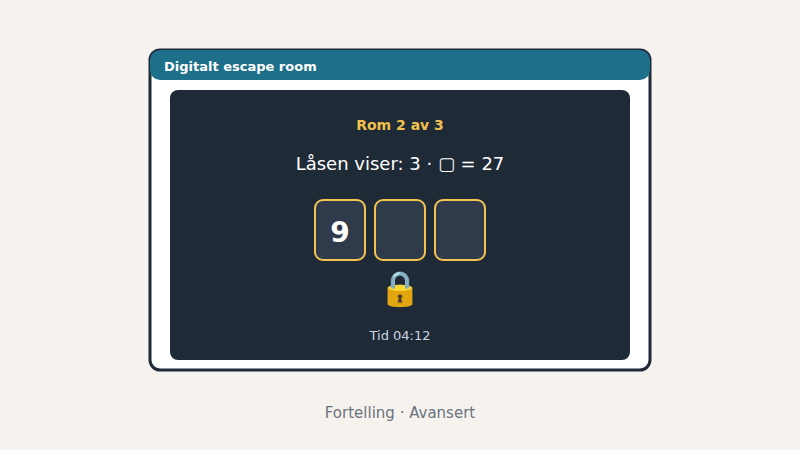

# Introduksjon {.intro}

Et escape room der du må løse oppgaver fra et fag for å finne kodene til låsene.
Hvert rom har en gåte, og svaret låser opp neste rom. Denne appen bygger du i
flere runder. Start lite, og legg til én ting om gangen.



## Før du starter {.tip}

Gjør [Din første app fra chatten](../forste_app/forste_app) først. Har du ikke
gitt KI-en beskrivelsen av KIT Apps i chatten du bruker, gjør du steg 3 der
først.


# Steg 1: Lag appen {.activity}

## Sjekkliste {.check}

- [ ] Lim inn denne prompten i chatten. Endre den gjerne, så appen blir din:

  ```
  Lag et escape room for KIT Apps med tre rom. Hvert rom har en kort
  tekst, en gåte og en lås med en tallkode. Riktig kode åpner neste rom,
  feil kode gir et hint etter tre forsøk. Vis tiden som har gått. Gåtene
  skal ligge i en liste i koden, så jeg lett kan bytte dem ut. Lag
  eksempelgåter med enkel matte. Norsk tekst.
  ```

- [ ] Når det virker, lager du dine egne gåter fra et fag, der svaret blir et
  tall. Så ber du om ett tillegg om gangen: «Lag en historie som binder rommene
  sammen», «Legg til en lås med bokstaver», og «Vis en sluttskjerm med tiden og
  antall hint».

- [ ] Kopier koden. Trykk **New** i KIT Apps, skriv et navn i **App Name**, lim
  inn koden og trykk **Run App**. Appen lagres av seg selv.

- [ ] Virker den ikke? Trykk **Copy a fix request for your AI** og lim det inn i
  chatten.

- [ ] Får du en ny versjon fra KI-en, trykker du **Edit**, bytter ut all koden
  og trykker **Save Changes**.


# Steg 2: Test appen {.activity}

## Test prosjektet {.flag}

| Test | Dette skal skje |
|---|---|
| Skriv riktig kode | Neste rom åpnes |
| Skriv feil kode tre ganger | Et hint vises |
| Løs alle rommene | Sluttskjermen viser tiden |

- [ ] Gjør alle testene. Rett det som ikke virker, én ting om gangen.

- [ ] La en annen prøve appen uten at du forklarer noe.


# Steg 3: Bygg videre {.activity}

Velg det du vil ha, og be om én ting om gangen. Be alltid om hele filen på nytt,
og test igjen etter hver endring.

- **Lagspill:**

  ```
  Vis en toppliste med lagnavn og tid.
  ```

- **Mørkt rom:**

  ```
  La første rom være mørkt, og gi lys når man klikker på riktig sted.
  ```

## Lagre {.save}

Appen ligger i lista i KIT Apps. Vil du ha den som eget program, se [Gjør den
til en ferdig app](../ferdig_app/ferdig_app).


## Utfordring {.challenge}

La en annen gruppe prøve escape roomet. Var gåtene for lette eller for
vanskelige? Juster dem.
