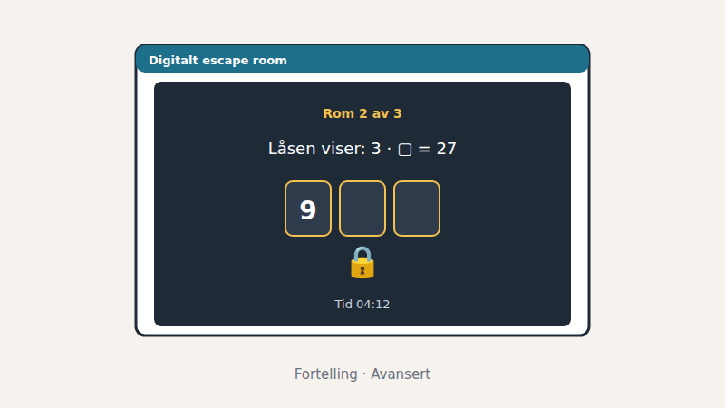

# Introduksjon {.intro}

Eit escape room der du må løyse oppgåver frå eit fag for å finne kodane til
låsane. Kvart rom har ei gåte, og svaret låser opp neste rom. Denne appen
byggjer du i fleire rundar. Start lite, og legg til éin ting om gongen.



## Før du startar {.tip}

Gjer [Din første app frå chatten](../forste_app/forste_app_nn) først. Har du
ikkje gitt KI-en skildringa av KIT Apps i chatten du bruker, gjer du steg 3 der
først.


# Steg 1: Lag appen {.activity}

## Sjekkliste {.check}

- [ ] Lim inn denne prompten i chatten. Endre han gjerne, så appen blir din:

  ```
  Lag eit escape room for KIT Apps med tre rom. Kvart rom har ein kort
  tekst, ei gåte og ein lås med ein talkode. Rett kode opnar neste rom,
  feil kode gir eit hint etter tre forsøk. Vis tida som har gått. Gåtene
  skal liggje i ei liste i koden, så eg lett kan byte dei ut. Lag
  eksempelgåter med enkel matte. Nynorsk tekst.
  ```

- [ ] Når det verkar, lagar du dine eigne gåter frå eit fag, der svaret blir eit
  tal. Så ber du om eitt tillegg om gongen: «Lag ei historie som bind romma
  saman», «Legg til ein lås med bokstavar», og «Vis ein sluttskjerm med tida og
  talet på hint».

- [ ] Kopier koden. Trykk **New** i KIT Apps, skriv eit namn i **App Name**, lim
  inn koden og trykk **Run App**. Appen blir lagra av seg sjølv.

- [ ] Verkar han ikkje? Trykk **Copy a fix request for your AI** og lim det inn
  i chatten.

- [ ] Får du ein ny versjon frå KI-en, trykkjer du **Edit**, byter ut all koden
  og trykkjer **Save Changes**.


# Steg 2: Test appen {.activity}

## Test prosjektet {.flag}

| Test | Dette skal skje |
|---|---|
| Skriv rett kode | Neste rom blir opna |
| Skriv feil kode tre gonger | Eit hint blir vist |
| Løys alle romma | Sluttskjermen viser tida |

- [ ] Gjer alle testane. Rett det som ikkje verkar, éin ting om gongen.

- [ ] La ein annan prøve appen utan at du forklarer noko.


# Steg 3: Bygg vidare {.activity}

Vel det du vil ha, og be om éin ting om gongen. Be alltid om heile fila på nytt,
og test igjen etter kvar endring.

- **Lagspel:**

  ```
  Vis ei toppliste med lagnamn og tid.
  ```

- **Mørkt rom:**

  ```
  La første rom vere mørkt, og gi lys når ein klikkar på rett stad.
  ```

## Lagre {.save}

Appen ligg i lista i KIT Apps. Vil du ha han som eige program, sjå [Gjer han til
ein ferdig app](../ferdig_app/ferdig_app_nn).


## Utfordring {.challenge}

La ei anna gruppe prøve escape roomet. Var gåtene for lette eller for
vanskelege? Juster dei.
