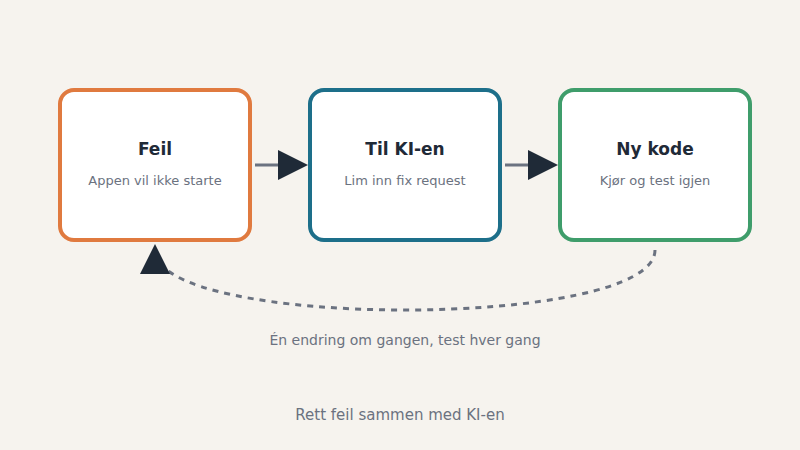

# Introduksjon {.intro}

Den første versjonen er sjelden helt riktig. I denne oppgaven lærer du å be om
én endring om gangen, å rette feil sammen med KI-en, og å teste at alt fortsatt
virker etterpå.



## Før du starter {.tip}

Du trenger appen fra [Din første app fra chatten](../forste_app/forste_app), og
den samme chatten du brukte da.


# Steg 1: Én endring om gangen {.activity}

## Sjekkliste {.check}

- [ ] Velg én ting du vil endre, for eksempel det som ikke virket i forrige
  oppgave.

- [ ] Beskriv hva du **ser**, og hva du **vil** ha:

  ```
  Når jeg skriver bokstaver i poengfeltet, blir tabellen tom. Jeg vil at
  appen skal si «Skriv et tall» i stedet. Gi meg hele filen på nytt.
  ```

- [ ] Kopier den nye koden. Trykk **Edit code** i KIT Apps, bytt ut alt med den
  nye koden, og kjør den.

## Tips {.protip}

Be alltid om **hele filen på nytt**. KIT Apps bytter ut hele appen, så små
biter av kode virker ikke.


# Steg 2: Når appen ikke vil starte {.activity}

Av og til lager KI-en kode med feil, og da viser KIT Apps en feilmelding i
stedet for appen.

## Sjekkliste {.check}

- [ ] Trykk **Copy a fix request for your AI** på feilskjermen.

- [ ] Lim det inn i chatten. Der står både feilmeldingen og koden din.

- [ ] Kopier svaret inn i KIT Apps og kjør igjen.

- [ ] Virker det ikke etter tre forsøk? Be KI-en forklare feilen med enkle ord,
  og spør om det finnes en enklere måte å gjøre det på.


# Steg 3: Test alt på nytt {.activity}

En endring kan ødelegge noe som virket før.

## Sjekkliste {.check}

- [ ] Lag en liste med det appen skal klare, for eksempel:

  | Test | Dette skal skje |
  |---|---|
  | Legg inn tre lag | Alle tre vises i tabellen |
  | Gi et lag 3 poeng | Laget får 3 poeng mer |
  | Skriv bokstaver i poengfeltet | Appen sier fra |
  | Gjør vinduet smalt | Tabellen er fortsatt lett å lese |

- [ ] Gå gjennom hele lista etter hver endring.

## Test prosjektet {.flag}

- [ ] La en medelev bruke appen uten at du forklarer noe. Hvor stopper de opp?


# Steg 4: Gjør den lett å bruke {.activity}

## Sjekkliste {.check}

- [ ] Be om en sjekk:

  ```
  Gå gjennom appen og foreslå tre ting som gjør den lettere å bruke, også
  for en som ser dårlig eller bare bruker tastatur. Ikke endre noe ennå.
  ```

- [ ] Velg én av forslagene og be KI-en gjøre den. Test igjen.

- [ ] Trykk **Save** når du er fornøyd.

## Prompter du kan lære av {.protip}

Bytt ut det som står i klammer.

- **Forstå appen:**

  ```
  Forklar hvordan appen virker, del for del, som til en som aldri har
  programmert.
  ```

- **Finn feilen før du retter:**

  ```
  Når jeg [gjør dette], skjer [dette], men jeg ventet [dette]. Finn ut
  hvorfor før du endrer noe, og forklar det.
  ```

- **Lær av det:**

  ```
  Hva burde jeg ha skrevet første gang, så du hadde gjort det riktig?
  ```

## Lagre {.save}

Trykk **Save**. Gi gjerne appen et nytt navn med versjon, for eksempel
`Poengtavle 2`, hvis du vil ta vare på den gamle.


## Utfordring {.challenge}

Be KI-en om to ulike design for appen, ett lyst og ett mørkt. Lagre begge og la
tre personer velge. Hvorfor valgte de som de gjorde?
