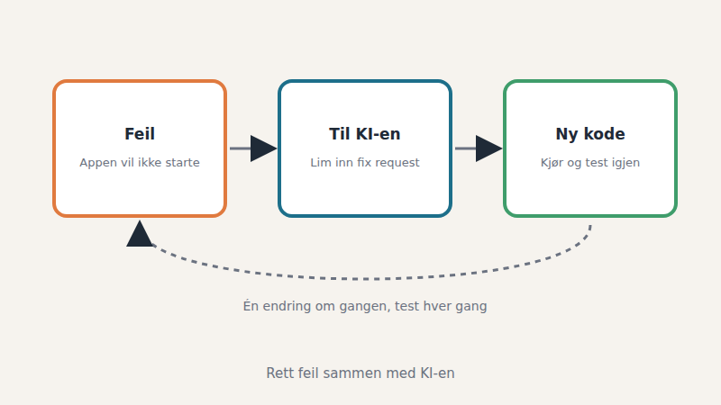

# Introduksjon {.intro}

Den første versjonen er sjeldan heilt rett. I denne oppgåva lærer du å be om
éi endring om gongen, å rette feil saman med KI-en, og å teste at alt framleis
verkar etterpå.



## Før du startar {.tip}

Du treng appen frå [Din første app
frå chatten](../forste_app/forste_app_nn), og den same chatten du brukte då.


# Steg 1: Éi endring om gongen {.activity}

## Sjekkliste {.check}

- [ ] Vel éin ting du vil endre, til dømes det som ikkje verka i førre
  oppgåve.

- [ ] Beskriv kva du **ser**, og kva du **vil** ha:

  ```
  Når eg skriv bokstavar i poengfeltet, blir tabellen tom. Eg vil at
  appen skal seie «Skriv eit tal» i staden. Gi meg heile fila på nytt.
  ```

- [ ] Kopier den nye koden. Trykk **Edit** i KIT Apps, byt ut alt med den nye
  koden, og trykk **Save Changes**.

## Tips {.protip}

Be alltid om **heile fila på nytt**. KIT Apps byter ut heile appen, så små
bitar av kode verkar ikkje.


# Steg 2: Når appen ikkje vil starte {.activity}

Av og til lagar KI-en kode med feil, og då viser KIT Apps ei feilmelding i
staden for appen.

## Sjekkliste {.check}

- [ ] Trykk **Copy a fix request for your AI** på feilskjermen.

- [ ] Lim det inn i chatten. Der står både feilmeldinga og koden din.

- [ ] Lim svaret inn med **Edit** og **Save Changes**, som i steg 1.

- [ ] Verkar det ikkje etter tre forsøk? Be KI-en forklare feilen med enkle
  ord, og spør om det finst ein enklare måte å gjere det på.


# Steg 3: Test alt på nytt {.activity}

Ei endring kan øydeleggje noko som verka før.

## Sjekkliste {.check}

- [ ] Lag ei liste med det appen skal klare, til dømes:

  | Test | Dette skal skje |
  |---|---|
  | Legg inn tre lag | Alle tre blir viste i tabellen |
  | Gi eit lag 3 poeng | Laget får 3 poeng meir |
  | Skriv bokstavar i poengfeltet | Appen seier frå |
  | Gjer vindauget smalt | Tabellen er framleis lett å lese |

- [ ] Gå gjennom heile lista etter kvar endring.

## Test prosjektet {.flag}

- [ ] La ein medelev bruke appen utan at du forklarer noko. Kvar stoppar dei
  opp?


# Steg 4: Gjer han lett å bruke {.activity}

## Sjekkliste {.check}

- [ ] Be om ein sjekk:

  ```
  Gå gjennom appen og foreslå tre ting som gjer han lettare å bruke, òg
  for ein som ser dårleg eller berre bruker tastatur. Ikkje endre noko
  enno.
  ```

- [ ] Vel eitt av forslaga og be KI-en gjere det. Test igjen.

## Promptar du kan lære av {.protip}

Byt ut det som står i klammer.

- **Forstå appen:**

  ```
  Forklar korleis appen verkar, del for del, som til ein som aldri har
  programmert.
  ```

- **Finn feilen før du rettar:**

  ```
  Når eg [gjer dette], skjer [dette], men eg venta [dette]. Finn ut
  kvifor før du endrar noko, og forklar det.
  ```

- **Lær av det:**

  ```
  Kva burde eg ha skrive første gong, så du hadde gjort det rett?
  ```

## Lagre {.save}

Endringane blir lagra når du trykkjer **Save Changes**. Vil du ta vare på ein
versjon som verkar, trykkjer du **Duplicate** under appen i lista før du endrar
han.


## Utfordring {.challenge}

Be KI-en om to ulike design for appen, eitt lyst og eitt mørkt. Lagre begge og
la tre personar velje. Kvifor valde dei som dei gjorde?
