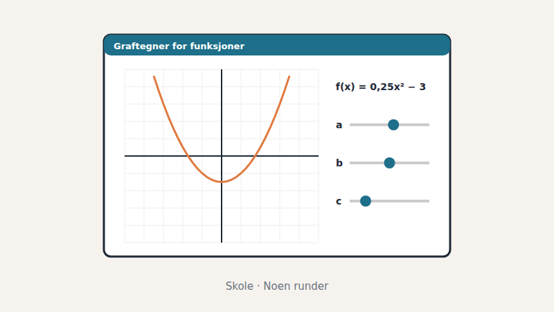

# Introduksjon {.intro}

En app som tegner grafen til en funksjon, med glidebrytere som endrer tallene.
Når du drar i en glidebryter og ser grafen endre seg, skjønner du hva tallene i
formelen betyr. Denne appen lager du med én prompt og noen runder med
forbedringer.



## Før du starter {.tip}

Gjør [Din første app fra chatten](../forste_app/forste_app) først. Har du ikke
gitt KI-en beskrivelsen av KIT Apps i chatten du bruker, gjør du steg 3 der
først.


# Steg 1: Lag appen {.activity}

## Sjekkliste {.check}

- [ ] Lim inn denne prompten i chatten. Endre den gjerne, så appen blir din:

  ```
  Lag en graftegner for KIT Apps for funksjonen f(x) = ax² + bx + c. Lag
  tre glidebrytere for a, b og c fra -5 til 5. Tegn grafen i et
  koordinatsystem med akser og rutenett fra -10 til 10. Vis
  funksjonsuttrykket med tallene. Norsk tekst.
  ```

- [ ] Kopier koden. Trykk **New** i KIT Apps, skriv et navn i **App Name**, lim
  inn koden og trykk **Run App**. Appen lagres av seg selv.

- [ ] Virker den ikke? Trykk **Copy a fix request for your AI** og lim det inn i
  chatten.

- [ ] Får du en ny versjon fra KI-en, trykker du **Edit**, bytter ut all koden
  og trykker **Save Changes**.


# Steg 2: Test appen {.activity}

## Test prosjektet {.flag}

| Test | Dette skal skje |
|---|---|
| Sett a=0, b=1, c=0 | En rett linje gjennom origo |
| Sett a=1, b=0, c=0 | En parabel med bunnpunkt i origo |
| Gjør a negativ | Parabelen snur |

- [ ] Gjør alle testene. Rett det som ikke virker, én ting om gangen.

- [ ] La en annen prøve appen uten at du forklarer noe.


# Steg 3: Bygg videre {.activity}

Velg det du vil ha, og be om én ting om gangen. Be alltid om hele filen på nytt,
og test igjen etter hver endring.

- **Nullpunkter:**

  ```
  Marker nullpunktene og bunn- eller toppunktet, og vis koordinatene.
  ```

- **Flere funksjoner:**

  ```
  La meg velge mellom lineær, andregrads og eksponentialfunksjon.
  ```

## Lagre {.save}

Appen ligger i lista i KIT Apps. Vil du ha den som eget program, se [Gjør den
til en ferdig app](../ferdig_app/ferdig_app).


## Utfordring {.challenge}

Bruk appen til å forklare en medelev hva tallet c gjør med grafen. Hva gjør a?
