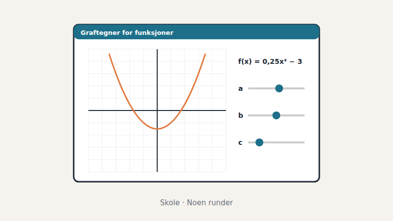

# Introduksjon {.intro}

Ein app som teiknar grafen til ein funksjon, med glidebrytarar som endrar tala.
Når du dreg i ein glidebrytar og ser grafen endre seg, skjønner du kva tala i
formelen tyder. Denne appen lagar du med éin prompt og nokre rundar med
forbetringar.



## Før du startar {.tip}

Gjer [Din første app frå chatten](../forste_app/forste_app_nn) først. Har du
ikkje gitt KI-en skildringa av KIT Apps i chatten du bruker, gjer du steg 3 der
først.


# Steg 1: Lag appen {.activity}

## Sjekkliste {.check}

- [ ] Lim inn denne prompten i chatten. Endre han gjerne, så appen blir din:

  ```
  Lag ein grafteiknar for KIT Apps for funksjonen f(x) = ax² + bx + c.
  Lag tre glidebrytarar for a, b og c frå -5 til 5. Teikn grafen i eit
  koordinatsystem med aksar og rutenett frå -10 til 10. Vis
  funksjonsuttrykket med tala. Nynorsk tekst.
  ```

- [ ] Kopier koden. Trykk **New** i KIT Apps, skriv eit namn i **App Name**, lim
  inn koden og trykk **Run App**. Appen blir lagra av seg sjølv.

- [ ] Verkar han ikkje? Trykk **Copy a fix request for your AI** og lim det inn
  i chatten.

- [ ] Får du ein ny versjon frå KI-en, trykkjer du **Edit**, byter ut all koden
  og trykkjer **Save Changes**.


# Steg 2: Test appen {.activity}

## Test prosjektet {.flag}

| Test | Dette skal skje |
|---|---|
| Set a=0, b=1, c=0 | Ei rett linje gjennom origo |
| Set a=1, b=0, c=0 | Ein parabel med botnpunkt i origo |
| Gjer a negativ | Parabelen snur |

- [ ] Gjer alle testane. Rett det som ikkje verkar, éin ting om gongen.

- [ ] La ein annan prøve appen utan at du forklarer noko.


# Steg 3: Bygg vidare {.activity}

Vel det du vil ha, og be om éin ting om gongen. Be alltid om heile fila på nytt,
og test igjen etter kvar endring.

- **Nullpunkt:**

  ```
  Merk nullpunkta og botn- eller toppunktet, og vis koordinatane.
  ```

- **Fleire funksjonar:**

  ```
  La meg velje mellom lineær, andregrads- og eksponentialfunksjon.
  ```

## Lagre {.save}

Appen ligg i lista i KIT Apps. Vil du ha han som eige program, sjå [Gjer han til
ein ferdig app](../ferdig_app/ferdig_app_nn).


## Utfordring {.challenge}

Bruk appen til å forklare ein medelev kva talet c gjer med grafen. Kva gjer a?
