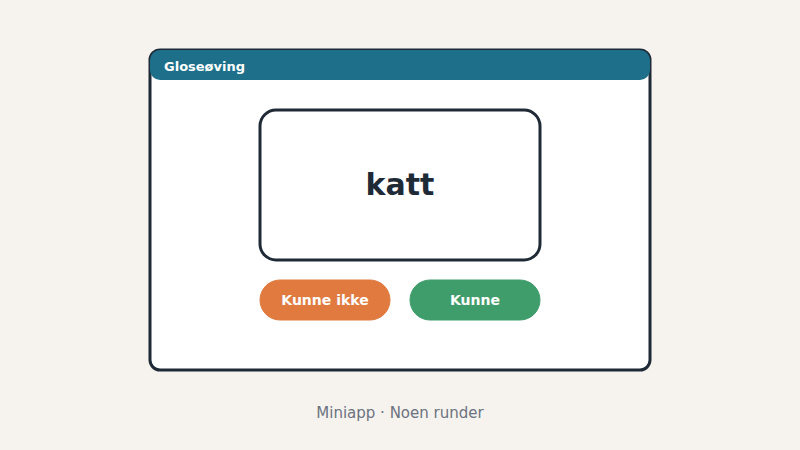

# Introduksjon {.intro}

En app for å øve på gloser med kort som snus. Appen husker hvilke ord du kan, og
spør oftere om dem du ikke kan. Denne appen lager du med én prompt og noen
runder med forbedringer.



## Før du starter {.tip}

Gjør [Din første app fra chatten](../forste_app/forste_app) først. Har du ikke
gitt KI-en beskrivelsen av KIT Apps i chatten du bruker, gjør du steg 3 der
først.


# Steg 1: Lag appen {.activity}

## Sjekkliste {.check}

- [ ] Lim inn denne prompten i chatten. Endre den gjerne, så appen blir din:

  ```
  Lag en app for gloseøving for KIT Apps. Jeg skal kunne legge inn
  ordpar (norsk og engelsk). Vis ett kort om gangen som jeg kan snu. Jeg
  trykker «Kunne» eller «Kunne ikke». Ord jeg ikke kunne, skal komme
  oftere. Husk ordene og hvordan det går til neste gang. Norsk tekst.
  ```

- [ ] Kopier koden, trykk **New** i KIT Apps, lim inn og trykk **Run App**.

- [ ] Virker den ikke? Trykk **Copy a fix request for your AI** og lim det inn i
  chatten.

- [ ] Trykk **Save** når appen virker.


# Steg 2: Test appen {.activity}

## Test prosjektet {.flag}

| Test | Dette skal skje |
|---|---|
| Legg inn fem ordpar | Alle fem kan øves på |
| Svar «Kunne ikke» på ett ord | Det ordet kommer igjen snart |
| Lukk og åpne KIT Apps | Ordene er der fortsatt |

- [ ] Gjør alle testene. Rett det som ikke virker, én ting om gangen.

- [ ] La en annen prøve appen uten at du forklarer noe.


# Steg 3: Bygg videre {.activity}

Velg det du vil ha, og be om én ting om gangen. Be alltid om hele filen på nytt,
og test igjen etter hver endring.

- **Begge veier:**

  ```
  La meg velge om spørsmålet er på norsk eller engelsk.
  ```

- **Lim inn liste:**

  ```
  La meg lime inn en hel liste med ett ordpar per linje.
  ```

## Lagre {.save}

Trykk **Save** i KIT Apps. Vil du ha appen som eget program, se [Gjør den til
en ferdig app](../ferdig_app/ferdig_app).


## Utfordring {.challenge}

Bruk appen til neste gloseprøve. Hvor mange ord kunne du før og etter?
