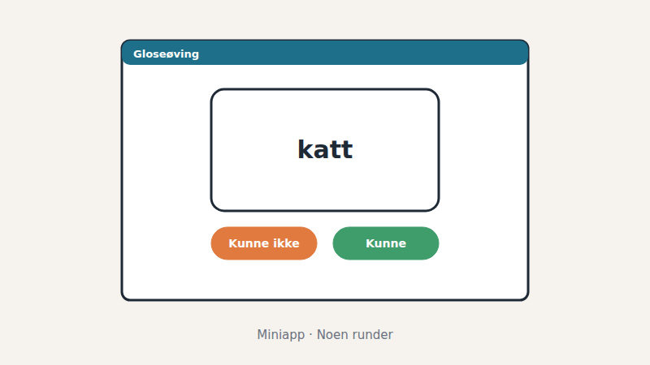

# Introduksjon {.intro}

Ein app for å øve på gloser med kort som blir snudde. Appen hugsar kva ord du
kan, og spør oftare om dei du ikkje kan. Denne appen lagar du med éin prompt og
nokre rundar med forbetringar.



## Før du startar {.tip}

Gjer [Din første app frå chatten](../forste_app/forste_app_nn) først. Har du
ikkje gitt KI-en skildringa av KIT Apps i chatten du bruker, gjer du steg 3 der
først.


# Steg 1: Lag appen {.activity}

## Sjekkliste {.check}

- [ ] Lim inn denne prompten i chatten. Endre han gjerne, så appen blir din:

  ```
  Lag ein app for gloseøving for KIT Apps. Eg skal kunne leggje inn
  ordpar (norsk og engelsk). Vis eitt kort om gongen som eg kan snu. Eg
  trykkjer «Kunne» eller «Kunne ikkje». Ord eg ikkje kunne, skal kome
  oftare. Hugs orda og korleis det går til neste gong. Nynorsk tekst.
  ```

- [ ] Kopier koden. Trykk **New** i KIT Apps, skriv eit namn i **App Name**, lim
  inn koden og trykk **Run App**. Appen blir lagra av seg sjølv.

- [ ] Verkar han ikkje? Trykk **Copy a fix request for your AI** og lim det inn
  i chatten.

- [ ] Får du ein ny versjon frå KI-en, trykkjer du **Edit**, byter ut all koden
  og trykkjer **Save Changes**.


# Steg 2: Test appen {.activity}

## Test prosjektet {.flag}

| Test | Dette skal skje |
|---|---|
| Legg inn fem ordpar | Alle fem kan øvast på |
| Svar «Kunne ikkje» på eitt ord | Det ordet kjem igjen snart |
| Lukk og opne KIT Apps | Orda er der framleis |

- [ ] Gjer alle testane. Rett det som ikkje verkar, éin ting om gongen.

- [ ] La ein annan prøve appen utan at du forklarer noko.


# Steg 3: Byggj vidare {.activity}

Vel det du vil ha, og be om éin ting om gongen. Be alltid om heile fila på nytt,
og test igjen etter kvar endring.

- **Begge vegar:**

  ```
  La meg velje om spørsmålet er på norsk eller engelsk.
  ```

- **Lim inn liste:**

  ```
  La meg lime inn ei heil liste med eitt ordpar per linje.
  ```

## Lagre {.save}

Appen ligg i lista i KIT Apps. Vil du ha han som eige program, sjå [Gjer han
til ein ferdig app](../ferdig_app/ferdig_app_nn).


## Utfordring {.challenge}

Bruk appen til neste gloseprøve. Kor mange ord kunne du før og etter?
