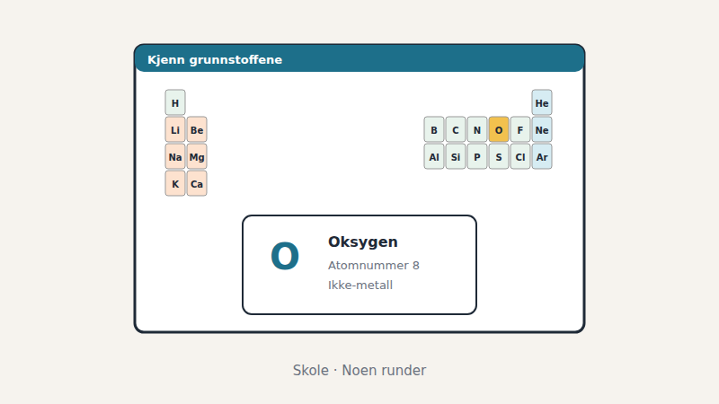

# Introduksjon {.intro}

En app med de 20 første grunnstoffene i periodesystemet, der du kan klikke på et
grunnstoff og se fakta, og spille en quiz. Her må du sjekke det KI-en skriver,
for KI tar ofte feil på tall og fakta. Denne appen lager du med én prompt og
noen runder med forbedringer.



## Før du starter {.tip}

Gjør [Din første app fra chatten](../forste_app/forste_app) først. Har du ikke
gitt KI-en beskrivelsen av KIT Apps i chatten du bruker, gjør du steg 3 der
først.


# Steg 1: Lag appen {.activity}

## Sjekkliste {.check}

- [ ] Lim inn denne prompten i chatten. Endre den gjerne, så appen blir din:

  ```
  Lag en app for KIT Apps med de 20 første grunnstoffene i
  periodesystemet, plassert som i periodesystemet. Når jeg klikker på et
  grunnstoff, vis navn, symbol, atomnummer og om det er metall,
  ikke-metall eller edelgass. Lag også en quiz der appen viser et symbol
  og jeg skal velge riktig navn. Norsk tekst.
  ```

- [ ] Sjekk minst ti av grunnstoffene mot periodesystemet i naturfagboka. Finner
  du feil, beskriv dem for KI-en og be om hele filen på nytt.

- [ ] Kopier koden. Trykk **New** i KIT Apps, skriv et navn i **App Name**, lim
  inn koden og trykk **Run App**. Appen lagres av seg selv.

- [ ] Virker den ikke? Trykk **Copy a fix request for your AI** og lim det inn i
  chatten.

- [ ] Får du en ny versjon fra KI-en, trykker du **Edit**, bytter ut all koden
  og trykker **Save Changes**.


# Steg 2: Test appen {.activity}

## Test prosjektet {.flag}

| Test | Dette skal skje |
|---|---|
| Klikk på O | Oksygen, atomnummer 8 |
| Klikk på Na | Natrium, atomnummer 11, metall |
| Sjekk at Ne er edelgass | Neon, edelgass |

- [ ] Gjør alle testene. Rett det som ikke virker, én ting om gangen.

- [ ] La en annen prøve appen uten at du forklarer noe.


# Steg 3: Bygg videre {.activity}

Velg det du vil ha, og be om én ting om gangen. Be alltid om hele filen på nytt,
og test igjen etter hver endring.

- **Elektroner:**

  ```
  Vis hvordan elektronene fordeler seg i skall for grunnstoffet jeg
  klikker på.
  ```

- **Farger:**

  ```
  Fargelegg grunnstoffene etter gruppe.
  ```

## Lagre {.save}

Appen ligger i lista i KIT Apps. Vil du ha den som eget program, se [Gjør den
til en ferdig app](../ferdig_app/ferdig_app).


## Utfordring {.challenge}

Hvor mange feil fant du i det KI-en lagde første gang? Hva sier det om å bruke
KI til fakta?
