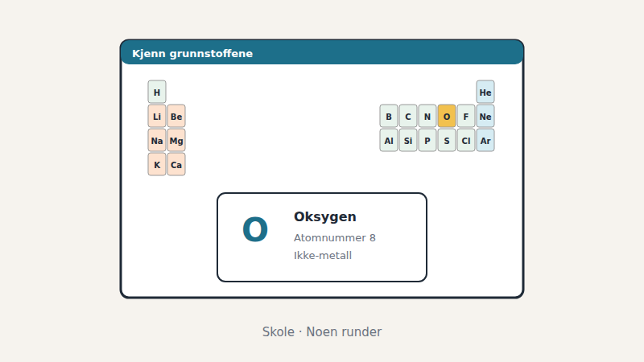

# Introduksjon {.intro}

Ein app med dei 20 første grunnstoffa i periodesystemet, der du kan klikke på
eit grunnstoff og sjå fakta, og spele ein quiz. Her må du sjekke det KI-en
skriv, for KI tek ofte feil på tal og fakta. Denne appen lagar du med éin prompt
og nokre rundar med forbetringar.



## Før du startar {.tip}

Gjer [Din første app frå chatten](../forste_app/forste_app_nn) først. Har du
ikkje gitt KI-en skildringa av KIT Apps i chatten du bruker, gjer du steg 3 der
først.


# Steg 1: Lag appen {.activity}

## Sjekkliste {.check}

- [ ] Lim inn denne prompten i chatten. Endre han gjerne, så appen blir din:

  ```
  Lag ein app for KIT Apps med dei 20 første grunnstoffa i
  periodesystemet, plasserte som i periodesystemet. Når eg klikkar på
  eit grunnstoff, vis namn, symbol, atomnummer og om det er metall,
  ikkje-metall eller edelgass. Lag også ein quiz der appen viser eit
  symbol og eg skal velje rett namn. Nynorsk tekst.
  ```

- [ ] Sjekk minst ti av grunnstoffa mot periodesystemet i naturfagboka. Finn du
  feil, skildrar du dei for KI-en og ber om heile fila på nytt.

- [ ] Kopier koden. Trykk **New** i KIT Apps, skriv eit namn i **App Name**, lim
  inn koden og trykk **Run App**. Appen blir lagra av seg sjølv.

- [ ] Verkar han ikkje? Trykk **Copy a fix request for your AI** og lim det inn
  i chatten.

- [ ] Får du ein ny versjon frå KI-en, trykkjer du **Edit**, byter ut all koden
  og trykkjer **Save Changes**.


# Steg 2: Test appen {.activity}

## Test prosjektet {.flag}

| Test | Dette skal skje |
|---|---|
| Klikk på O | Oksygen, atomnummer 8 |
| Klikk på Na | Natrium, atomnummer 11, metall |
| Sjekk at Ne er edelgass | Neon, edelgass |

- [ ] Gjer alle testane. Rett det som ikkje verkar, éin ting om gongen.

- [ ] La ein annan prøve appen utan at du forklarer noko.


# Steg 3: Bygg vidare {.activity}

Vel det du vil ha, og be om éin ting om gongen. Be alltid om heile fila på nytt,
og test igjen etter kvar endring.

- **Elektron:**

  ```
  Vis korleis elektrona fordeler seg i skal for grunnstoffet eg klikkar
  på.
  ```

- **Fargar:**

  ```
  Fargelegg grunnstoffa etter gruppe.
  ```

## Lagre {.save}

Appen ligg i lista i KIT Apps. Vil du ha han som eige program, sjå [Gjer han til
ein ferdig app](../ferdig_app/ferdig_app_nn).


## Utfordring {.challenge}

Kor mange feil fann du i det KI-en laga første gongen? Kva seier det om å bruke
KI til fakta?
