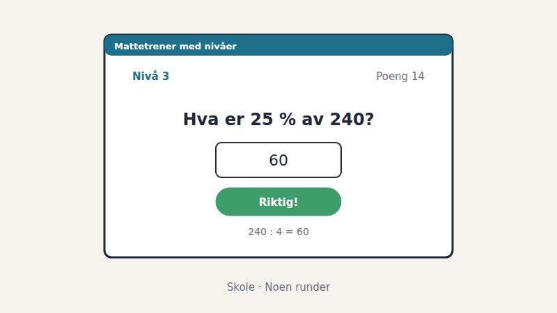

# Introduksjon {.intro}

En app som gir deg regneoppgaver, og blir vanskeligere når du svarer riktig. Du
velger selv hva du vil øve på: gangetabellen, brøk, prosent eller likninger.
Denne appen lager du med én prompt og noen runder med forbedringer.



## Før du starter {.tip}

Gjør [Din første app fra chatten](../forste_app/forste_app) først. Har du ikke
gitt KI-en beskrivelsen av KIT Apps i chatten du bruker, gjør du steg 3 der
først.


# Steg 1: Lag appen {.activity}

## Sjekkliste {.check}

- [ ] Lim inn denne prompten i chatten. Endre den gjerne, så appen blir din:

  ```
  Lag en mattetrener for KIT Apps som gir meg én oppgave om gangen i
  prosentregning, som «Hva er 20 % av 150?». Start med 10, 25 og 50
  prosent av runde tall. Etter fem riktige på rad går jeg opp ett nivå
  med vanskeligere prosenter og tall. Svarer jeg feil, viser appen
  riktig svar og forklarer hvordan man regner det ut. Vis nivå og poeng.
  Husk beste nivå. Norsk tekst.
  ```

- [ ] Kopier koden. Trykk **New** i KIT Apps, skriv et navn i **App Name**, lim
  inn koden og trykk **Run App**. Appen lagres av seg selv.

- [ ] Virker den ikke? Trykk **Copy a fix request for your AI** og lim det inn i
  chatten.

- [ ] Får du en ny versjon fra KI-en, trykker du **Edit**, bytter ut all koden
  og trykker **Save Changes**.


# Steg 2: Test appen {.activity}

## Test prosjektet {.flag}

| Test | Dette skal skje |
|---|---|
| Svar riktig fem ganger | Du går opp ett nivå |
| Svar feil | Riktig svar og en forklaring vises |
| Sjekk ti oppgaver selv | Alle fasitsvarene stemmer |

- [ ] Gjør alle testene. Rett det som ikke virker, én ting om gangen.

- [ ] La en annen prøve appen uten at du forklarer noe.


# Steg 3: Bygg videre {.activity}

Velg det du vil ha, og be om én ting om gangen. Be alltid om hele filen på nytt,
og test igjen etter hver endring.

- **Andre temaer:**

  ```
  Legg til brøk og likninger som egne valg.
  ```

- **Tid:**

  ```
  Legg til en modus med 60 sekunder der jeg skal klare flest mulig.
  ```

## Lagre {.save}

Appen ligger i lista i KIT Apps. Vil du ha den som eget program, se [Gjør den
til en ferdig app](../ferdig_app/ferdig_app).


## Utfordring {.challenge}

Bytt prosent med noe dere har om i matte nå. Sjekk at forklaringene appen gir,
stemmer med måten dere lærer det på.
