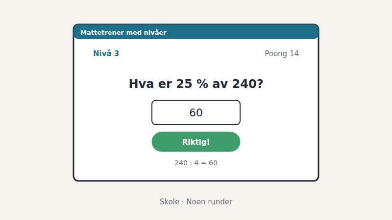

# Introduksjon {.intro}

Ein app som gir deg reknestykke, og blir vanskelegare når du svarer rett. Du vel
sjølv kva du vil øve på: gongetabellen, brøk, prosent eller likningar. Denne
appen lagar du med éin prompt og nokre rundar med forbetringar.



## Før du startar {.tip}

Gjer [Din første app frå chatten](../forste_app/forste_app_nn) først. Har du
ikkje gitt KI-en skildringa av KIT Apps i chatten du bruker, gjer du steg 3 der
først.


# Steg 1: Lag appen {.activity}

## Sjekkliste {.check}

- [ ] Lim inn denne prompten i chatten. Endre han gjerne, så appen blir din:

  ```
  Lag ein mattetrenar for KIT Apps som gir meg eitt reknestykke om
  gongen i prosentrekning, som «Kva er 20 % av 150?». Start med 10, 25
  og 50 prosent av runde tal. Etter fem rette på rad går eg opp eitt
  nivå med vanskelegare prosentar og tal. Svarer eg feil, viser appen
  rett svar og forklarer korleis ein reknar det ut. Vis nivå og poeng.
  Hugs beste nivå. Nynorsk tekst.
  ```

- [ ] Kopier koden. Trykk **New** i KIT Apps, skriv eit namn i **App Name**, lim
  inn koden og trykk **Run App**. Appen blir lagra av seg sjølv.

- [ ] Verkar han ikkje? Trykk **Copy a fix request for your AI** og lim det inn
  i chatten.

- [ ] Får du ein ny versjon frå KI-en, trykkjer du **Edit**, byter ut all koden
  og trykkjer **Save Changes**.


# Steg 2: Test appen {.activity}

## Test prosjektet {.flag}

| Test | Dette skal skje |
|---|---|
| Svar rett fem gonger | Du går opp eitt nivå |
| Svar feil | Rett svar og ei forklaring blir viste |
| Sjekk ti reknestykke sjølv | Alle fasitsvara stemmer |

- [ ] Gjer alle testane. Rett det som ikkje verkar, éin ting om gongen.

- [ ] La ein annan prøve appen utan at du forklarer noko.


# Steg 3: Bygg vidare {.activity}

Vel det du vil ha, og be om éin ting om gongen. Be alltid om heile fila på nytt,
og test igjen etter kvar endring.

- **Andre tema:**

  ```
  Legg til brøk og likningar som eigne val.
  ```

- **Tid:**

  ```
  Legg til ein modus med 60 sekund der eg skal klare flest mogleg.
  ```

## Lagre {.save}

Appen ligg i lista i KIT Apps. Vil du ha han som eige program, sjå [Gjer han til
ein ferdig app](../ferdig_app/ferdig_app_nn).


## Utfordring {.challenge}

Byt prosent med noko de har om i matte no. Sjekk at forklaringane appen gir,
stemmer med måten de lærer det på.
