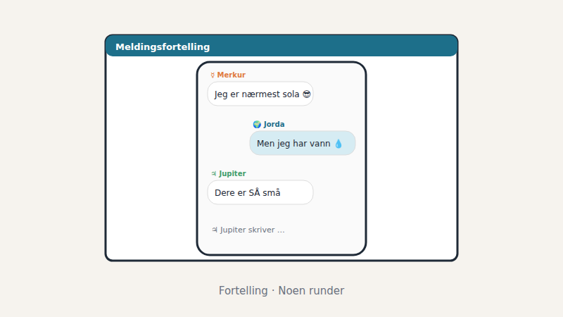

# Introduksjon {.intro}

En fortelling som ser ut som en gruppechat på mobilen. Meldingene kommer én og
én, med «skriver …» mellom. Tenk deg en chat mellom grunnlovsfedrene på Eidsvoll
i 1814, mellom planetene i solsystemet, eller mellom karakterene i en bok dere
leser. Det er en morsom måte å lære noe på, og å vise at du har forstått det.
Denne appen lager du med én prompt og noen runder med forbedringer.



## Før du starter {.tip}

Gjør [Din første app fra chatten](../forste_app/forste_app) først. Har du ikke
gitt KI-en beskrivelsen av KIT Apps i chatten du bruker, gjør du steg 3 der
først.


# Steg 1: Lag appen {.activity}

## Sjekkliste {.check}

- [ ] Lim inn denne prompten i chatten. Endre den gjerne, så appen blir din:

  ```
  Lag en meldingsfortelling for KIT Apps som ser ut som en gruppechat på
  en mobil. Meldingene skal komme én om gangen når jeg trykker på
  skjermen, med «skriver …» før hver melding. Hver person har navn,
  farge og en emoji som bilde. Meldingene skal stå i en liste i koden,
  så jeg lett kan bytte dem ut. Lag en kort eksempelchat mellom Merkur,
  Jorda og Jupiter om hvem som er størst og varmest. Norsk tekst.
  ```

- [ ] Skriv din egen chat om et tema fra et fag: 15 til 25 meldinger, 3 eller 4
  personer. Gi KI-en teksten og be den bytte ut eksempelchatten. Sjekk at
  faktaene stemmer.

- [ ] Kopier koden. Trykk **New** i KIT Apps, skriv et navn i **App Name**, lim
  inn koden og trykk **Run App**. Appen lagres av seg selv.

- [ ] Virker den ikke? Trykk **Copy a fix request for your AI** og lim det inn i
  chatten.

- [ ] Får du en ny versjon fra KI-en, trykker du **Edit**, bytter ut all koden
  og trykker **Save Changes**.

## Tenk deg om {.tip}

Bruk historiske personer, karakterer fra bøker eller ting som planeter og
celler. Ikke bruk ekte medelever, lærere eller andre du kjenner, og ikke legg
ord i munnen på ekte, levende personer. Skriv i appen at fortellingen er
oppdiktet.


# Steg 2: Test appen {.activity}

## Test prosjektet {.flag}

| Test | Dette skal skje |
|---|---|
| Trykk gjennom hele chatten | Alle meldingene kommer i riktig rekkefølge |
| Trykk veldig fort | Meldingene kommer ikke i feil rekkefølge |
| Se på mobilvisning | Det ser ut som en chat på mobil |

- [ ] Gjør alle testene. Rett det som ikke virker, én ting om gangen.

- [ ] La en annen prøve appen uten at du forklarer noe.


# Steg 3: Bygg videre {.activity}

Velg det du vil ha, og be om én ting om gangen. Be alltid om hele filen på nytt,
og test igjen etter hver endring.

- **Bilder:**

  ```
  La en melding også kunne være et bilde eller en emoji i stor
  størrelse.
  ```

- **Valg:**

  ```
  La leseren velge mellom to svar et sted i chatten, og la chatten
  fortsette ulikt.
  ```

## Lagre {.save}

Appen ligger i lista i KIT Apps. Vil du ha den som eget program, se [Gjør den
til en ferdig app](../ferdig_app/ferdig_app).


## Utfordring {.challenge}

Del fortellingen med klassen. Kan de forklare temaet etter å ha lest chatten?
