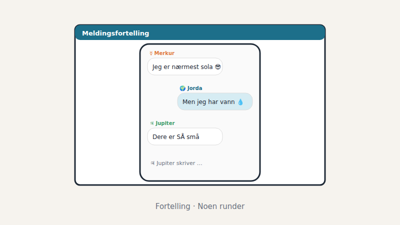

# Introduksjon {.intro}

Ei forteljing som ser ut som ein gruppechat på mobilen. Meldingane kjem éi og
éi, med «skriv …» imellom. Tenk deg ein chat mellom grunnlovsfedrane på Eidsvoll
i 1814, mellom planetane i solsystemet, eller mellom karakterane i ei bok de
les. Det er ein morosam måte å lære noko på, og å vise at du har forstått det.
Denne appen lagar du med éin prompt og nokre rundar med forbetringar.



## Før du startar {.tip}

Gjer [Din første app frå chatten](../forste_app/forste_app_nn) først. Har du
ikkje gitt KI-en skildringa av KIT Apps i chatten du bruker, gjer du steg 3 der
først.


# Steg 1: Lag appen {.activity}

## Sjekkliste {.check}

- [ ] Lim inn denne prompten i chatten. Endre han gjerne, så appen blir din:

  ```
  Lag ei meldingsforteljing for KIT Apps som ser ut som ein gruppechat
  på ein mobil. Meldingane skal kome éi om gongen når eg trykkjer på
  skjermen, med «skriv …» før kvar melding. Kvar person har namn, farge
  og ein emoji som bilete. Meldingane skal stå i ei liste i koden, så eg
  lett kan byte dei ut. Lag ein kort eksempelchat mellom Merkur, Jorda
  og Jupiter om kven som er størst og varmast. Nynorsk tekst.
  ```

- [ ] Skriv din eigen chat om eit tema frå eit fag: 15 til 25 meldingar, 3 eller
  4 personar. Gi KI-en teksten og be han byte ut eksempelchatten. Sjekk at fakta
  stemmer.

- [ ] Kopier koden. Trykk **New** i KIT Apps, skriv eit namn i **App Name**, lim
  inn koden og trykk **Run App**. Appen blir lagra av seg sjølv.

- [ ] Verkar han ikkje? Trykk **Copy a fix request for your AI** og lim det inn
  i chatten.

- [ ] Får du ein ny versjon frå KI-en, trykkjer du **Edit**, byter ut all koden
  og trykkjer **Save Changes**.

## Tenk deg om {.tip}

Bruk historiske personar, karakterar frå bøker eller ting som planetar og
celler. Ikkje bruk ekte medelevar, lærarar eller andre du kjenner, og ikkje legg
ord i munnen på ekte, levande personar. Skriv i appen at forteljinga er
oppdikta.


# Steg 2: Test appen {.activity}

## Test prosjektet {.flag}

| Test | Dette skal skje |
|---|---|
| Trykk gjennom heile chatten | Alle meldingane kjem i rett rekkjefølgje |
| Trykk veldig fort | Meldingane kjem ikkje i feil rekkjefølgje |
| Sjå på mobilvising | Det ser ut som ein chat på mobil |

- [ ] Gjer alle testane. Rett det som ikkje verkar, éin ting om gongen.

- [ ] La ein annan prøve appen utan at du forklarer noko.


# Steg 3: Bygg vidare {.activity}

Vel det du vil ha, og be om éin ting om gongen. Be alltid om heile fila på nytt,
og test igjen etter kvar endring.

- **Bilete:**

  ```
  La ei melding også kunne vere eit bilete eller ein emoji i stor
  storleik.
  ```

- **Val:**

  ```
  La lesaren velje mellom to svar ein stad i chatten, og la chatten
  halde fram ulikt.
  ```

## Lagre {.save}

Appen ligg i lista i KIT Apps. Vil du ha han som eige program, sjå [Gjer han til
ein ferdig app](../ferdig_app/ferdig_app_nn).


## Utfordring {.challenge}

Del forteljinga med klassen. Kan dei forklare temaet etter å ha lese chatten?
