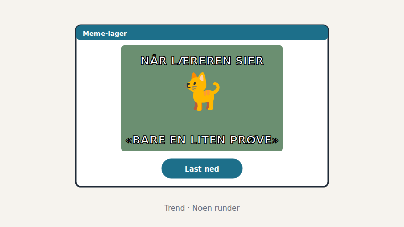

# Introduksjon {.intro}

En app der du velger et bilde, skriver tekst øverst og nederst og laster ned
resultatet. Memes er en egen sjanger med egne regler, og de kan også brukes til
å forklare noe fra et fag på en morsom måte. Denne appen lager du med én prompt
og noen runder med forbedringer.



## Før du starter {.tip}

Gjør [Din første app fra chatten](../forste_app/forste_app) først. Har du ikke
gitt KI-en beskrivelsen av KIT Apps i chatten du bruker, gjør du steg 3 der
først.


# Steg 1: Lag appen {.activity}

## Sjekkliste {.check}

- [ ] Lim inn denne prompten i chatten. Endre den gjerne, så appen blir din:

  ```
  Lag en meme-lager for KIT Apps. Jeg skal kunne laste opp et bilde fra
  PC-en, skrive tekst øverst og nederst i hvite store bokstaver med
  svart kant, og endre tekststørrelsen. Lag en knapp som laster ned
  memen som et bilde. Norsk tekst.
  ```

- [ ] Kopier koden. Trykk **New** i KIT Apps, skriv et navn i **App Name**, lim
  inn koden og trykk **Run App**. Appen lagres av seg selv.

- [ ] Virker den ikke? Trykk **Copy a fix request for your AI** og lim det inn i
  chatten.

- [ ] Får du en ny versjon fra KI-en, trykker du **Edit**, bytter ut all koden
  og trykker **Save Changes**.

## Tenk deg om {.tip}

Bruk bilder du har tatt selv, eller bilder du har lov til å bruke. Ikke lag
memes om ekte personer du kjenner, og ikke bruk bilder av andre uten at de har
sagt ja. Det som er morsomt for deg, kan være vondt for den det handler om.


# Steg 2: Test appen {.activity}

## Test prosjektet {.flag}

| Test              | Dette skal skje                    |
| ----------------- | ---------------------------------- |
| Last opp et bilde | Bildet vises                       |
| Skriv lang tekst  | Teksten brytes og blir ikke kuttet |
| Last ned          | Bildet har teksten på              |

- [ ] Gjør alle testene. Rett det som ikke virker, én ting om gangen.

- [ ] La en annen prøve appen uten at du forklarer noe.


# Steg 3: Bygg videre {.activity}

Velg det du vil ha, og be om én ting om gangen. Be alltid om hele filen på nytt,
og test igjen etter hver endring.

- **Maler:**

  ```
  Lag tre ferdige bakgrunner med farge og mønster, så jeg ikke trenger
  bilde.
  ```

- **Flytte tekst:**

  ```
  La meg dra teksten dit jeg vil.
  ```

## Lagre {.save}

Appen ligger i lista i KIT Apps. Vil du ha den som eget program, se [Gjør den
til en ferdig app](../ferdig_app/ferdig_app).

## Utfordring {.challenge}

Lag en meme som forklarer noe fra et fag, for eksempel forskjellen på vær og
klima. Kan noen lære noe av den?
