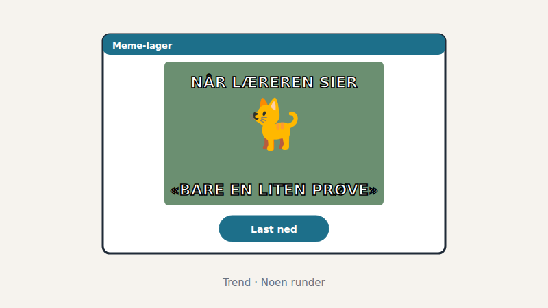

# Introduksjon {.intro}

Ein app der du vel eit bilete, skriv tekst øvst og nedst og lastar ned
resultatet. Memes er ein eigen sjanger med eigne reglar, og dei kan også brukast
til å forklare noko frå eit fag på ein morosam måte. Denne appen lagar du med
éin prompt og nokre rundar med forbetringar.



## Før du startar {.tip}

Gjer [Din første app frå chatten](../forste_app/forste_app_nn) først. Har
du ikkje gitt KI-en skildringa av KIT Apps i chatten du brukar, gjer du steg 3
der først.


# Steg 1: Lag appen {.activity}

## Sjekkliste {.check}

- [ ] Lim inn denne prompten i chatten. Endre han gjerne, så appen blir din:

  ```
  Lag ein meme-lagar for KIT Apps. Eg skal kunne laste opp eit bilete
  frå PC-en, skrive tekst øvst og nedst i kvite store bokstavar med
  svart kant, og endre tekststorleiken. Lag ein knapp som lastar ned
  memen som eit bilete. Nynorsk tekst.
  ```

- [ ] Kopier koden. Trykk **New** i KIT Apps, skriv eit namn i **App Name**, lim
  inn koden og trykk **Run App**. Appen blir lagra av seg sjølv.

- [ ] Verkar han ikkje? Trykk **Copy a fix request for your AI** og lim det inn
  i chatten.

- [ ] Får du ein ny versjon frå KI-en, trykkjer du **Edit**, byter ut all koden
  og trykkjer **Save Changes**.

## Tenk deg om {.tip}

Bruk bilete du har teke sjølv, eller bilete du har lov til å bruke. Ikkje lag
memes om ekte personar du kjenner, og ikkje bruk bilete av andre utan at dei har
sagt ja. Det som er morosamt for deg, kan vere vondt for den det handlar om.


# Steg 2: Test appen {.activity}

## Test prosjektet {.flag}

| Test | Dette skal skje |
|---|---|
| Last opp eit bilete | Biletet blir vist |
| Skriv lang tekst | Teksten blir broten og ikkje kutta |
| Last ned | Biletet har teksten på |

- [ ] Gjer alle testane. Rett det som ikkje verkar, éin ting om gongen.

- [ ] La ein annan prøve appen utan at du forklarer noko.


# Steg 3: Byggj vidare {.activity}

Vel det du vil ha, og be om éin ting om gongen. Be alltid om heile fila på nytt,
og test igjen etter kvar endring.

- **Malar:**

  ```
  Lag tre ferdige bakgrunnar med farge og mønster, så eg ikkje treng
  bilete.
  ```

- **Flytte tekst:**

  ```
  La meg dra teksten dit eg vil.
  ```

## Lagre {.save}

Appen ligg i lista i KIT Apps. Vil du ha han som eige program, sjå [Gjer han til
ein ferdig app](../ferdig_app/ferdig_app_nn).


## Utfordring {.challenge}

Lag ein meme som forklarer noko frå eit fag, til dømes skilnaden på vêr og
klima. Kan nokon lære noko av han?
