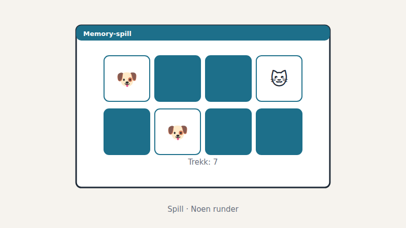

# Introduksjon {.intro}

Det klassiske spillet der du snur to kort og leter etter par. Du bestemmer
temaet. Denne appen lager du med én prompt og noen runder med forbedringer.



## Før du starter {.tip}

Gjør [Din første app fra chatten](../forste_app/forste_app) først. Har du ikke
gitt KI-en beskrivelsen av KIT Apps i chatten du bruker, gjør du steg 3 der
først.


# Steg 1: Lag appen {.activity}

## Sjekkliste {.check}

- [ ] Lim inn denne prompten i chatten. Endre den gjerne, så appen blir din:

  ```
  Lag et memory-spill for KIT Apps med 16 kort (8 par). Bruk emoji som
  bilder, tema dyr. Tell antall trekk og tiden. Vis en gratulasjon når
  alle par er funnet, og en knapp for nytt spill. Norsk tekst.
  ```

- [ ] Kopier koden. Trykk **New** i KIT Apps, skriv et navn i **App Name**, lim
  inn koden og trykk **Run App**. Appen lagres av seg selv.

- [ ] Virker den ikke? Trykk **Copy a fix request for your AI** og lim det inn i
  chatten.

- [ ] Får du en ny versjon fra KI-en, trykker du **Edit**, bytter ut all koden
  og trykker **Save Changes**.


# Steg 2: Test appen {.activity}

## Test prosjektet {.flag}

| Test | Dette skal skje |
|---|---|
| Snu to like kort | De blir liggende oppe |
| Snu to ulike kort | De snus tilbake etter et sekund |
| Klikk fort på mange kort | Aldri mer enn to kort oppe om gangen |

- [ ] Gjør alle testene. Rett det som ikke virker, én ting om gangen.

- [ ] La en annen prøve appen uten at du forklarer noe.


# Steg 3: Bygg videre {.activity}

Velg det du vil ha, og be om én ting om gangen. Be alltid om hele filen på nytt,
og test igjen etter hver endring.

- **Vanskelighetsgrad:**

  ```
  La meg velge 12, 16 eller 24 kort.
  ```

- **Tema:**

  ```
  La meg velge tema: dyr, mat eller sport.
  ```

- **To spillere:**

  ```
  To spillere bytter på, og hver får poeng for sine par.
  ```

## Lagre {.save}

Appen ligger i lista i KIT Apps. Vil du ha den som eget program, se [Gjør den
til en ferdig app](../ferdig_app/ferdig_app).


## Utfordring {.challenge}

Bytt emojiene med ord og forklaringer fra et fag, for eksempel begrep og
forklaring i naturfag. Da blir spillet en øvingsapp.
