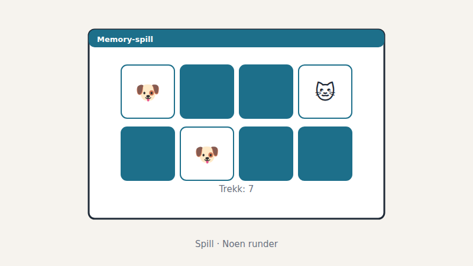

# Introduksjon {.intro}

Det klassiske spelet der du snur to kort og leitar etter par. Du bestemmer
temaet. Denne appen lagar du med éin prompt og nokre rundar med forbetringar.



## Før du startar {.tip}

Gjer [Din første app frå chatten](../forste_app/forste_app_nn) først. Har du
ikkje gitt KI-en skildringa av KIT Apps i chatten du bruker, gjer du steg 3 der
først.


# Steg 1: Lag appen {.activity}

## Sjekkliste {.check}

- [ ] Lim inn denne prompten i chatten. Endre han gjerne, så appen blir din:

  ```
  Lag eit memory-spel for KIT Apps med 16 kort (8 par). Bruk emoji som
  bilete, tema dyr. Tel talet på trekk og tida. Vis ei gratulasjon når
  alle para er funne, og ein knapp for nytt spel. Nynorsk tekst.
  ```

- [ ] Kopier koden. Trykk **New** i KIT Apps, skriv eit namn i **App Name**, lim
  inn koden og trykk **Run App**. Appen blir lagra av seg sjølv.

- [ ] Verkar han ikkje? Trykk **Copy a fix request for your AI** og lim det inn
  i chatten.

- [ ] Får du ein ny versjon frå KI-en, trykkjer du **Edit**, byter ut all koden
  og trykkjer **Save Changes**.


# Steg 2: Test appen {.activity}

## Test prosjektet {.flag}

| Test | Dette skal skje |
|---|---|
| Snu to like kort | Dei blir liggjande oppe |
| Snu to ulike kort | Dei blir snudde tilbake etter eit sekund |
| Klikk fort på mange kort | Aldri meir enn to kort oppe om gongen |

- [ ] Gjer alle testane. Rett det som ikkje verkar, éin ting om gongen.

- [ ] La ein annan prøve appen utan at du forklarer noko.


# Steg 3: Byggj vidare {.activity}

Vel det du vil ha, og be om éin ting om gongen. Be alltid om heile fila på nytt,
og test igjen etter kvar endring.

- **Vanskegrad:**

  ```
  La meg velje 12, 16 eller 24 kort.
  ```

- **Tema:**

  ```
  La meg velje tema: dyr, mat eller sport.
  ```

- **To spelarar:**

  ```
  To spelarar byter på, og kvar får poeng for sine par.
  ```

## Lagre {.save}

Appen ligg i lista i KIT Apps. Vil du ha han som eige program, sjå [Gjer han
til ein ferdig app](../ferdig_app/ferdig_app_nn).


## Utfordring {.challenge}

Byt ut emojiane med ord og forklaringar frå eit fag, til dømes omgrep og
forklaring i naturfag. Då blir spelet ein øvingsapp.
