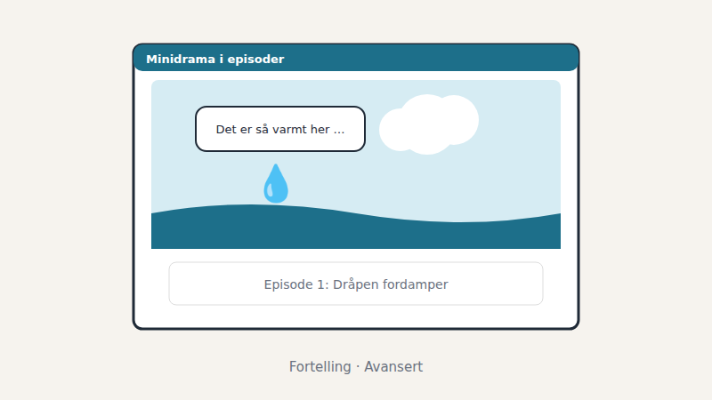

# Introduksjon {.intro}

En liten serie i episoder, med figurer som snakker i snakkebobler og beveger seg
over skjermen. Vannets kretsløp som såpeopera, der en vanndråpe fordamper fra
havet og havner i en sky. Eller fotosyntesen som krimdrama. Fag blir lettere å
huske når det er en historie med følelser og konflikt. Denne appen bygger du i
flere runder. Start lite, og legg til én ting om gangen.



## Før du starter {.tip}

Gjør [Din første app fra chatten](../forste_app/forste_app) først. Har du ikke
gitt KI-en beskrivelsen av KIT Apps i chatten du bruker, gjør du steg 3 der
først.


# Steg 1: Lag appen {.activity}

## Sjekkliste {.check}

- [ ] Lim inn denne prompten i chatten. Endre den gjerne, så appen blir din:

  ```
  Lag et minidrama for KIT Apps. Det skal ha scener med en bakgrunn og
  to eller tre figurer laget av enkle former eller emoji. I hver scene
  sier figurene noe i snakkebobler, én replikk om gangen når jeg
  trykker. Figurene kan gli inn og ut av scenen. Manuset skal ligge i en
  liste i koden. Lag første episode av «Dråpen», om en vanndråpe som
  fordamper fra havet og blir med i en sky. Norsk tekst.
  ```

- [ ] Skriv manuset til neste episode selv, med replikker og hvem som sier hva.
  Gi det til KI-en. Be så om ett tillegg om gangen: «Lag en meny med episodene»,
  «Legg til en forteller-tekst nederst», og «La bakgrunnen skifte farge når det
  blir kveld».

- [ ] Kopier koden. Trykk **New** i KIT Apps, skriv et navn i **App Name**, lim
  inn koden og trykk **Run App**. Appen lagres av seg selv.

- [ ] Virker den ikke? Trykk **Copy a fix request for your AI** og lim det inn i
  chatten.

- [ ] Får du en ny versjon fra KI-en, trykker du **Edit**, bytter ut all koden
  og trykker **Save Changes**.

## Tenk deg om {.tip}

Et godt minidrama har en konflikt: noen vil noe, og noe står i veien. Dråpen vil
ned igjen, men det er for varmt. Faget blir svaret på konflikten.


# Steg 2: Test appen {.activity}

## Test prosjektet {.flag}

| Test | Dette skal skje |
|---|---|
| Trykk gjennom en scene | Replikkene kommer i riktig rekkefølge |
| Gå til neste episode | Riktig bakgrunn og figurer vises |
| Se om faget stemmer | Kretsløpet er forklart riktig |

- [ ] Gjør alle testene. Rett det som ikke virker, én ting om gangen.

- [ ] La en annen prøve appen uten at du forklarer noe.


# Steg 3: Bygg videre {.activity}

Velg det du vil ha, og be om én ting om gangen. Be alltid om hele filen på nytt,
og test igjen etter hver endring.

- **Lyd:**

  ```
  Legg til en kort lyd når en figur dukker opp. Lyden skal kunne slås
  av.
  ```

- **Seere velger:**

  ```
  La seeren stemme på hva som skjer i neste episode.
  ```

## Lagre {.save}

Appen ligger i lista i KIT Apps. Vil du ha den som eget program, se [Gjør den
til en ferdig app](../ferdig_app/ferdig_app).


## Utfordring {.challenge}

Lag en trailer: en scene på 20 sekunder som får andre til å ville se resten.
