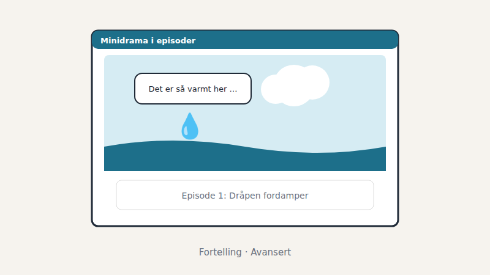

# Introduksjon {.intro}

Ein liten serie i episodar, med figurar som snakkar i snakkebobler og flyttar
seg over skjermen. Krinsløpet til vatnet som såpeopera, der ein vassdrope
fordampar frå havet og hamnar i ei sky. Eller fotosyntesen som krimdrama. Fag
blir lettare å hugse når det er ei historie med kjensler og konflikt. Denne
appen byggjer du i fleire rundar. Start lite, og legg til éin ting om gongen.



## Før du startar {.tip}

Gjer [Din første app frå chatten](../forste_app/forste_app_nn) først. Har du
ikkje gitt KI-en skildringa av KIT Apps i chatten du bruker, gjer du steg 3 der
først.


# Steg 1: Lag appen {.activity}

## Sjekkliste {.check}

- [ ] Lim inn denne prompten i chatten. Endre han gjerne, så appen blir din:

  ```
  Lag eit minidrama for KIT Apps. Det skal ha scener med ein bakgrunn og
  to eller tre figurar laga av enkle former eller emoji. I kvar scene
  seier figurane noko i snakkebobler, éi replikk om gongen når eg
  trykkjer. Figurane kan gli inn og ut av scena. Manuset skal liggje i
  ei liste i koden. Lag første episode av «Dropen», om ein vassdrope som
  fordampar frå havet og blir med i ei sky. Nynorsk tekst.
  ```

- [ ] Skriv manuset til neste episode sjølv, med replikkar og kven som seier
  kva. Gi det til KI-en. Be så om eitt tillegg om gongen: «Lag ein meny med
  episodane», «Legg til ein forteljartekst nedst», og «La bakgrunnen skifte
  farge når det blir kveld».

- [ ] Kopier koden. Trykk **New** i KIT Apps, skriv eit namn i **App Name**, lim
  inn koden og trykk **Run App**. Appen blir lagra av seg sjølv.

- [ ] Verkar han ikkje? Trykk **Copy a fix request for your AI** og lim det inn
  i chatten.

- [ ] Får du ein ny versjon frå KI-en, trykkjer du **Edit**, byter ut all koden
  og trykkjer **Save Changes**.

## Tenk deg om {.tip}

Eit godt minidrama har ein konflikt: nokon vil noko, og noko står i vegen.
Dropen vil ned att, men det er for varmt. Faget blir svaret på konflikten.


# Steg 2: Test appen {.activity}

## Test prosjektet {.flag}

| Test | Dette skal skje |
|---|---|
| Trykk gjennom ei scene | Replikkane kjem i rett rekkjefølgje |
| Gå til neste episode | Rett bakgrunn og figurar blir viste |
| Sjå om faget stemmer | Krinsløpet er forklart rett |

- [ ] Gjer alle testane. Rett det som ikkje verkar, éin ting om gongen.

- [ ] La ein annan prøve appen utan at du forklarer noko.


# Steg 3: Bygg vidare {.activity}

Vel det du vil ha, og be om éin ting om gongen. Be alltid om heile fila på nytt,
og test igjen etter kvar endring.

- **Lyd:**

  ```
  Legg til ein kort lyd når ein figur dukkar opp. Lyden skal kunne
  slåast av.
  ```

- **Sjåarane vel:**

  ```
  La sjåaren røyste på kva som skjer i neste episode.
  ```

## Lagre {.save}

Appen ligg i lista i KIT Apps. Vil du ha han som eige program, sjå [Gjer han til
ein ferdig app](../ferdig_app/ferdig_app_nn).


## Utfordring {.challenge}

Lag ein trailer: ei scene på 20 sekund som får andre til å ville sjå resten.
