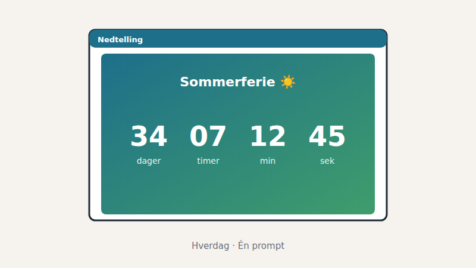

# Introduksjon {.intro}

En stor, fin nedtelling til noe du gleder deg til: sommerferien, en konsert,
bursdagen eller avreise på tur. Med dager, timer, minutter og sekunder. Denne
appen lager du med én prompt.



## Før du starter {.tip}

Gjør [Din første app fra chatten](../forste_app/forste_app) først. Har du ikke
gitt KI-en beskrivelsen av KIT Apps i chatten du bruker, gjør du steg 3 der
først.


# Steg 1: Lag appen {.activity}

## Sjekkliste {.check}

- [ ] Lim inn denne prompten i chatten. Endre den gjerne, så appen blir din:

  ```
  Lag en nedtelling for KIT Apps til en dato og et klokkeslett jeg
  velger, med en tittel jeg skriver selv. Vis dager, timer, minutter og
  sekunder i store tall på en bakgrunn med fargeovergang. Når tiden er
  ute, vis konfetti. Husk dato og tittel. Norsk tekst.
  ```

- [ ] Kopier koden. Trykk **New** i KIT Apps, skriv et navn i **App Name**, lim
  inn koden og trykk **Run App**. Appen lagres av seg selv.

- [ ] Virker den ikke? Trykk **Copy a fix request for your AI** og lim det inn i
  chatten.

- [ ] Får du en ny versjon fra KI-en, trykker du **Edit**, bytter ut all koden
  og trykker **Save Changes**.


# Steg 2: Test appen {.activity}

## Test prosjektet {.flag}

| Test | Dette skal skje |
|---|---|
| Velg en dato om ett døgn | Det står 0 dager og rundt 24 timer |
| Velg en dato som har vært | Appen sier fra eller viser feiring |
| Lukk og åpne | Nedtellingen fortsetter |

- [ ] Gjør alle testene. Rett det som ikke virker, én ting om gangen.

- [ ] La en annen prøve appen uten at du forklarer noe.


# Steg 3: Bygg videre {.activity}

Velg det du vil ha, og be om én ting om gangen. Be alltid om hele filen på nytt,
og test igjen etter hver endring.

- **Flere:**

  ```
  La meg ha flere nedtellinger og bytte mellom dem.
  ```

- **Tema:**

  ```
  La meg velge farge og en emoji for hver nedtelling.
  ```

## Lagre {.save}

Appen ligger i lista i KIT Apps. Vil du ha den som eget program, se [Gjør den
til en ferdig app](../ferdig_app/ferdig_app).


## Utfordring {.challenge}

Lag en nedtelling til siste skoledag for klassen, og vis den på storskjermen.
