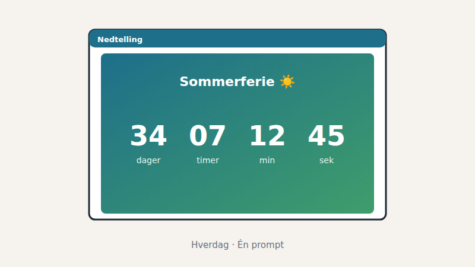

# Introduksjon {.intro}

Ei stor, fin nedteljing til noko du gler deg til: sommarferien, ein konsert,
bursdagen eller avreise på tur. Med dagar, timar, minutt og sekund. Denne appen
lagar du med éin prompt.



## Før du startar {.tip}

Gjer [Din første app frå chatten](../forste_app/forste_app_nn) først. Har
du ikkje gitt KI-en skildringa av KIT Apps i chatten du brukar, gjer du steg 3
der først.


# Steg 1: Lag appen {.activity}

## Sjekkliste {.check}

- [ ] Lim inn denne prompten i chatten. Endre han gjerne, så appen blir din:

  ```
  Lag ei nedteljing for KIT Apps til ein dato og eit klokkeslett eg vel,
  med ein tittel eg skriv sjølv. Vis dagar, timar, minutt og sekund i
  store tal på ein bakgrunn med fargeovergang. Når tida er ute, vis
  konfetti. Hugs dato og tittel. Nynorsk tekst.
  ```

- [ ] Kopier koden. Trykk **New** i KIT Apps, skriv eit namn i **App Name**, lim
  inn koden og trykk **Run App**. Appen blir lagra av seg sjølv.

- [ ] Verkar han ikkje? Trykk **Copy a fix request for your AI** og lim det inn
  i chatten.

- [ ] Får du ein ny versjon frå KI-en, trykkjer du **Edit**, byter ut all koden
  og trykkjer **Save Changes**.


# Steg 2: Test appen {.activity}

## Test prosjektet {.flag}

| Test | Dette skal skje |
|---|---|
| Vel ein dato om eitt døgn | Det står 0 dagar og rundt 24 timar |
| Vel ein dato som har vore | Appen seier frå eller viser feiring |
| Lukk og opne | Nedteljinga held fram |

- [ ] Gjer alle testane. Rett det som ikkje verkar, éin ting om gongen.

- [ ] La ein annan prøve appen utan at du forklarer noko.


# Steg 3: Byggj vidare {.activity}

Vel det du vil ha, og be om éin ting om gongen. Be alltid om heile fila på nytt,
og test igjen etter kvar endring.

- **Fleire:**

  ```
  La meg ha fleire nedteljingar og byte mellom dei.
  ```

- **Tema:**

  ```
  La meg velje farge og ein emoji for kvar nedteljing.
  ```

## Lagre {.save}

Appen ligg i lista i KIT Apps. Vil du ha han som eige program, sjå [Gjer han til
ein ferdig app](../ferdig_app/ferdig_app_nn).


## Utfordring {.challenge}

Lag ei nedteljing til siste skuledag for klassen, og vis henne på storskjermen.
