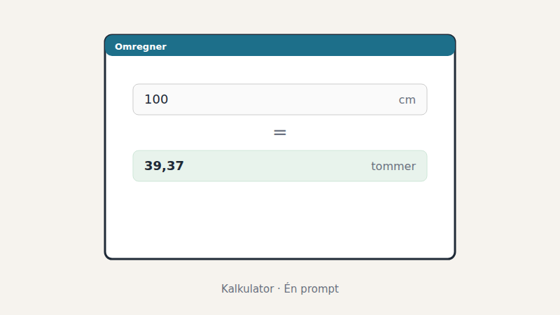

# Introduksjon {.intro}

En kalkulator som regner om mellom enheter, for eksempel centimeter og tommer,
eller desiliter og gram mel når du baker. Denne appen lager du med én prompt.



## Før du starter {.tip}

Gjør [Din første app fra chatten](../forste_app/forste_app) først. Har du ikke
gitt KI-en beskrivelsen av KIT Apps i chatten du bruker, gjør du steg 3 der
først.


# Steg 1: Lag appen {.activity}

## Sjekkliste {.check}

- [ ] Lim inn denne prompten i chatten. Endre den gjerne, så appen blir din:

  ```
  Lag en omregner for KIT Apps. Den skal regne om lengde (mm, cm, m, km,
  tommer), vekt (g, kg) og volum (ml, dl, l). Velg kategori, skriv inn
  et tall og velg enheter. Svaret skal oppdateres mens jeg skriver.
  Norsk tekst.
  ```

- [ ] Kopier koden. Trykk **New** i KIT Apps, skriv et navn i **App Name**, lim
  inn koden og trykk **Run App**. Appen lagres av seg selv.

- [ ] Virker den ikke? Trykk **Copy a fix request for your AI** og lim det inn i
  chatten.

- [ ] Får du en ny versjon fra KI-en, trykker du **Edit**, bytter ut all koden
  og trykker **Save Changes**.


# Steg 2: Test appen {.activity}

## Test prosjektet {.flag}

| Test | Dette skal skje |
|---|---|
| 100 cm til m | 1 m |
| 1 tomme til cm | 2,54 cm |
| Skriv bokstaver | Appen sier fra i stedet for å vise feil svar |

- [ ] Gjør alle testene. Rett det som ikke virker, én ting om gangen.

- [ ] La en annen prøve appen uten at du forklarer noe.


# Steg 3: Bygg videre {.activity}

Velg det du vil ha, og be om én ting om gangen. Be alltid om hele filen på nytt,
og test igjen etter hver endring.

- **Bytt-knapp:**

  ```
  Lag en knapp som bytter om fra- og til-enhet.
  ```

- **Bakeenheter:**

  ```
  Legg til teskje, spiseskje og kopp.
  ```

## Lagre {.save}

Appen ligger i lista i KIT Apps. Vil du ha den som eget program, se [Gjør den
til en ferdig app](../ferdig_app/ferdig_app).


## Utfordring {.challenge}

Sjekk tre svar med en annen kalkulator. Stemmer de? Hva gjør du hvis KI-en har
regnet feil?
