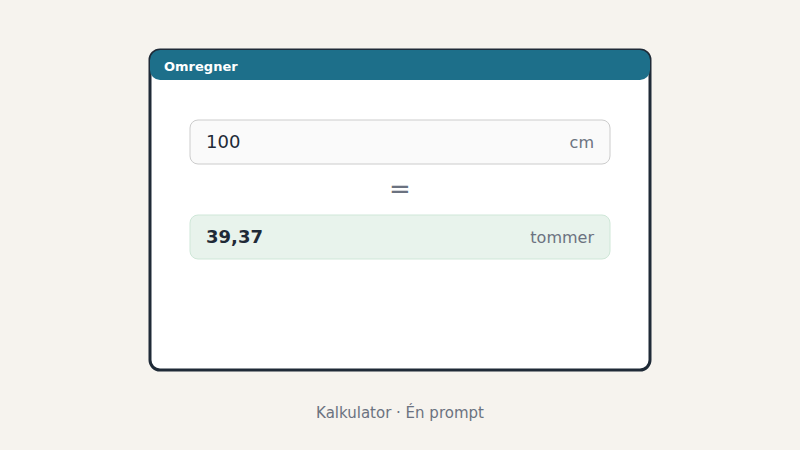

# Introduksjon {.intro}

Ein kalkulator som reknar om mellom einingar, til dømes centimeter og tommar,
eller desiliter og gram mjøl når du bakar. Denne appen lagar du med éin prompt.



## Før du startar {.tip}

Gjer [Din første app frå chatten](../forste_app/forste_app_nn) først. Har du
ikkje gitt KI-en skildringa av KIT Apps i chatten du bruker, gjer du steg 3 der
først.


# Steg 1: Lag appen {.activity}

## Sjekkliste {.check}

- [ ] Lim inn denne prompten i chatten. Endre han gjerne, så appen blir din:

  ```
  Lag ein omreknar for KIT Apps. Han skal rekne om lengd (mm, cm, m, km,
  tommar), vekt (g, kg) og volum (ml, dl, l). Vel kategori, skriv inn
  eit tal og vel einingar. Svaret skal oppdaterast medan eg skriv.
  Nynorsk tekst.
  ```

- [ ] Kopier koden. Trykk **New** i KIT Apps, skriv eit namn i **App Name**, lim
  inn koden og trykk **Run App**. Appen blir lagra av seg sjølv.

- [ ] Verkar han ikkje? Trykk **Copy a fix request for your AI** og lim det inn
  i chatten.

- [ ] Får du ein ny versjon frå KI-en, trykkjer du **Edit**, byter ut all koden
  og trykkjer **Save Changes**.


# Steg 2: Test appen {.activity}

## Test prosjektet {.flag}

| Test | Dette skal skje |
|---|---|
| 100 cm til m | 1 m |
| 1 tomme til cm | 2,54 cm |
| Skriv bokstavar | Appen seier frå i staden for å vise feil svar |

- [ ] Gjer alle testane. Rett det som ikkje verkar, éin ting om gongen.

- [ ] La ein annan prøve appen utan at du forklarer noko.


# Steg 3: Byggj vidare {.activity}

Vel det du vil ha, og be om éin ting om gongen. Be alltid om heile fila på nytt,
og test igjen etter kvar endring.

- **Byt-knapp:**

  ```
  Lag ein knapp som byter om frå- og til-eining.
  ```

- **Bakeeiningar:**

  ```
  Legg til teskei, spiseskei og kopp.
  ```

## Lagre {.save}

Appen ligg i lista i KIT Apps. Vil du ha han som eige program, sjå [Gjer han
til ein ferdig app](../ferdig_app/ferdig_app_nn).


## Utfordring {.challenge}

Sjekk tre svar med ein annan kalkulator. Stemmer dei? Kva gjer du viss KI-en har
rekna feil?
