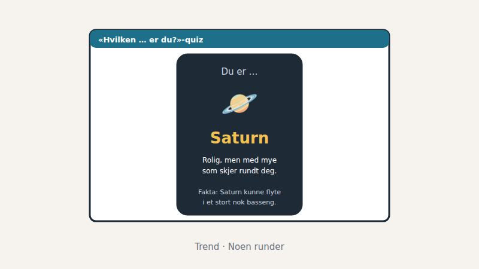

# Introduksjon {.intro}

En quiz som «Hvilken planet er du?» eller «Hvilken figur fra historien er du?».
Svarene gir poeng til ulike resultater, og til slutt får du et resultatkort du
kan dele. Det er bare for moro skyld, men du lærer mye om temaet når du skal
skrive resultatene. Denne appen lager du med én prompt og noen runder med
forbedringer.



## Før du starter {.tip}

Gjør [Din første app fra chatten](../forste_app/forste_app) først. Har du ikke
gitt KI-en beskrivelsen av KIT Apps i chatten du bruker, gjør du steg 3 der
først.


# Steg 1: Lag appen {.activity}

## Sjekkliste {.check}

- [ ] Lim inn denne prompten i chatten. Endre den gjerne, så appen blir din:

  ```
  Lag en «Hvilken planet er du?»-quiz for KIT Apps med seks spørsmål og
  fire svar på hvert. Hvert svar gir poeng til én av fire planeter. Til
  slutt vises et resultatkort med planeten, en emoji og to setninger som
  forklarer hvorfor, og en ekte fakta om planeten. Knapp for å ta quizen
  igjen. Spørsmålene og resultatene skal ligge i en liste i koden. Norsk
  tekst.
  ```

- [ ] Velg ditt eget tema og skriv spørsmålene og resultatene selv. Sjekk at
  faktaene i resultatene stemmer.

- [ ] Kopier koden. Trykk **New** i KIT Apps, skriv et navn i **App Name**, lim
  inn koden og trykk **Run App**. Appen lagres av seg selv.

- [ ] Virker den ikke? Trykk **Copy a fix request for your AI** og lim det inn i
  chatten.

- [ ] Får du en ny versjon fra KI-en, trykker du **Edit**, bytter ut all koden
  og trykker **Save Changes**.

## Tenk deg om {.tip}

Dette er en quiz for moro skyld, ikke en ekte personlighetstest. Skriv det i
appen. Ikke lag quizer som rangerer ekte mennesker, utseende eller kropp.


# Steg 2: Test appen {.activity}

## Test prosjektet {.flag}

| Test | Dette skal skje |
|---|---|
| Velg det første svaret på alt | Du får et resultat |
| Prøv å få hvert resultat | Alle fire resultatene er mulige |
| Ta quizen igjen | Poengene starter på null |

- [ ] Gjør alle testene. Rett det som ikke virker, én ting om gangen.

- [ ] La en annen prøve appen uten at du forklarer noe.


# Steg 3: Bygg videre {.activity}

Velg det du vil ha, og be om én ting om gangen. Be alltid om hele filen på nytt,
og test igjen etter hver endring.

- **Resultatkort:**

  ```
  Gjør resultatkortet høyt og smalt, som en story, så det passer å dele.
  ```

- **Prosent:**

  ```
  Vis hvor mange prosent du likner på hvert resultat.
  ```

## Lagre {.save}

Appen ligger i lista i KIT Apps. Vil du ha den som eget program, se [Gjør den
til en ferdig app](../ferdig_app/ferdig_app).


## Utfordring {.challenge}

La fem personer ta quizen. Fikk de ulike resultater? Hvis alle fikk det samme,
må poengene justeres.
