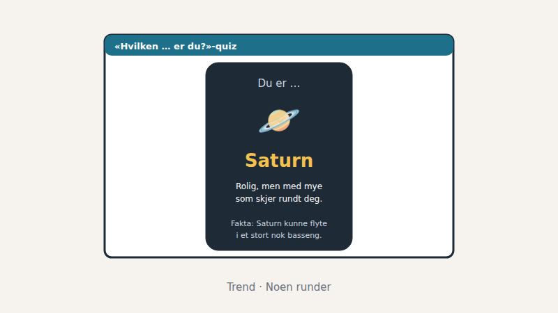

# Introduksjon {.intro}

Ein quiz som «Kva planet er du?» eller «Kva person frå historia er du?». Svara
gir poeng til ulike resultat, og til slutt får du eit resultatkort du kan dele.
Det er berre for moro skuld, men du lærer mykje om temaet når du skal skrive
resultata. Denne appen lagar du med éin prompt og nokre rundar med forbetringar.



## Før du startar {.tip}

Gjer [Din første app frå chatten](../forste_app/forste_app_nn) først. Har
du ikkje gitt KI-en skildringa av KIT Apps i chatten du brukar, gjer du steg 3
der først.


# Steg 1: Lag appen {.activity}

## Sjekkliste {.check}

- [ ] Lim inn denne prompten i chatten. Endre han gjerne, så appen blir din:

  ```
  Lag ein «Kva planet er du?»-quiz for KIT Apps med seks spørsmål og
  fire svar på kvart. Kvart svar gir poeng til éin av fire planetar. Til
  slutt blir det vist eit resultatkort med planeten, ein emoji og to
  setningar som forklarer kvifor, og eit ekte faktum om planeten. Knapp
  for å ta quizen på nytt. Spørsmåla og resultata skal liggje i ei liste
  i koden. Nynorsk tekst.
  ```

- [ ] Vel ditt eige tema og skriv spørsmåla og resultata sjølv. Sjekk at fakta i
  resultata stemmer.

- [ ] Kopier koden. Trykk **New** i KIT Apps, skriv eit namn i **App Name**, lim
  inn koden og trykk **Run App**. Appen blir lagra av seg sjølv.

- [ ] Verkar han ikkje? Trykk **Copy a fix request for your AI** og lim det inn
  i chatten.

- [ ] Får du ein ny versjon frå KI-en, trykkjer du **Edit**, byter ut all koden
  og trykkjer **Save Changes**.

## Tenk deg om {.tip}

Dette er ein quiz for moro skuld, ikkje ein ekte personlegdomstest. Skriv det i
appen. Ikkje lag quizar som rangerer ekte menneske, utsjånad eller kropp.


# Steg 2: Test appen {.activity}

## Test prosjektet {.flag}

| Test | Dette skal skje |
|---|---|
| Vel det første svaret på alt | Du får eit resultat |
| Prøv å få kvart resultat | Alle fire resultata er moglege |
| Ta quizen på nytt | Poenga startar på null |

- [ ] Gjer alle testane. Rett det som ikkje verkar, éin ting om gongen.

- [ ] La ein annan prøve appen utan at du forklarer noko.


# Steg 3: Byggj vidare {.activity}

Vel det du vil ha, og be om éin ting om gongen. Be alltid om heile fila på nytt,
og test igjen etter kvar endring.

- **Resultatkort:**

  ```
  Gjer resultatkortet høgt og smalt, som ein story, så det passar å
  dele.
  ```

- **Prosent:**

  ```
  Vis kor mange prosent du liknar på kvart resultat.
  ```

## Lagre {.save}

Appen ligg i lista i KIT Apps. Vil du ha han som eige program, sjå [Gjer han til
ein ferdig app](../ferdig_app/ferdig_app_nn).


## Utfordring {.challenge}

La fem personar ta quizen. Fekk dei ulike resultat? Viss alle fekk det same, må
poenga justerast.
