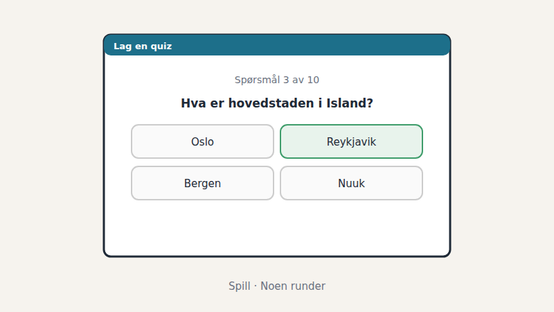

# Introduksjon {.intro}

En quiz om noe du kan mye om: en fotballklubb, en bokserie, landene i Europa
eller et tema fra skolen. Du lager spørsmålene, KI-en lager spillet. Denne appen
lager du med én prompt og noen runder med forbedringer.



## Før du starter {.tip}

Gjør [Din første app fra chatten](../forste_app/forste_app) først. Har du ikke
gitt KI-en beskrivelsen av KIT Apps i chatten du bruker, gjør du steg 3 der
først.


# Steg 1: Lag appen {.activity}

## Sjekkliste {.check}

- [ ] Lim inn denne prompten i chatten. Endre den gjerne, så appen blir din:

  ```
  Lag en quiz for KIT Apps med ti spørsmål og fire svaralternativer. Vis
  ett spørsmål om gangen, si om svaret var riktig, og vis poengsummen
  til slutt med en knapp for å spille igjen. Jeg gir deg spørsmålene
  etterpå. Norsk tekst.
  ```

- [ ] Gi KI-en spørsmålene dine i neste melding, med riktig svar for hvert.
  Skriv dem selv, så du vet at de stemmer.

- [ ] Kopier koden. Trykk **New** i KIT Apps, skriv et navn i **App Name**, lim
  inn koden og trykk **Run App**. Appen lagres av seg selv.

- [ ] Virker den ikke? Trykk **Copy a fix request for your AI** og lim det inn i
  chatten.

- [ ] Får du en ny versjon fra KI-en, trykker du **Edit**, bytter ut all koden
  og trykker **Save Changes**.


# Steg 2: Test appen {.activity}

## Test prosjektet {.flag}

| Test | Dette skal skje |
|---|---|
| Svar riktig på alt | 10 av 10 |
| Svar feil på alt | 0 av 10, og ingen feil i appen |
| Trykk Spill igjen | Spillet starter på nytt med 0 poeng |

- [ ] Gjør alle testene. Rett det som ikke virker, én ting om gangen.

- [ ] La en annen prøve appen uten at du forklarer noe.


# Steg 3: Bygg videre {.activity}

Velg det du vil ha, og be om én ting om gangen. Be alltid om hele filen på nytt,
og test igjen etter hver endring.

- **Tilfeldig rekkefølge:**

  ```
  Bland rekkefølgen på spørsmål og svar hver gang.
  ```

- **Tid:**

  ```
  Gi 15 sekunder per spørsmål, og vis en nedtelling.
  ```

- **Rekord:**

  ```
  Husk den beste poengsummen.
  ```

## Lagre {.save}

Appen ligger i lista i KIT Apps. Vil du ha den som eget program, se [Gjør den
til en ferdig app](../ferdig_app/ferdig_app).


## Utfordring {.challenge}

La tre personer ta quizen. Hvilket spørsmål var vanskeligst? Skriv det om, så
det blir tydeligere.
