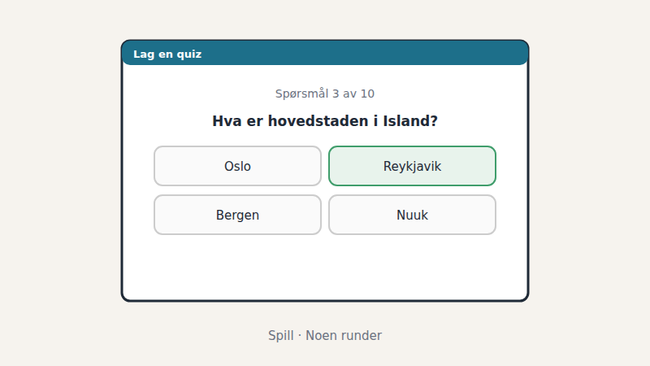

# Introduksjon {.intro}

Ein quiz om noko du kan mykje om: ein fotballklubb, ein bokserie, landa i Europa
eller eit tema frå skulen. Du lagar spørsmåla, KI-en lagar spelet. Denne appen
lagar du med éin prompt og nokre rundar med forbetringar.



## Før du startar {.tip}

Gjer [Din første app frå chatten](../forste_app/forste_app_nn) først. Har du
ikkje gitt KI-en skildringa av KIT Apps i chatten du bruker, gjer du steg 3 der
først.


# Steg 1: Lag appen {.activity}

## Sjekkliste {.check}

- [ ] Lim inn denne prompten i chatten. Endre han gjerne, så appen blir din:

  ```
  Lag ein quiz for KIT Apps med ti spørsmål og fire svaralternativ. Vis
  eitt spørsmål om gongen, sei om svaret var rett, og vis poengsummen
  til slutt med ein knapp for å spele igjen. Eg gir deg spørsmåla
  etterpå. Nynorsk tekst.
  ```

- [ ] Gi KI-en spørsmåla dine i neste melding, med rett svar for kvart. Skriv
  dei sjølv, så du veit at dei stemmer.

- [ ] Kopier koden. Trykk **New** i KIT Apps, skriv eit namn i **App Name**, lim
  inn koden og trykk **Run App**. Appen blir lagra av seg sjølv.

- [ ] Verkar han ikkje? Trykk **Copy a fix request for your AI** og lim det inn
  i chatten.

- [ ] Får du ein ny versjon frå KI-en, trykkjer du **Edit**, byter ut all koden
  og trykkjer **Save Changes**.


# Steg 2: Test appen {.activity}

## Test prosjektet {.flag}

| Test | Dette skal skje |
|---|---|
| Svar rett på alt | 10 av 10 |
| Svar feil på alt | 0 av 10, og ingen feil i appen |
| Trykk Spel igjen | Spelet startar på nytt med 0 poeng |

- [ ] Gjer alle testane. Rett det som ikkje verkar, éin ting om gongen.

- [ ] La ein annan prøve appen utan at du forklarer noko.


# Steg 3: Byggj vidare {.activity}

Vel det du vil ha, og be om éin ting om gongen. Be alltid om heile fila på nytt,
og test igjen etter kvar endring.

- **Tilfeldig rekkjefølgje:**

  ```
  Bland rekkjefølgja på spørsmål og svar kvar gong.
  ```

- **Tid:**

  ```
  Gi 15 sekund per spørsmål, og vis ei nedteljing.
  ```

- **Rekord:**

  ```
  Hugs den beste poengsummen.
  ```

## Lagre {.save}

Appen ligg i lista i KIT Apps. Vil du ha han som eige program, sjå [Gjer han
til ein ferdig app](../ferdig_app/ferdig_app_nn).


## Utfordring {.challenge}

La tre personar ta quizen. Kva spørsmål var vanskelegast? Skriv det om, så det
blir tydelegare.
