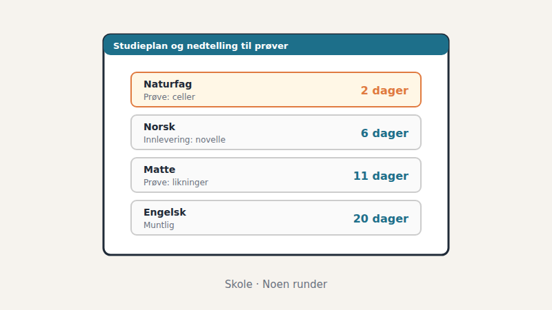

# Introduksjon {.intro}

En app der du legger inn prøver og innleveringer, og ser hvor mange dager det er
igjen. Appen hjelper deg å dele lesingen opp i små økter, så du ikke må lese alt
kvelden før. Denne appen lager du med én prompt og noen runder med forbedringer.



## Før du starter {.tip}

Gjør [Din første app fra chatten](../forste_app/forste_app) først. Har du ikke
gitt KI-en beskrivelsen av KIT Apps i chatten du bruker, gjør du steg 3 der
først.


# Steg 1: Lag appen {.activity}

## Sjekkliste {.check}

- [ ] Lim inn denne prompten i chatten. Endre den gjerne, så appen blir din:

  ```
  Lag en studieplan for KIT Apps. Jeg skal kunne legge inn prøver og
  innleveringer med fag, dato og hva den handler om. Vis dem sortert
  etter dato, med antall dager igjen. Det som er mindre enn tre dager
  unna, skal vises tydelig. Husk alt. Norsk tekst.
  ```

- [ ] Kopier koden. Trykk **New** i KIT Apps, skriv et navn i **App Name**, lim
  inn koden og trykk **Run App**. Appen lagres av seg selv.

- [ ] Virker den ikke? Trykk **Copy a fix request for your AI** og lim det inn i
  chatten.

- [ ] Får du en ny versjon fra KI-en, trykker du **Edit**, bytter ut all koden
  og trykker **Save Changes**.


# Steg 2: Test appen {.activity}

## Test prosjektet {.flag}

| Test | Dette skal skje |
|---|---|
| Legg inn en prøve om to dager | Den står øverst og er markert |
| Legg inn en som allerede har vært | Den vises som ferdig eller forsvinner |
| Lukk og åpne | Alt er der fortsatt |

- [ ] Gjør alle testene. Rett det som ikke virker, én ting om gangen.

- [ ] La en annen prøve appen uten at du forklarer noe.


# Steg 3: Bygg videre {.activity}

Velg det du vil ha, og be om én ting om gangen. Be alltid om hele filen på nytt,
og test igjen etter hver endring.

- **Leseplan:**

  ```
  For hver prøve: la meg dele pensum i deler og fordele dem på dagene
  fram til prøven.
  ```

- **Sjekkliste:**

  ```
  La meg krysse av delene jeg har lest.
  ```

## Lagre {.save}

Appen ligger i lista i KIT Apps. Vil du ha den som eget program, se [Gjør den
til en ferdig app](../ferdig_app/ferdig_app).


## Utfordring {.challenge}

Bruk appen fram til neste prøve. Fulgte du planen? Hva må endres for at den skal
passe deg?
