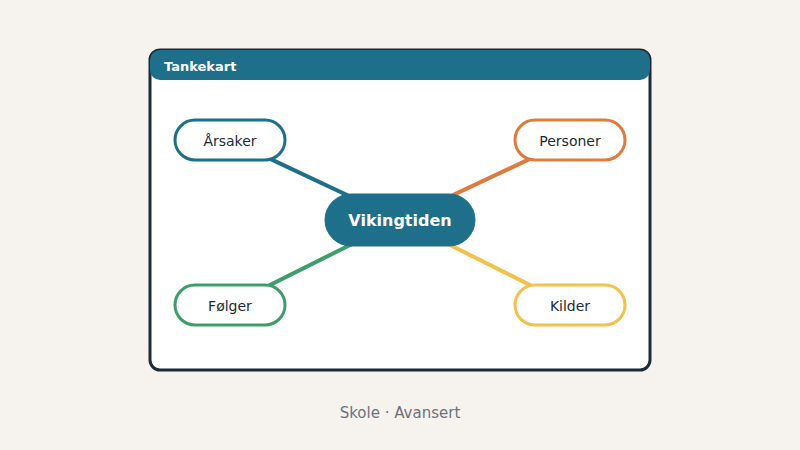

# Introduksjon {.intro}

Et tankekart der du skriver et tema i midten og drar ut idéer og begreper rundt.
Fint til å planlegge en tekst, øve til prøve eller samle idéer i en gruppe.
Denne appen bygger du i flere runder. Start lite, og legg til én ting om gangen.



## Før du starter {.tip}

Gjør [Din første app fra chatten](../forste_app/forste_app) først. Har du ikke
gitt KI-en beskrivelsen av KIT Apps i chatten du bruker, gjør du steg 3 der
først.


# Steg 1: Lag appen {.activity}

## Sjekkliste {.check}

- [ ] Lim inn denne prompten i chatten. Endre den gjerne, så appen blir din:

  ```
  Lag et tankekart for KIT Apps. Det skal starte med én boble i midten
  der jeg kan skrive temaet. Jeg skal kunne legge til nye bobler koblet
  til en boble jeg har valgt, og skrive tekst i dem. Linjer mellom
  boblene. Bare dette i første versjon. Norsk tekst.
  ```

- [ ] Når det virker, ber du om ett tillegg om gangen: «La meg dra boblene
  rundt, og la linjene følge med», «Gi hver gren sin egen farge», «Husk
  tankekartet», og «Lag en knapp som laster ned tankekartet som et bilde».

- [ ] Kopier koden. Trykk **New** i KIT Apps, skriv et navn i **App Name**, lim
  inn koden og trykk **Run App**. Appen lagres av seg selv.

- [ ] Virker den ikke? Trykk **Copy a fix request for your AI** og lim det inn i
  chatten.

- [ ] Får du en ny versjon fra KI-en, trykker du **Edit**, bytter ut all koden
  og trykker **Save Changes**.


# Steg 2: Test appen {.activity}

## Test prosjektet {.flag}

| Test | Dette skal skje |
|---|---|
| Legg til tre bobler rundt midten | Alle er koblet til midten med linjer |
| Dra en boble | Linjen følger med |
| Lukk og åpne | Tankekartet er der fortsatt |

- [ ] Gjør alle testene. Rett det som ikke virker, én ting om gangen.

- [ ] La en annen prøve appen uten at du forklarer noe.


# Steg 3: Bygg videre {.activity}

Velg det du vil ha, og be om én ting om gangen. Be alltid om hele filen på nytt,
og test igjen etter hver endring.

- **Slette:**

  ```
  La meg slette en boble og alle boblene under den.
  ```

- **Flere kart:**

  ```
  La meg ha flere tankekart, ett per fag.
  ```

## Lagre {.save}

Appen ligger i lista i KIT Apps. Vil du ha den som eget program, se [Gjør den
til en ferdig app](../ferdig_app/ferdig_app).


## Utfordring {.challenge}

Bruk tankekartet til å planlegge en tekst eller en presentasjon på skolen. Ble
det lettere å se hva som hører sammen?
