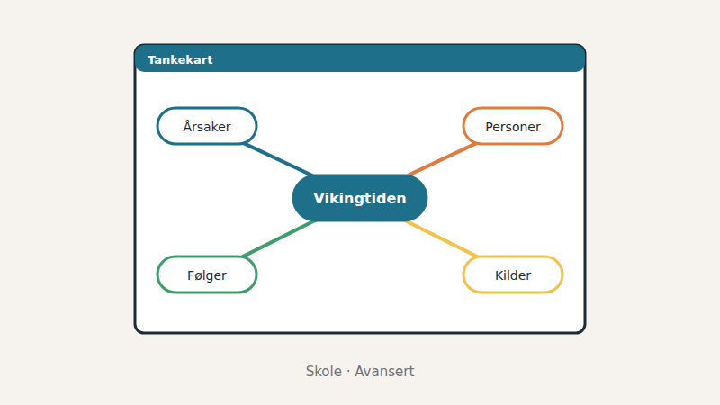

# Introduksjon {.intro}

Eit tankekart der du skriv eit tema i midten og dreg ut idear og omgrep rundt.
Fint til å planleggje ein tekst, øve til prøve eller samle idear i ei gruppe.
Denne appen byggjer du i fleire rundar. Start lite, og legg til éin ting om
gongen.



## Før du startar {.tip}

Gjer [Din første app frå chatten](../forste_app/forste_app_nn) først. Har du
ikkje gitt KI-en skildringa av KIT Apps i chatten du bruker, gjer du steg 3 der
først.


# Steg 1: Lag appen {.activity}

## Sjekkliste {.check}

- [ ] Lim inn denne prompten i chatten. Endre han gjerne, så appen blir din:

  ```
  Lag eit tankekart for KIT Apps. Det skal starte med éi boble i midten
  der eg kan skrive temaet. Eg skal kunne leggje til nye bobler kopla
  til ei boble eg har valt, og skrive tekst i dei. Linjer mellom
  boblene. Berre dette i første versjon. Nynorsk tekst.
  ```

- [ ] Når det verkar, ber du om eitt tillegg om gongen: «La meg dra boblene
  rundt, og la linjene følgje med», «Gi kvar grein sin eigen farge», «Hugs
  tankekartet», og «Lag ein knapp som lastar ned tankekartet som eit bilete».

- [ ] Kopier koden. Trykk **New** i KIT Apps, skriv eit namn i **App Name**, lim
  inn koden og trykk **Run App**. Appen blir lagra av seg sjølv.

- [ ] Verkar han ikkje? Trykk **Copy a fix request for your AI** og lim det inn
  i chatten.

- [ ] Får du ein ny versjon frå KI-en, trykkjer du **Edit**, byter ut all koden
  og trykkjer **Save Changes**.


# Steg 2: Test appen {.activity}

## Test prosjektet {.flag}

| Test | Dette skal skje |
|---|---|
| Legg til tre bobler rundt midten | Alle er kopla til midten med linjer |
| Dra ei boble | Linja følgjer med |
| Lukk og opne | Tankekartet er der framleis |

- [ ] Gjer alle testane. Rett det som ikkje verkar, éin ting om gongen.

- [ ] La ein annan prøve appen utan at du forklarer noko.


# Steg 3: Bygg vidare {.activity}

Vel det du vil ha, og be om éin ting om gongen. Be alltid om heile fila på nytt,
og test igjen etter kvar endring.

- **Slette:**

  ```
  La meg slette ei boble og alle boblene under henne.
  ```

- **Fleire kart:**

  ```
  La meg ha fleire tankekart, eitt per fag.
  ```

## Lagre {.save}

Appen ligg i lista i KIT Apps. Vil du ha han som eige program, sjå [Gjer han til
ein ferdig app](../ferdig_app/ferdig_app_nn).


## Utfordring {.challenge}

Bruk tankekartet til å planleggje ein tekst eller ein presentasjon på skulen.
Vart det lettare å sjå kva som høyrer saman?
