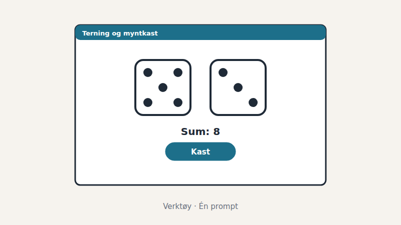

# Introduksjon {.intro}

En app som kaster terninger og mynt. Nyttig til brettspill, og når klassen skal
bestemme hvem som starter. Denne appen lager du med én prompt.



## Før du starter {.tip}

Gjør [Din første app fra chatten](../forste_app/forste_app) først. Har du ikke
gitt KI-en beskrivelsen av KIT Apps i chatten du bruker, gjør du steg 3 der
først.


# Steg 1: Lag appen {.activity}

## Sjekkliste {.check}

- [ ] Lim inn denne prompten i chatten. Endre den gjerne, så appen blir din:

  ```
  Lag en app for KIT Apps som kaster én til seks terninger og kan kaste
  mynt. Vis terningene som store prikker, og vis summen. Store knapper,
  norsk tekst.
  ```

- [ ] Kopier koden, trykk **New** i KIT Apps, lim inn og trykk **Run App**.

- [ ] Virker den ikke? Trykk **Copy a fix request for your AI** og lim det inn i
  chatten.

- [ ] Trykk **Save** når appen virker.


# Steg 2: Test appen {.activity}

## Test prosjektet {.flag}

| Test | Dette skal skje |
|---|---|
| Kast én terning mange ganger | Du får alle tallene fra 1 til 6 |
| Kast tre terninger | Summen stemmer |
| Kast mynt ti ganger | Både kron og mynt kommer |

- [ ] Gjør alle testene. Rett det som ikke virker, én ting om gangen.

- [ ] La en annen prøve appen uten at du forklarer noe.


# Steg 3: Bygg videre {.activity}

Velg det du vil ha, og be om én ting om gangen. Be alltid om hele filen på nytt,
og test igjen etter hver endring.

- **Historikk:**

  ```
  Vis de ti siste kastene under terningene.
  ```

- **Animasjon:**

  ```
  La terningene rulle et halvt sekund før de stopper.
  ```

## Lagre {.save}

Trykk **Save** i KIT Apps. Vil du ha appen som eget program, se [Gjør den til
en ferdig app](../ferdig_app/ferdig_app).


## Utfordring {.challenge}

Kast én terning 60 ganger og tell hvor mange av hvert tall du får. Er det
omtrent like mange? Be KI-en lage et søylediagram som teller for deg.
